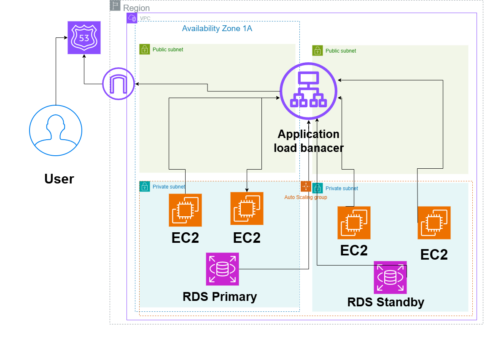

# Highly Available Web Application on AWS

## System Design Question

Design a highly available web application on AWS that can continue running if an EC2 instance or an entire Availability Zone fails.

## Architecture

## Architecture Overview

This architecture uses multiple Availability Zones to provide high availability.

Users access the application through Route 53. Traffic is then sent to an Application Load Balancer, which distributes requests to EC2 instances running across multiple Availability Zones.

The EC2 instances are part of an Auto Scaling Group, so new instances can be launched automatically when traffic increases or when an existing instance becomes unhealthy.

The database uses Amazon RDS Multi-AZ with a primary database in one Availability Zone and a secondary standby database in another Availability Zone.

## Main AWS Services

- Amazon Route 53
- Application Load Balancer
- Amazon EC2
- Auto Scaling Group
- Amazon RDS Multi-AZ
- Amazon VPC
- Public Subnets
- Private Subnets

## Traffic Flow

1. User accesses the application.
2. Route 53 resolves the domain name.
3. Traffic is sent to the Application Load Balancer.
4. The Load Balancer sends traffic to healthy EC2 instances.
5. EC2 instances process application requests.
6. EC2 instances connect to the RDS database.

## High Availability

The application is deployed across two Availability Zones.

If one EC2 instance fails, the Load Balancer stops sending traffic to that instance and the Auto Scaling Group can replace it.

If one Availability Zone fails, EC2 instances in the second Availability Zone continue serving traffic.

RDS Multi-AZ provides database failover by maintaining a standby database in another Availability Zone.

## Scalability

The Auto Scaling Group can automatically increase or decrease the number of EC2 instances depending on application demand.

The Application Load Balancer distributes incoming traffic across the available EC2 instances.

## Key Design Decisions

- EC2 instances are placed in private subnets.
- The Application Load Balancer handles incoming application traffic.
- EC2 instances are distributed across multiple Availability Zones.
- Auto Scaling improves availability and scalability.
- RDS Multi-AZ protects the database from Availability Zone failure.