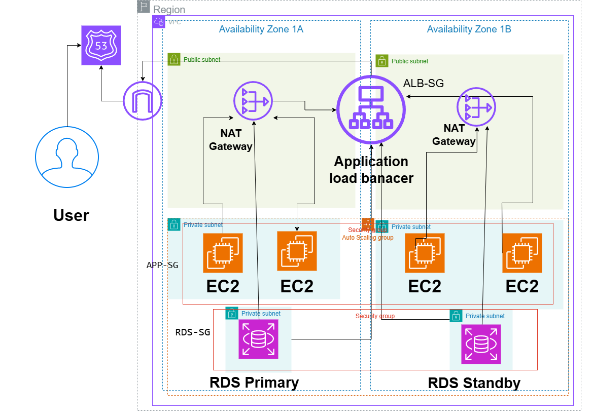

# Secure Three-Tier Web Architecture on AWS

## System Design Question

Design a secure and highly available three-tier web application on AWS with separate public, application, and database layers.

## Architecture



## Architecture Overview

This architecture separates the application into public, application, and database tiers across two Availability Zones.

Users access the application through Route 53 and an internet-facing Application Load Balancer.

The application servers run on EC2 instances inside private application subnets.

The database uses Amazon RDS Multi-AZ with the primary database in one Availability Zone and a standby database in another Availability Zone.

## Main AWS Services

- Amazon Route 53
- Application Load Balancer
- Amazon EC2
- Auto Scaling Group
- Amazon RDS Multi-AZ
- Amazon VPC
- Internet Gateway
- NAT Gateway
- AWS Certificate Manager
- Security Groups

## Network Design

Each Availability Zone contains:

- Public Subnet
- Private Application Subnet
- Private Database Subnet

The Application Load Balancer is connected to the public subnets.

EC2 instances run inside private application subnets.

RDS instances run inside private database subnets.

NAT Gateways allow private EC2 instances to access the internet for updates without exposing them to incoming internet traffic.

## Traffic Flow

1. User accesses the application domain.
2. Route 53 resolves the domain.
3. HTTPS traffic reaches the Application Load Balancer.
4. The Load Balancer forwards requests to healthy EC2 instances.
5. EC2 instances process application requests.
6. EC2 instances connect to Amazon RDS.

## Security

The architecture follows a layered Security Group model.

```text
Internet
   |
HTTPS 443
   |
ALB-SG
   |
Application Traffic
   |
APP-SG
   |
Database Traffic
   |
RDS-SG