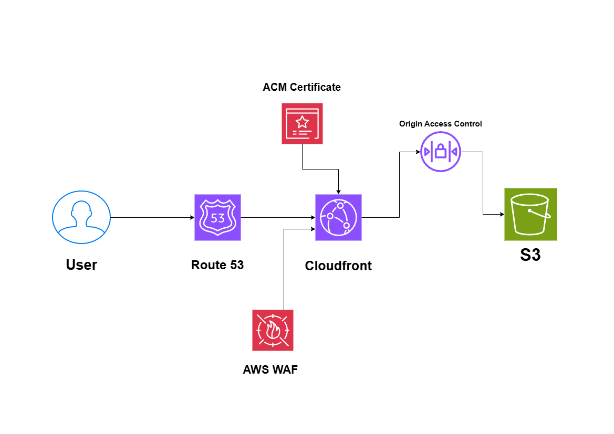

# Global Static Website on AWS

## System Design Question

Design a secure and globally distributed static website using AWS.

The website should load quickly for users around the world while keeping the S3 bucket private.

## Architecture

## Architecture Overview

This architecture uses Amazon S3 to store static website files such as HTML, CSS, JavaScript, and images.

Amazon CloudFront distributes the website globally through edge locations and caches content close to users.

Route 53 provides DNS resolution for the custom domain.

AWS Certificate Manager provides the TLS certificate for HTTPS.

AWS WAF protects the CloudFront distribution from common web attacks.

Origin Access Control allows CloudFront to securely access the private S3 bucket.

## Main AWS Services

- Amazon Route 53
- Amazon CloudFront
- Amazon S3
- Origin Access Control
- AWS Certificate Manager
- AWS WAF

## Traffic Flow

1. A user accesses the website domain.
2. Route 53 resolves the domain to the CloudFront distribution.
3. CloudFront serves cached content from the nearest edge location when available.
4. If the content is not cached, CloudFront requests it from the S3 origin.
5. Origin Access Control allows CloudFront to securely retrieve objects from the private S3 bucket.
6. The content is returned to the user and cached at the edge.

## Security

The S3 bucket remains private with public access blocked.

Users cannot directly access website files from the S3 bucket.

Only the CloudFront distribution is allowed to retrieve objects through Origin Access Control.

AWS WAF protects the public CloudFront endpoint from common HTTP attacks and abusive requests.

HTTPS is enabled using AWS Certificate Manager.

## Performance

CloudFront caches static content at AWS edge locations around the world.

This reduces latency because users can receive cached content from locations closer to them instead of every request going directly to S3.

## Cost Efficiency

The architecture uses managed and serverless AWS services.

There are no EC2 instances, load balancers, or databases to manage.

S3 provides low-cost storage and CloudFront reduces repeated requests to the origin.

## Key Design Decisions

- S3 stores the static website files.
- The S3 bucket is private.
- CloudFront is the only public content delivery layer.
- Origin Access Control prevents direct public S3 access.
- Route 53 manages DNS.
- ACM enables HTTPS.
- AWS WAF provides basic web protection.
- CloudFront improves global performance through caching.