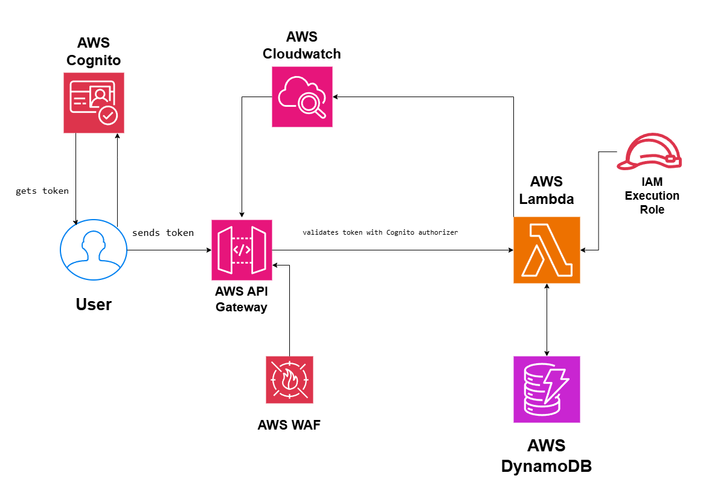

# Serverless REST API on AWS

## System Design Question

Design a scalable and secure serverless REST API on AWS that supports CRUD operations, user authentication, monitoring, and automatic scaling.

## Architecture



## Architecture Overview

This architecture uses AWS managed serverless services to build a scalable REST API without managing servers.

Users authenticate through Amazon Cognito and receive an authentication token.

The token is sent with requests to Amazon API Gateway.

API Gateway uses a Cognito authorizer to validate the user before allowing access to protected endpoints.

AWS Lambda handles the backend application logic.

Amazon DynamoDB stores the application data.

AWS WAF protects the API from malicious and abusive requests.

Amazon CloudWatch provides logging and monitoring for API Gateway and Lambda.

## Main AWS Services

- Amazon Cognito
- Amazon API Gateway
- AWS Lambda
- Amazon DynamoDB
- AWS IAM
- AWS WAF
- Amazon CloudWatch

## Request Flow

1. The user authenticates with Amazon Cognito.
2. Cognito returns an authentication token.
3. The user sends the token with the API request.
4. API Gateway validates the token using a Cognito authorizer.
5. Authorized requests are forwarded to AWS Lambda.
6. Lambda processes the request.
7. Lambda reads or writes data in DynamoDB.
8. The response is returned to the user.

## API Operations

Example endpoints:

```text
POST   /items
GET    /items/{id}
PUT    /items/{id}
DELETE /items/{id}