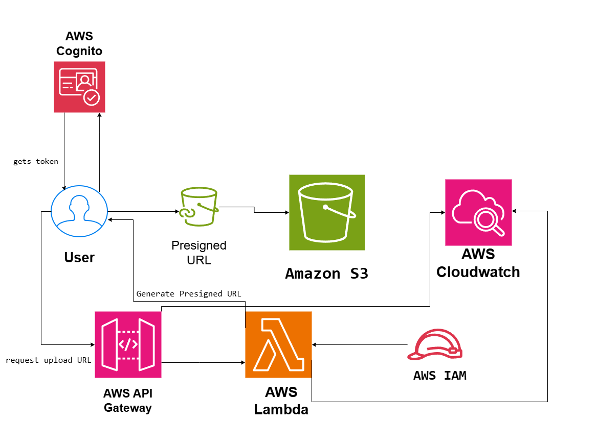

# Large File Upload System on AWS

## System Design Question

Design a secure serverless architecture that allows users to upload very large files directly to Amazon S3 without sending the files through API Gateway or AWS Lambda.

## Architecture

## Architecture Overview

This architecture allows authenticated users to securely upload large files directly to Amazon S3 using temporary presigned URLs.

Amazon Cognito handles user authentication.

The user requests upload permission through Amazon API Gateway.

AWS Lambda generates a temporary S3 presigned URL using its IAM execution role.

The presigned URL is returned to the user, who then uploads the file directly to the private S3 bucket.

Large files can use S3 Multipart Upload so individual parts can be uploaded and retried separately.

## Main AWS Services

- Amazon Cognito
- Amazon API Gateway
- AWS Lambda
- Amazon S3
- AWS IAM
- Amazon CloudWatch

## Request Flow

1. The user authenticates with Amazon Cognito.
2. Cognito returns an authentication token.
3. The user requests an upload URL through API Gateway.
4. API Gateway invokes Lambda.
5. Lambda generates a temporary S3 presigned URL.
6. The presigned URL is returned to the user.
7. The user uploads the file directly to Amazon S3.
8. Large files can use multipart upload.

## Security

The S3 bucket remains private and public access is blocked.

Users receive temporary presigned URLs instead of permanent AWS credentials.

The presigned URL expires after a limited period.

Lambda uses an IAM execution role with least-privilege S3 permissions.

Users can be restricted to specific object paths such as:

`uploads/{user-id}/*`

## Large File Handling

Large files are uploaded directly from the client to Amazon S3.

The file does not pass through API Gateway or Lambda.

S3 Multipart Upload allows large files to be divided into smaller parts.

If one part fails, only that part needs to be uploaded again instead of restarting the entire upload.

## Monitoring

Amazon CloudWatch provides logs and metrics for API Gateway and Lambda.

CloudWatch can be used to investigate API errors, Lambda failures, and presigned URL generation problems.

## Scalability

The architecture uses serverless AWS services and does not require application servers.

Amazon S3 handles large-scale object storage while API Gateway and Lambda automatically scale with upload-request traffic.

## Key Design Decisions

- Cognito authenticates users.
- API Gateway receives upload permission requests.
- Lambda generates temporary presigned URLs.
- IAM provides least-privilege S3 permissions.
- Files upload directly from the user to S3.
- S3 remains private.
- Multipart Upload supports very large files.
- CloudWatch provides monitoring and logging.