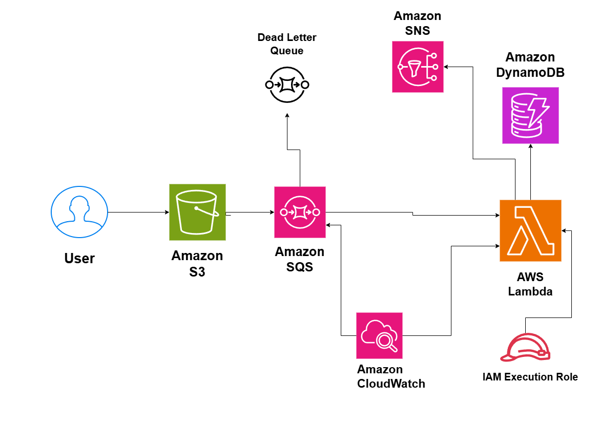

# Event-Driven File Processing System on AWS

## System Design Question

Design a serverless event-driven system that automatically processes files uploaded to Amazon S3 while supporting retries, failure handling, notifications, and monitoring.

## Architecture



## Architecture Overview

This architecture automatically processes files after they are uploaded to Amazon S3.

Amazon S3 generates an event when a new object is uploaded.

The event is sent to Amazon SQS, which acts as a buffer between file uploads and backend processing.

AWS Lambda polls the SQS queue and processes each file.

Processing results and metadata are stored in Amazon DynamoDB.

Amazon SNS sends notifications after processing completes or fails.

Messages that repeatedly fail processing are moved to a Dead Letter Queue for later investigation.

## Main AWS Services

- Amazon S3
- Amazon SQS
- AWS Lambda
- Amazon DynamoDB
- Amazon SNS
- Amazon CloudWatch
- SQS Dead Letter Queue
- AWS IAM

## Event Flow

1. A user uploads a file to Amazon S3.
2. S3 generates an ObjectCreated event.
3. The event is sent to the main SQS processing queue.
4. Lambda polls the queue for new messages.
5. Lambda reads and processes the uploaded file.
6. Processing metadata or results are stored in DynamoDB.
7. Lambda publishes a notification through SNS.
8. Successfully processed SQS messages are removed from the queue.

## Failure Handling

If processing fails, the message remains in SQS and can be retried.

After the configured maximum number of processing attempts, the message is moved to the Dead Letter Queue.

The DLQ allows failed jobs to be inspected and reprocessed later without losing the original event.

The original uploaded file remains safely stored in Amazon S3.

## Scalability

Amazon SQS buffers incoming jobs when many files are uploaded at the same time.

Lambda scales independently to process queued messages.

For example:

```text
10,000 File Uploads
        ↓
       SQS
        ↓
Buffers Processing Jobs
        ↓
Lambda Workers Scale