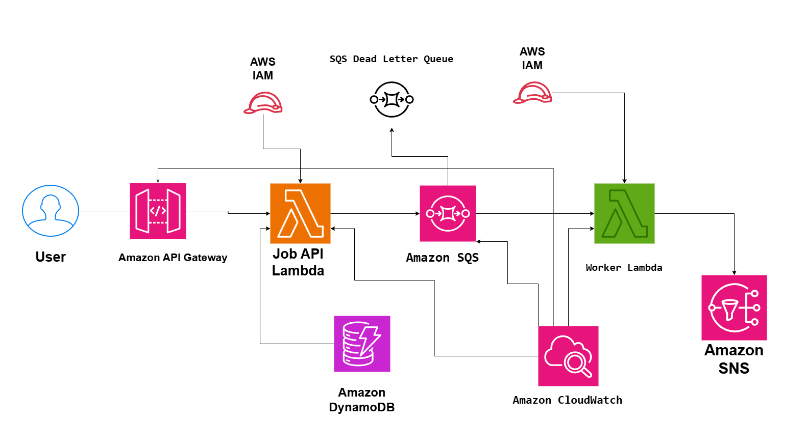

# Asynchronous Job Processing System on AWS

## System Design Question

Design a scalable asynchronous job processing system on AWS that accepts jobs quickly, processes them in the background, tracks job status, handles failures, and supports large traffic spikes.

## Architecture



## Architecture Overview

This architecture separates job submission from job execution.

Users submit jobs through Amazon API Gateway.

A Lambda function accepts the request, creates a job record in DynamoDB, sends the job to Amazon SQS, and returns a job ID immediately.

A separate worker Lambda polls the SQS queue and processes jobs asynchronously.

The worker updates job status in DynamoDB and can publish completion notifications through Amazon SNS.

Repeatedly failed jobs are moved to an SQS Dead Letter Queue.

## Main AWS Services

- Amazon API Gateway
- AWS Lambda
- Amazon SQS
- Amazon DynamoDB
- Amazon SNS
- Amazon CloudWatch
- AWS IAM
- SQS Dead Letter Queue

## Job Submission Flow

1. The user sends a job request to API Gateway.
2. API Gateway invokes the job API Lambda.
3. Lambda creates a job record in DynamoDB.
4. The initial job status is stored as `QUEUED`.
5. Lambda sends the job message to SQS.
6. The API immediately returns a job ID to the user.

Example:

```text
POST /jobs
        ↓
Create Job
        ↓
Return job_id