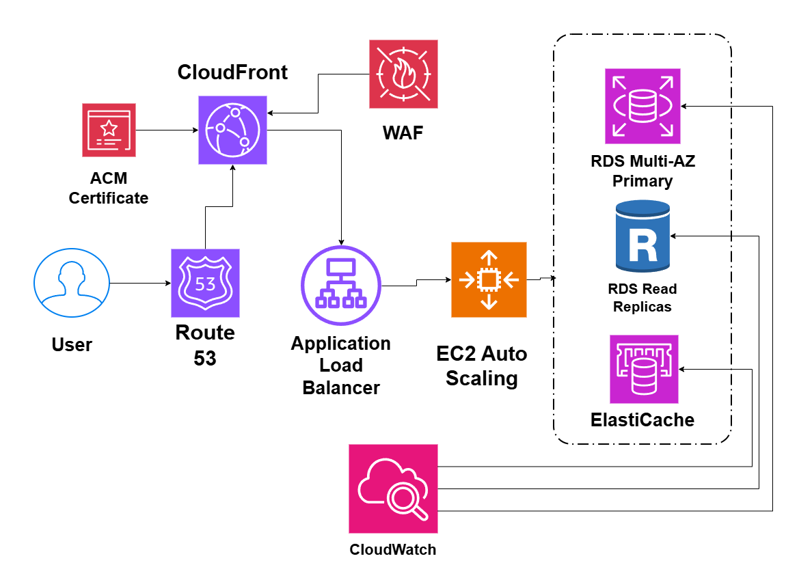

# Highly Scalable Web Application on AWS

## System Design Question

Design a highly scalable web application on AWS that can handle sudden traffic spikes while maintaining high availability and good performance.

## Architecture

## Architecture Overview

This architecture is designed to handle large and unpredictable traffic spikes.

Amazon Route 53 provides DNS resolution.

Amazon CloudFront caches static content close to users and reduces traffic reaching the backend.

The Application Load Balancer distributes dynamic requests across EC2 instances.

EC2 Auto Scaling automatically increases or decreases application capacity depending on traffic.

Amazon ElastiCache stores frequently requested data and reduces database load.

Amazon RDS provides the relational database layer.

RDS Read Replicas handle read-heavy workloads and reduce pressure on the primary database.

AWS WAF protects the public application from common web attacks.

AWS Certificate Manager provides HTTPS certificates.

Amazon CloudWatch monitors application performance and infrastructure health.

## Main AWS Services

- Amazon Route 53
- Amazon CloudFront
- AWS WAF
- AWS Certificate Manager
- Application Load Balancer
- Amazon EC2 Auto Scaling
- Amazon ElastiCache
- Amazon RDS
- RDS Read Replicas
- Amazon CloudWatch

## Traffic Flow

1. The user accesses the application.
2. Route 53 resolves the domain.
3. CloudFront serves cached content when available.
4. Dynamic requests are forwarded to the Application Load Balancer.
5. The Load Balancer distributes requests across EC2 instances.
6. Auto Scaling adjusts the number of EC2 instances based on demand.
7. The application checks ElastiCache for frequently requested data.
8. Database writes go to the primary RDS database.
9. Read-heavy queries can be handled by RDS Read Replicas.

## Scalability

CloudFront reduces backend traffic by caching static content.

EC2 Auto Scaling increases application capacity during traffic spikes.

ElastiCache reduces repeated database queries.

RDS Read Replicas distribute read-heavy database traffic.

Together, these services allow multiple layers of the architecture to scale.

## High Availability

The application tier uses multiple EC2 instances behind an Application Load Balancer.

RDS can use Multi-AZ deployment for database failover.

If one application instance fails, traffic can continue to healthy instances.

## Security

AWS WAF protects the CloudFront distribution from common HTTP attacks.

AWS Certificate Manager provides HTTPS encryption.

Backend infrastructure is not directly exposed to users.

## Monitoring

Amazon CloudWatch can monitor:

- EC2 CPU utilization
- Auto Scaling activity
- Load Balancer metrics
- RDS performance
- Read Replica lag
- ElastiCache performance
- Application errors

## Key Design Decisions

- CloudFront handles global caching.
- ALB distributes dynamic traffic.
- EC2 Auto Scaling handles sudden traffic growth.
- ElastiCache reduces database load.
- RDS Multi-AZ improves availability.
- Read Replicas improve read scalability.
- WAF protects the public application.
- CloudWatch provides monitoring.