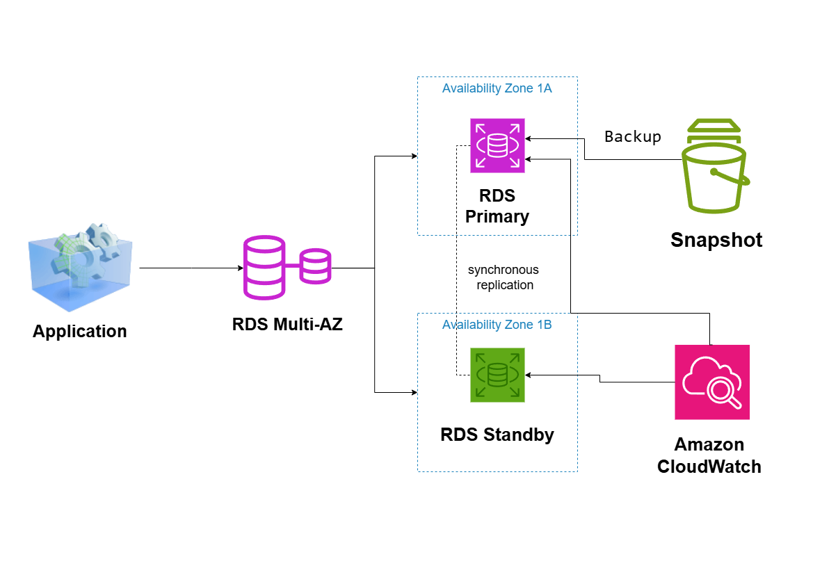

# Highly Available Database Architecture on AWS

## System Design Question

Design a highly available relational database architecture on AWS that can survive database instance failure and Availability Zone failure.

## Architecture



## Architecture Overview

This architecture uses Amazon RDS Multi-AZ to provide high availability for a relational database.

The application connects to a single RDS endpoint.

The primary database runs in one Availability Zone and a standby database runs in another Availability Zone.

Amazon RDS keeps the standby synchronized with the primary and automatically performs failover if the primary database becomes unavailable.

## Main AWS Services

- Amazon RDS
- RDS Multi-AZ
- Amazon CloudWatch
- Automated Backups
- RDS Snapshots

## Database Flow

1. The application connects to the RDS endpoint.
2. The primary RDS instance handles application database traffic.
3. Data is synchronously replicated to the standby instance.
4. The standby remains ready for automatic failover.
5. If the primary fails, the standby is promoted.
6. The application continues using the same RDS endpoint.

## High Availability

The primary and standby database instances run in separate Availability Zones.

If the primary database instance or its Availability Zone fails, Amazon RDS automatically fails over to the standby.

This reduces downtime without requiring the application to manually switch database endpoints.

## Replication

RDS Multi-AZ uses synchronous replication between the primary and standby database instances.

```text
RDS Primary
     ↓
Synchronous Replication
     ↓
RDS Standby