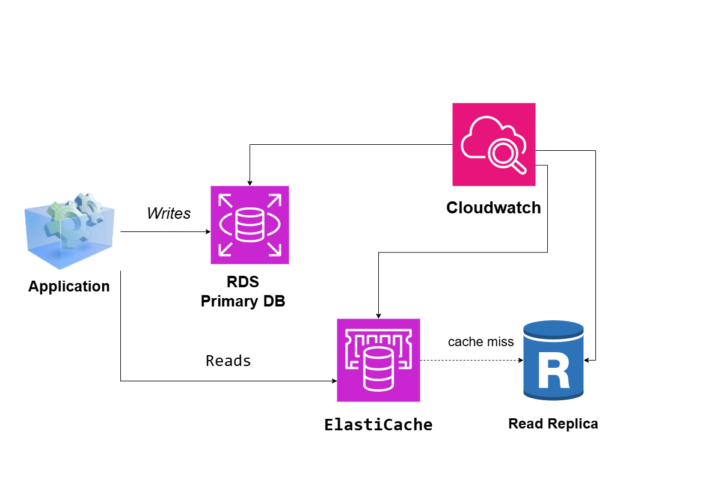

# Read-Heavy Database Architecture on AWS

## System Design Question

Design a relational database architecture on AWS that can handle very high read traffic while reducing pressure on the primary database.

## Architecture



## Architecture Overview

This architecture separates database writes from read-heavy traffic.

The application sends write operations to the primary Amazon RDS database.

Read requests first check Amazon ElastiCache.

Frequently requested data can be returned directly from the cache without querying the database.

If the requested data is not available in the cache, the application retrieves it from an RDS Read Replica.

The primary database asynchronously replicates data to the read replica.

Amazon CloudWatch monitors database and cache performance.

## Main AWS Services

- Amazon RDS
- RDS Primary Database
- RDS Read Replicas
- Amazon ElastiCache
- Amazon CloudWatch

## Write Flow

Write operations are sent to the primary database.

```text
Application
    |
    | Writes
    v
RDS Primary