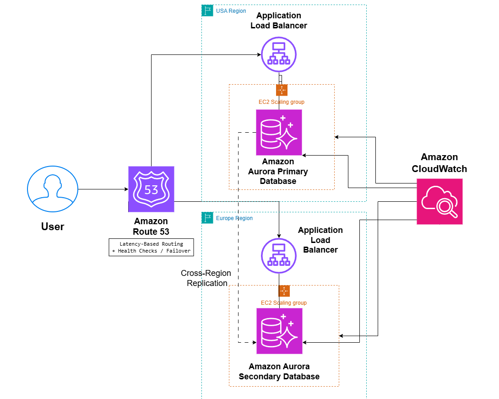

# Multi-Region Application on AWS

## System Design Question

Design a highly available multi-region application on AWS that provides low latency to users in different geographic locations and continues operating if one AWS Region fails.

## Architecture



## Architecture Overview

This architecture deploys the application in two AWS Regions.

Amazon Route 53 routes users to the Region with the lowest latency.

Each Region contains its own Application Load Balancer and EC2 Auto Scaling environment.

Amazon Aurora Global Database replicates data across Regions.

The primary Aurora cluster runs in the US Region and the secondary Aurora cluster runs in the Europe Region.

Amazon CloudWatch monitors the health and performance of both regional stacks.

## Main AWS Services

- Amazon Route 53
- Application Load Balancer
- Amazon EC2 Auto Scaling
- Amazon Aurora Global Database
- Amazon CloudWatch

## Traffic Flow

1. The user accesses the application.
2. Route 53 evaluates latency and health.
3. The user is routed to the closest healthy AWS Region.
4. The regional Application Load Balancer receives the request.
5. Traffic is distributed across EC2 instances in the Auto Scaling group.
6. The application accesses the regional Aurora database cluster.

## Global Routing

Route 53 can use latency-based routing to direct users to the Region with the best response time.

Health checks can detect regional application failures.

If one Region becomes unavailable, traffic can be redirected to the healthy Region.

## Application Scaling

Each Region has its own EC2 Auto Scaling group.

This allows application capacity to scale independently based on regional traffic.

If traffic increases in Europe, the Europe Auto Scaling group can increase capacity without affecting the US Region.

## Global Database

The architecture uses Amazon Aurora Global Database.

```text
US Region
Aurora Primary
      |
      | Cross-Region Replication
      v
Europe Region
Aurora Secondary