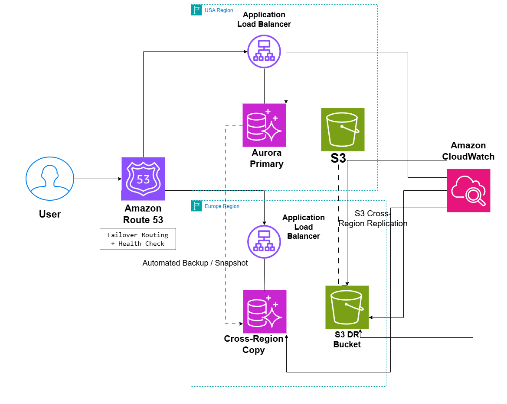

# Disaster Recovery Warm Standby Architecture on AWS

## System Design Question

Design a disaster recovery architecture on AWS using a Warm Standby strategy so the application can recover if the primary AWS Region becomes unavailable.

## Architecture



## Architecture Overview

This architecture uses two AWS Regions.

The primary Region handles normal production traffic.

The secondary Region acts as a disaster recovery environment and keeps replicated application data available.

Amazon Route 53 uses failover routing and health checks to redirect traffic if the primary Region becomes unavailable.

Amazon Aurora replicates database data across Regions.

Amazon S3 Cross-Region Replication copies objects to the disaster recovery Region.

Automated backups and snapshots provide an additional recovery layer.

Amazon CloudWatch monitors both Regions.

## Main AWS Services

- Amazon Route 53
- Route 53 Health Checks
- Application Load Balancer
- Amazon Aurora
- Aurora Cross-Region Replication
- Amazon S3
- S3 Cross-Region Replication
- Automated Backups / Snapshots
- Amazon CloudWatch

## Normal Operation

During normal operation, users are routed to the primary Region.

```text
User
  ↓
Route 53
  ↓
Primary Region