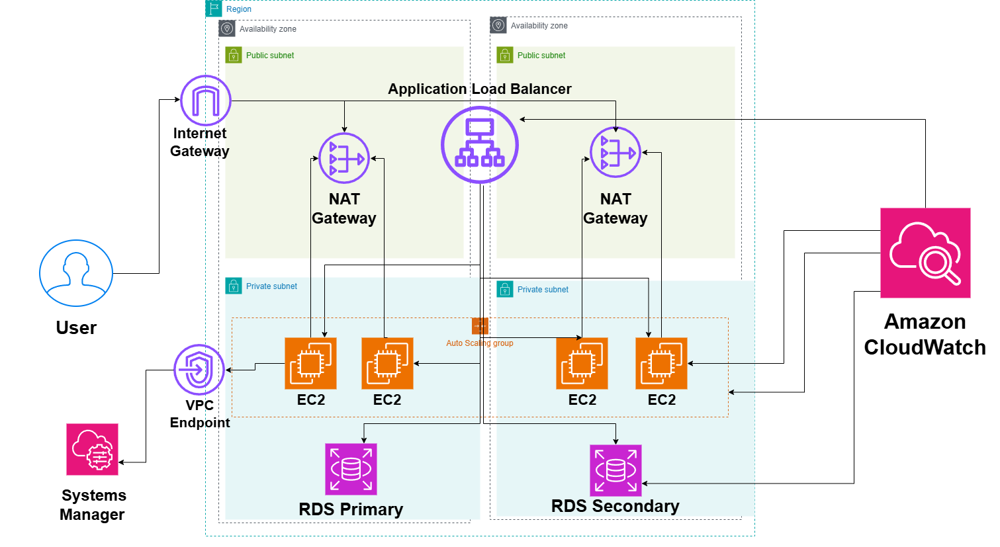

# Secure Private Application Architecture on AWS

## System Design Question

Design a secure AWS application where backend servers and databases are not publicly accessible.

The application should use a controlled public entry point, private application servers, private databases, secure outbound internet access, and bastionless administrative access.

## Architecture



## Architecture Overview

This architecture keeps the application and database layers private while exposing only the required public entry point.

Users access the application through an internet-facing Application Load Balancer.

The EC2 application servers run inside private subnets and do not require public IP addresses.

Amazon RDS runs in private database subnets.

NAT Gateways allow private EC2 instances to access the internet for software updates and external dependencies without accepting inbound internet traffic.

AWS Systems Manager Session Manager provides secure administrative access without exposing SSH.

VPC Endpoints allow private communication with supported AWS services.

Amazon CloudWatch provides monitoring and logging.

## Main AWS Services

- Amazon VPC
- Internet Gateway
- Application Load Balancer
- Amazon EC2
- EC2 Auto Scaling
- NAT Gateway
- Amazon RDS
- AWS Systems Manager
- VPC Endpoints
- Amazon CloudWatch
- Security Groups

## Application Traffic Flow

```text
User
  ↓
Internet
  ↓
Internet Gateway
  ↓
Application Load Balancer
  ↓
Private EC2
  ↓
Amazon RDS