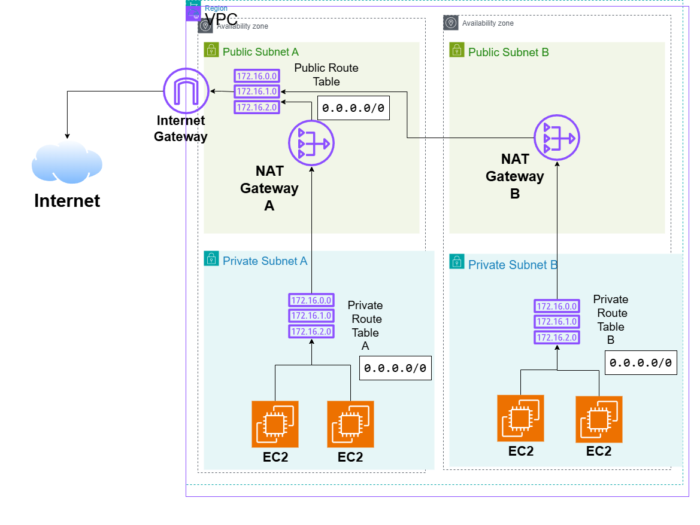

# VPC Internet Access Architecture on AWS

## System Design Question

Design an AWS VPC architecture where EC2 instances run in private subnets but still have outbound internet access.

The private instances must not be directly reachable from the internet.

## Architecture



## Architecture Overview

This architecture uses public and private subnets across multiple Availability Zones.

EC2 instances run inside private subnets without public IP addresses.

Each Availability Zone contains a NAT Gateway inside a public subnet.

The private subnets route outbound internet traffic through their local NAT Gateway.

The NAT Gateways then reach the internet through an Internet Gateway attached to the VPC.

## Main AWS Components

- Amazon VPC
- Internet Gateway
- Public Subnets
- Private Subnets
- NAT Gateways
- Public Route Table
- Private Route Tables
- Amazon EC2

## Public Subnet Routing

The public subnets use a route table containing:

```text
0.0.0.0/0 → Internet Gateway