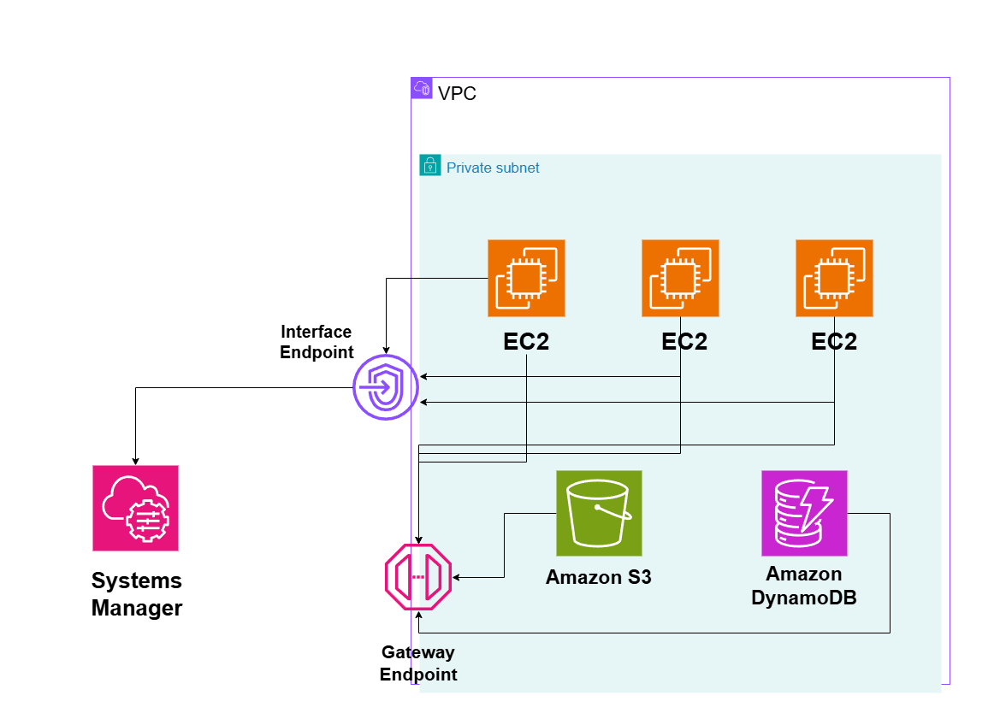

# Private AWS Service Access with VPC Endpoints

## System Design Question

Design an AWS architecture where EC2 instances running in private subnets can securely access AWS services without using the public internet or a NAT Gateway.

## Architecture



## Architecture Overview

This architecture uses VPC Endpoints to allow private EC2 instances to communicate with AWS services through the AWS private network.

The EC2 instances remain inside private subnets and do not require public IP addresses.

Gateway Endpoints are used for Amazon S3 and Amazon DynamoDB.

Interface Endpoints are used for services such as AWS Systems Manager.

IAM roles and endpoint policies can be used to restrict what resources the EC2 instances are allowed to access.

## Main AWS Services

- Amazon VPC
- Amazon EC2
- Gateway VPC Endpoint
- Interface VPC Endpoint
- Amazon S3
- Amazon DynamoDB
- AWS Systems Manager
- AWS IAM

## Gateway Endpoint

Gateway Endpoints provide private access to supported services such as:

- Amazon S3
- Amazon DynamoDB

The traffic flow is:

```text
Private EC2
    ↓
Private Route Table
    ↓
Gateway Endpoint
    ↓
Amazon S3 / DynamoDB