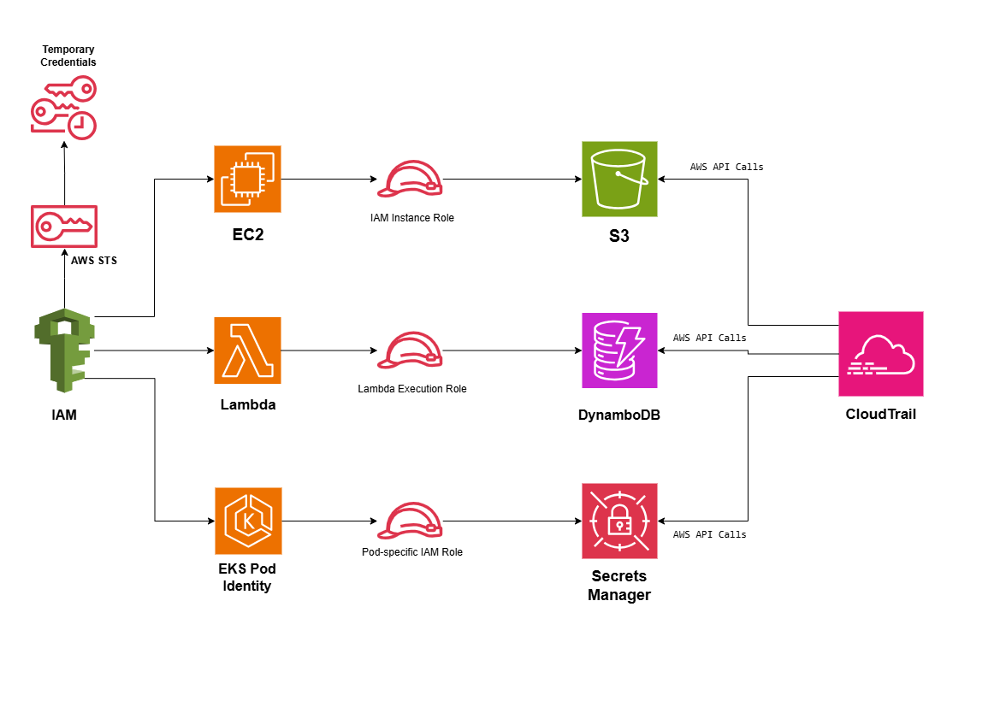

# Secure IAM Architecture on AWS

## System Design Question

Design a secure IAM architecture for workloads running on EC2, AWS Lambda, and Amazon EKS without storing long-term AWS access keys inside applications.

## Architecture



## Architecture Overview

This architecture uses IAM roles and temporary credentials instead of permanent AWS access keys.

Each workload receives its own permissions based on the principle of least privilege.

Amazon EC2 uses an IAM instance role.

AWS Lambda uses a Lambda execution role.

Amazon EKS workloads use workload-specific IAM permissions through EKS Pod Identity or IRSA.

AWS Secrets Manager stores sensitive application secrets.

AWS CloudTrail records AWS API activity for auditing and investigation.

## Main AWS Services

- AWS IAM
- AWS STS
- Amazon EC2
- AWS Lambda
- Amazon EKS
- Amazon S3
- Amazon DynamoDB
- AWS Secrets Manager
- AWS CloudTrail

## EC2 Access Pattern

Amazon EC2 uses an IAM role instead of stored access keys.

```text
EC2
 ↓
IAM Instance Role
 ↓
Temporary Credentials
 ↓
Amazon S3