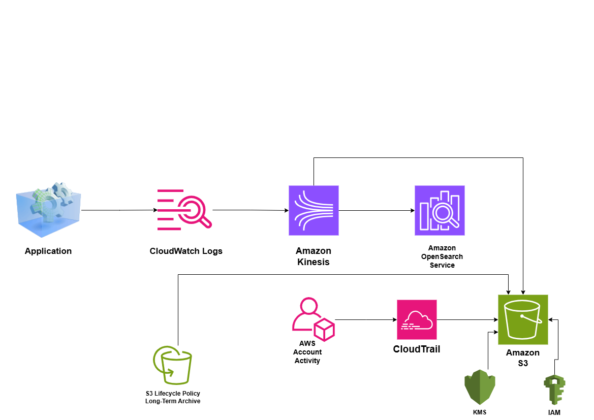

# Centralized Logging System on AWS

## System Design Question

Design a centralized logging architecture on AWS that collects logs from multiple applications and AWS services, supports fast searching, long-term retention, auditing, and secure access.

## Architecture



## Architecture Overview

This architecture centralizes application, infrastructure, and AWS account activity logs.

Application and AWS service logs are collected using Amazon CloudWatch Logs.

Amazon Kinesis streams log data to downstream destinations.

Amazon OpenSearch Service provides fast searching and investigation of recent logs.

Amazon S3 provides cost-efficient long-term log storage.

AWS CloudTrail records AWS account and API activity and stores audit logs in S3.

AWS KMS provides encryption and AWS IAM controls who can access or manage the logging environment.

S3 Lifecycle Policies move older logs into lower-cost storage classes for long-term retention.

## Main AWS Services

- Amazon CloudWatch Logs
- Amazon Kinesis
- Amazon OpenSearch Service
- Amazon S3
- AWS CloudTrail
- AWS KMS
- AWS IAM
- S3 Lifecycle Policies

## Log Sources

Logs can come from multiple AWS workloads and services, such as:

- EC2 application logs
- Lambda logs
- VPC Flow Logs
- ALB access logs
- Application logs
- Other AWS service logs

## Application Log Flow

```text
Applications / AWS Services
        ↓
CloudWatch Logs
        ↓
Amazon Kinesis
       /       \
      ↓         ↓
OpenSearch    Amazon S3