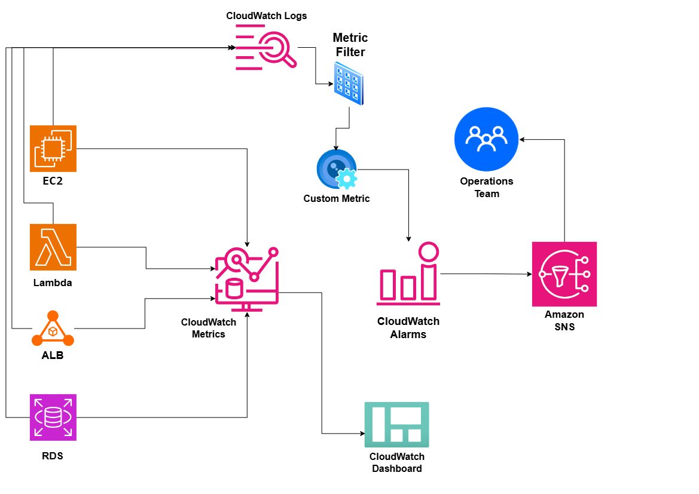

# Cloud Monitoring and Alerting System on AWS

## System Design Question

Design a centralized AWS monitoring and alerting architecture that collects infrastructure metrics and application logs, detects failures automatically, and notifies the operations team.

## Architecture



## Architecture Overview

This architecture uses Amazon CloudWatch to monitor AWS infrastructure and application workloads.

Services such as EC2, Lambda, Application Load Balancer, and Amazon RDS send metrics to CloudWatch.

CloudWatch Alarms evaluate these metrics and trigger notifications through Amazon SNS.

The operations team receives alerts when important thresholds or failure conditions are detected.

Application logs are stored in CloudWatch Logs.

Metric Filters can search logs for specific patterns and convert matching events into custom CloudWatch metrics.

CloudWatch Dashboards provide centralized visibility into application and infrastructure health.

## Main AWS Services

- Amazon CloudWatch Metrics
- Amazon CloudWatch Logs
- CloudWatch Metric Filters
- CloudWatch Custom Metrics
- CloudWatch Alarms
- CloudWatch Dashboards
- Amazon SNS
- Amazon EC2
- AWS Lambda
- Application Load Balancer
- Amazon RDS

## Infrastructure Monitoring Flow

```text
EC2 / Lambda / ALB / RDS
        ↓
CloudWatch Metrics
        ↓
CloudWatch Alarms
        ↓
Amazon SNS
        ↓
Operations Team