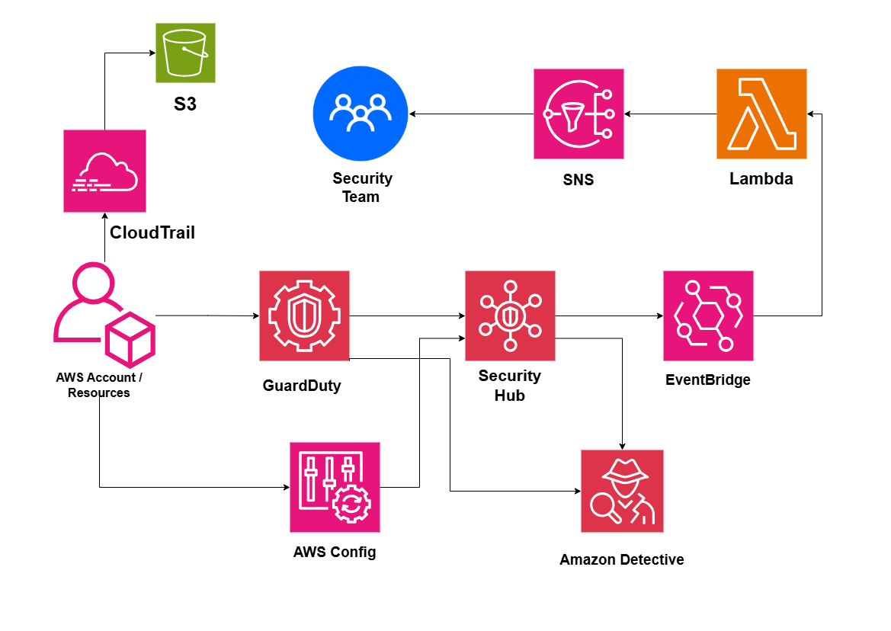

# Cloud Security Monitoring Architecture on AWS

## System Design Question

Design a centralized cloud security monitoring architecture on AWS that detects suspicious activity, configuration problems, and security threats, then automatically alerts the security team.

## Architecture



## Architecture Overview

This architecture combines multiple AWS security services to provide centralized threat detection, compliance monitoring, auditing, investigation, and alerting.

Amazon GuardDuty detects suspicious activity and potential security threats.

AWS Config monitors resource configuration and compliance.

AWS Security Hub aggregates security findings into a centralized location.

Amazon EventBridge routes important findings to AWS Lambda for automated response.

Amazon SNS sends alerts to the security team.

AWS CloudTrail records AWS API activity and stores audit logs in Amazon S3.

Amazon Detective helps security teams investigate suspicious behavior and relationships between AWS resources.

## Main AWS Services

- Amazon GuardDuty
- AWS Security Hub
- AWS Config
- AWS CloudTrail
- Amazon EventBridge
- AWS Lambda
- Amazon SNS
- Amazon Detective
- Amazon S3

## Threat Detection Flow

```text
AWS Account / Resources
        ↓
Amazon GuardDuty
        ↓
Security Findings
        ↓
AWS Security Hub
```

GuardDuty can detect suspicious behavior such as:

- Compromised credentials
- Suspicious API calls
- Unusual network activity
- Communication with malicious IP addresses
- Potential crypto-mining behavior

## Configuration Monitoring

AWS Config monitors resource configurations and compliance.

```text
AWS Resources
     ↓
AWS Config
     ↓
Security Hub
```

Examples of findings include:

- Public S3 buckets
- Open security groups
- Unencrypted resources
- Non-compliant configurations
- Unexpected configuration changes

## Centralized Security Findings

AWS Security Hub aggregates findings from security services.

```text
GuardDuty ──┐
AWS Config ─┼──→ Security Hub
Other AWS ──┘
```

This gives the security team a centralized view of security risks.

## Automated Alerting

High-severity findings can trigger automated workflows.

```text
Security Hub
     ↓
EventBridge
     ↓
AWS Lambda
     ↓
Amazon SNS
     ↓
Security Team
```

Lambda can also perform automated response actions if required.

Examples include:

- Tagging a compromised resource
- Quarantining an instance
- Disabling suspicious access
- Updating security controls

## Audit Logging

AWS CloudTrail records AWS API activity.

```text
AWS API Activity
      ↓
AWS CloudTrail
      ↓
Amazon S3
```

CloudTrail helps answer questions such as:

- Who changed an IAM policy?
- Who deleted a resource?
- Which role modified a security group?
- When was a bucket policy changed?
- Which AWS API call was performed?

## Security Investigation

Amazon Detective helps investigate security findings.

```text
GuardDuty / Security Hub Finding
            ↓
      Amazon Detective
            ↓
    Security Investigation
```

Detective helps analyze relationships between users, roles, resources, and activity.

## Security Incident Example

```text
Suspicious IAM Activity
        ↓
GuardDuty
        ↓
Security Hub
        ↓
EventBridge
        ↓
Lambda
        ↓
SNS
        ↓
Security Team
```

The security team can then use CloudTrail and Detective to investigate the incident.

## Key Design Decisions

- GuardDuty provides threat detection.
- AWS Config monitors configuration compliance.
- Security Hub centralizes findings.
- EventBridge routes important security events.
- Lambda enables automated response.
- SNS notifies the security team.
- CloudTrail provides audit history.
- S3 retains audit logs.
- Detective supports security investigations.