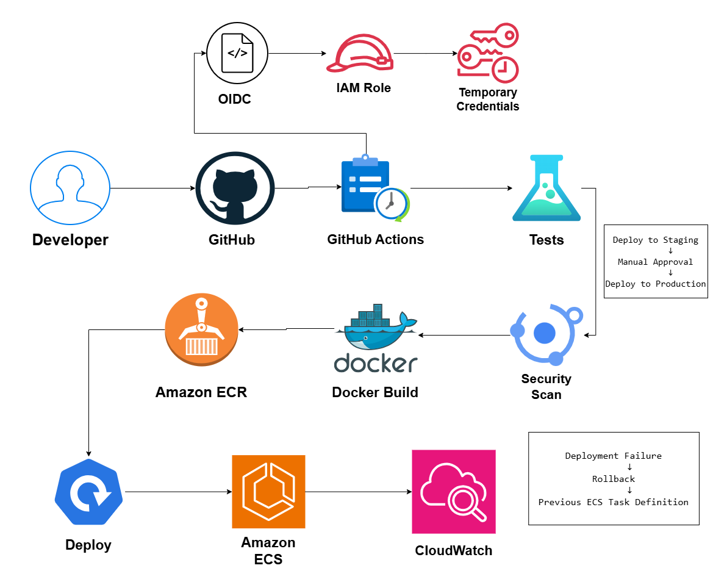

# CI/CD Pipeline for Cloud Applications on AWS

## System Design Question

Design a secure CI/CD pipeline that automatically tests, scans, builds, and deploys an application to AWS after developers push code to GitHub.

## Architecture



## Architecture Overview

This architecture uses GitHub Actions to automate the software delivery process.

Developers push code to GitHub.

GitHub Actions runs automated tests, security scans, and Docker image builds.

The Docker image is stored in Amazon ECR.

The application is deployed to Amazon ECS.

GitHub Actions authenticates to AWS using OIDC and an IAM role instead of permanent AWS access keys.

Amazon CloudWatch monitors the deployed application.

## Main AWS Services

- GitHub
- GitHub Actions
- Docker
- Amazon ECR
- Amazon ECS
- AWS IAM
- OIDC
- Amazon CloudWatch

## CI/CD Flow

```text
Developer
   ↓
GitHub
   ↓
GitHub Actions
   ↓
Tests
   ↓
Security Scan
   ↓
Docker Build
   ↓
Amazon ECR
   ↓
Deploy
   ↓
Amazon ECS
   ↓
CloudWatch
```

## Continuous Integration

The CI stage validates the application before deployment.

Typical steps include:

- Checkout source code
- Install dependencies
- Run unit tests
- Run linting
- Run security scans
- Build Docker image

## Security Scanning

Security scanning can include tools such as:

- Trivy
- SAST scanners
- Dependency scanners
- Container vulnerability scanners

The pipeline should stop if critical security issues are detected.

## Docker Image Build

After tests and security scans pass, the application is packaged as a Docker image.

```text
Source Code
    ↓
Docker Build
    ↓
Docker Image
```

Images should be versioned using tags such as:

```text
commit-sha
v1.0.0
release-2026-10
```

## Amazon ECR

Amazon ECR stores Docker images used by the deployment environment.

```text
Docker Build
    ↓
Amazon ECR
    ↓
Amazon ECS
```

## Secure AWS Authentication

GitHub Actions should not store permanent AWS access keys.

Instead, the pipeline uses OIDC.

```text
GitHub Actions
      ↓
     OIDC
      ↓
AWS IAM Role
      ↓
Temporary Credentials
```

These temporary credentials allow the workflow to perform only the required actions.

For example:

- Push images to ECR
- Update ECS services
- Register ECS task definitions

## Deployment Stages

A production pipeline can use multiple stages.

```text
Development
    ↓
Staging
    ↓
Manual Approval
    ↓
Production
```

This reduces the risk of automatically deploying broken changes directly to production.

## ECS Deployment

Amazon ECS runs the containerized application.

The deployment flow is:

```text
Amazon ECR
    ↓
ECS Service
    ↓
ECS Tasks
```

The ECS service pulls the required image version from ECR.

## Rollback

If a new deployment becomes unhealthy:

```text
Deployment Failure
      ↓
Rollback
      ↓
Previous ECS Task Definition
      ↓
Previous ECR Image
```

Keeping previous image versions makes rollback easier.

## Monitoring

Amazon CloudWatch monitors the deployed ECS application.

Useful metrics and logs include:

- CPU usage
- Memory usage
- Task failures
- Application logs
- Container errors
- Deployment failures

## Security

The pipeline follows several security practices:

- No permanent AWS credentials in GitHub
- OIDC authentication
- Least-privilege IAM role
- Security scanning before deployment
- Versioned container images
- Controlled production deployment
- Monitoring after deployment

## Key Design Decisions

- GitHub stores application source code.
- GitHub Actions automates CI/CD.
- Tests validate application behavior.
- Security scans detect vulnerabilities.
- Docker creates deployable application images.
- ECR stores versioned images.
- ECS runs the application.
- OIDC provides secure AWS authentication.
- CloudWatch monitors application health.
- Rollback restores the previous working deployment.