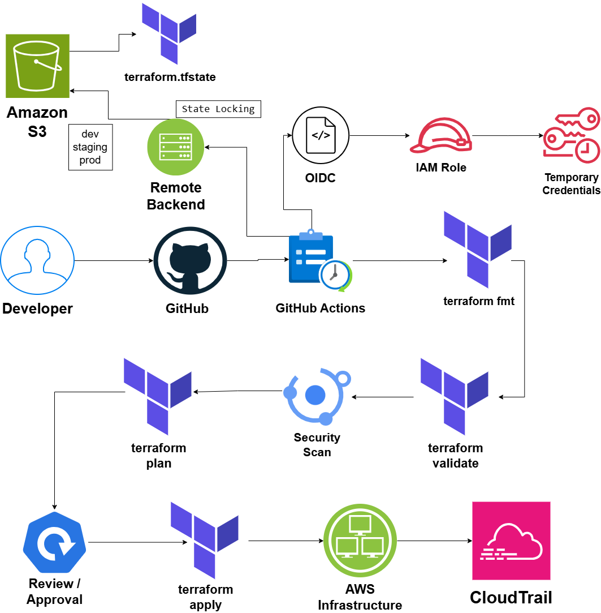

# Terraform CI/CD Pipeline on AWS

## System Design Question

Design a secure Infrastructure as Code CI/CD pipeline using Terraform and GitHub Actions.

The pipeline should validate Terraform code, run security scans, generate a plan, require approval before production changes, use remote state and state locking, authenticate securely to AWS, and keep an audit trail of infrastructure changes.

---

## Architecture



---

## Architecture Overview

This architecture uses GitHub Actions to automate Terraform infrastructure deployment.

Developers push Terraform code to GitHub.

GitHub Actions runs formatting checks, validation, security scanning, and Terraform planning.

Infrastructure changes are reviewed before `terraform apply` is executed.

Terraform state is stored remotely in Amazon S3.

Separate state is maintained for development, staging, and production environments.

State locking prevents multiple pipelines from modifying the same Terraform state at the same time.

GitHub Actions authenticates to AWS using OIDC and an IAM role instead of permanent AWS access keys.

AWS CloudTrail records infrastructure API activity for auditing.

---

## Main Components

- GitHub
- GitHub Actions
- Terraform
- Amazon S3
- Remote Terraform Backend
- State Locking
- AWS IAM
- OIDC
- Temporary AWS Credentials
- Checkov / tfsec
- AWS CloudTrail

---

## CI/CD Flow

```text
Developer
   ↓
GitHub
   ↓
GitHub Actions
   ↓
terraform fmt
   ↓
terraform validate
   ↓
Security Scan
   ↓
terraform plan
   ↓
Review / Approval
   ↓
terraform apply
   ↓
AWS Infrastructure
```

---

## Terraform Validation

The pipeline performs validation before infrastructure changes are applied.

Typical steps include:

```text
terraform fmt -check
        ↓
terraform init
        ↓
terraform validate
        ↓
Security Scan
        ↓
terraform plan
```

If one of these steps fails, the deployment stops.

---

## Security Scanning

Terraform code can be scanned using tools such as:

- Checkov
- tfsec
- Trivy configuration scanning

These tools can detect issues such as:

- Public S3 buckets
- Open security groups
- Missing encryption
- Overly broad IAM permissions
- Insecure Terraform configuration

---

## Terraform Plan

The pipeline generates a Terraform plan before applying infrastructure changes.

```text
terraform plan
      ↓
Review Changes
```

The plan allows reviewers to see:

- Resources being created
- Resources being modified
- Resources being destroyed

---

## Approval

Production infrastructure changes should require approval.

```text
Terraform Plan
      ↓
Manual Approval
      ↓
Terraform Apply
```

This prevents unreviewed infrastructure changes from being deployed directly to production.

---

## Remote State

Terraform state is stored remotely instead of only on a developer workstation.

```text
Terraform
   ↓
Remote Backend
   ↓
Amazon S3
   ↓
terraform.tfstate
```

Remote state allows teams and CI/CD pipelines to work with the same infrastructure state.

---

## Environment Separation

Development, staging, and production environments should use separate Terraform state.

```text
dev
    → dev.tfstate

staging
    → staging.tfstate

prod
    → prod.tfstate
```

Separating state reduces the blast radius of infrastructure changes.

---

## State Locking

State locking prevents multiple Terraform processes from modifying the same state simultaneously.

```text
Pipeline A ──┐
             ├──→ State Lock
Pipeline B ──┘
```

Only one infrastructure operation should hold the lock at a time.

---

## Secure AWS Authentication

GitHub Actions should not use permanent AWS access keys.

The pipeline uses OIDC.

```text
GitHub Actions
      ↓
     OIDC
      ↓
AWS IAM Role
      ↓
Temporary Credentials
```

The IAM role should follow least privilege and allow only the AWS actions required by the Terraform pipeline.

---

## Infrastructure Deployment

After approval:

```text
terraform apply
      ↓
AWS Infrastructure
```

Terraform creates or modifies the AWS resources defined in the infrastructure code.

---

## Auditing

AWS CloudTrail records AWS API activity generated by Terraform.

```text
Terraform Apply
      ↓
AWS API Calls
      ↓
AWS CloudTrail
```

CloudTrail provides an audit trail showing which AWS API actions occurred and which identity performed them.

---

## Security Benefits

This architecture provides:

- No permanent AWS credentials in GitHub
- OIDC-based authentication
- Temporary AWS credentials
- Terraform validation before deployment
- Security scanning
- Plan review before apply
- Production approval
- Remote state
- State locking
- Environment isolation
- AWS API auditing

---

## Key Design Decisions

| Component | Purpose |
|---|---|
| GitHub | Stores Terraform source code |
| GitHub Actions | Runs the Terraform CI/CD pipeline |
| `terraform fmt` | Checks Terraform formatting |
| `terraform validate` | Validates Terraform configuration |
| Checkov / tfsec | Scans infrastructure code for security problems |
| `terraform plan` | Shows proposed infrastructure changes |
| Manual Approval | Protects production deployments |
| `terraform apply` | Deploys AWS infrastructure |
| Amazon S3 | Stores remote Terraform state |
| State Locking | Prevents concurrent state modification |
| OIDC | Authenticates GitHub Actions to AWS |
| IAM Role | Provides least-privilege AWS permissions |
| CloudTrail | Audits infrastructure API activity |

---

## Key Takeaway

The pipeline follows this pattern:

```text
Validate
   ↓
Scan
   ↓
Plan
   ↓
Review
   ↓
Approve
   ↓
Apply
```

while using:

```text
Remote State
+
State Locking
+
OIDC Authentication
+
Environment Separation
+
CloudTrail Auditing
```