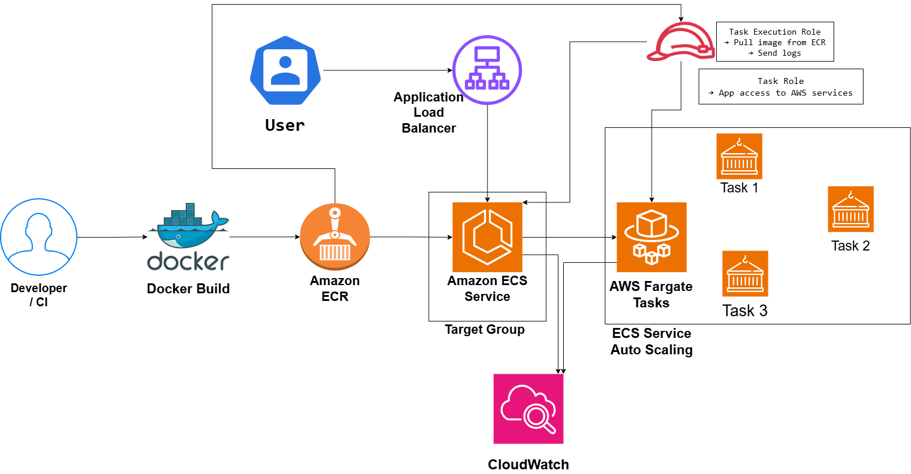

# Docker Container Deployment Architecture on AWS

## System Design Question

Design a production-ready container deployment architecture on AWS using Docker, Amazon ECR, Amazon ECS, and AWS Fargate.

The application should support load balancing, automatic scaling, monitoring, and secure IAM access.

---

## Architecture



---

## Architecture Overview

This architecture uses Docker to package the application into a container image.

The image is stored in Amazon ECR.

Amazon ECS manages the application service, while AWS Fargate provides the compute needed to run containers without managing EC2 worker nodes.

An Application Load Balancer distributes incoming traffic across healthy Fargate tasks.

ECS Service Auto Scaling automatically increases or decreases the number of running tasks based on application demand.

Amazon CloudWatch collects container logs and operational metrics.

IAM roles provide secure AWS access without storing permanent AWS credentials inside containers.

---

## Main AWS Services

- Docker
- Amazon ECR
- Amazon ECS
- AWS Fargate
- Application Load Balancer
- Target Group
- ECS Service Auto Scaling
- AWS IAM
- Amazon CloudWatch

---

## Container Build Flow

```text
Developer / CI
      ↓
Docker Build
      ↓
Amazon ECR
```

Developers or CI/CD pipelines build the Docker image.

The image is then pushed to Amazon Elastic Container Registry.

---

## Container Deployment Flow

```text
Amazon ECR
    ↓
Amazon ECS Service
    ↓
AWS Fargate Tasks
```

The ECS service uses the configured task definition to start Fargate tasks.

Fargate provides the underlying compute infrastructure.

---

## User Traffic Flow

```text
User
  ↓
Application Load Balancer
  ↓
Target Group
  ↓
ECS Service
  ↓
Fargate Tasks
```

The Application Load Balancer distributes incoming requests across healthy running tasks.

The Target Group performs health checks and prevents unhealthy tasks from receiving traffic.

---

## ECS Service

The ECS service maintains the desired number of tasks.

Example:

```text
Desired Count = 3

Task 1
Task 2
Task 3
```

If one task fails:

```text
Task Failure
    ↓
ECS Service detects unhealthy task
    ↓
New task launched
```

This improves application availability.

---

## AWS Fargate

AWS Fargate provides serverless compute for ECS containers.

The team does not need to manage EC2 worker nodes.

```text
Amazon ECS
    ↓
AWS Fargate
    ↓
Containers
```

---

## Auto Scaling

ECS Service Auto Scaling changes the number of Fargate tasks based on demand.

Example:

```text
Normal Traffic
2 Tasks

Traffic Spike
2 → 5 → 10 Tasks
```

Scaling can be based on metrics such as:

- CPU utilization
- Memory utilization
- Request count
- Custom CloudWatch metrics

---

## IAM Roles

Two IAM role concepts are important.

### Task Execution Role

The Task Execution Role is used by ECS/Fargate for platform operations.

Examples include:

- Pull Docker images from Amazon ECR
- Send container logs to CloudWatch
- Retrieve deployment-related configuration

```text
ECS / Fargate
      ↓
Task Execution Role
      ↓
Amazon ECR / CloudWatch
```

### Task Role

The Task Role is used by the application running inside the container.

Example:

```text
Application Container
        ↓
Task Role
        ↓
AWS Services
```

The task role can provide access to services such as:

- Amazon S3
- DynamoDB
- Secrets Manager
- SQS

The application does not need hard-coded AWS access keys.

---

## Monitoring

Amazon CloudWatch monitors the ECS environment.

Useful metrics and logs include:

- Container CPU
- Container memory
- ECS task count
- Task failures
- Application logs
- ECS service health
- ALB target health
- Auto Scaling events

---

## Failure Handling

If one Fargate task fails:

```text
Task Failure
    ↓
ECS Service
    ↓
Replacement Task
```

If traffic increases:

```text
Traffic Increase
      ↓
CloudWatch Metric
      ↓
ECS Service Auto Scaling
      ↓
Additional Fargate Tasks
```

If a task fails health checks:

```text
ALB Target Group
      ↓
Marks Task Unhealthy
      ↓
Stops Sending Traffic
```

---

## Security

The architecture follows several security practices:

- Container images stored in private ECR
- No hard-coded AWS credentials
- Task Execution Role for ECS platform permissions
- Task Role for application permissions
- Least-privilege IAM policies
- CloudWatch logging and monitoring
- ALB health checks

---

## Key Design Decisions

| Component | Purpose |
|---|---|
| Docker | Packages the application |
| Amazon ECR | Stores private Docker images |
| Amazon ECS | Manages container workloads |
| AWS Fargate | Runs containers without managing servers |
| ECS Service | Maintains desired task count |
| Fargate Tasks | Run application containers |
| Application Load Balancer | Distributes application traffic |
| Target Group | Performs task health checks |
| ECS Service Auto Scaling | Scales container capacity |
| Task Execution Role | Allows ECS/Fargate platform actions |
| Task Role | Allows application AWS access |
| CloudWatch | Provides logs and monitoring |

---

## Key Takeaway

The architecture follows this pattern:

```text
Build
  ↓
Store
  ↓
Deploy
  ↓
Load Balance
  ↓
Scale
  ↓
Monitor
```

using:

```text
Docker
  ↓
Amazon ECR
  ↓
Amazon ECS
  ↓
AWS Fargate
```