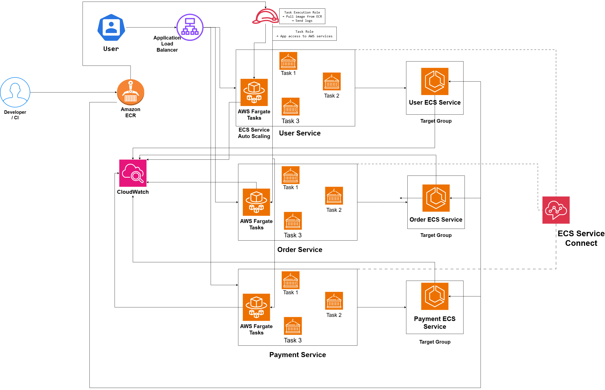

# ECS Microservices Architecture on AWS

## System Design Question

Design a scalable microservices architecture on AWS using Amazon ECS and AWS Fargate.

Each microservice should run independently, scale independently, use its own target group, communicate internally through service discovery, and use secure IAM roles.

---

## Architecture



---

## Architecture Overview

This architecture runs multiple containerized microservices on Amazon ECS using AWS Fargate.

Each microservice runs as its own ECS Service.

Example services include:

- User Service
- Order Service
- Payment Service

Amazon ECR stores the Docker images used by each service.

An Application Load Balancer receives external traffic and uses path-based routing to forward requests to the correct ECS service.

Each microservice has its own target group and Fargate tasks.

ECS Service Auto Scaling allows each service to scale independently.

ECS Service Connect provides private service-to-service communication between microservices.

Amazon CloudWatch collects logs and operational metrics.

IAM Task Roles provide least-privilege access to AWS services.

---

## Main AWS Services

- Amazon ECR
- Amazon ECS
- AWS Fargate
- Application Load Balancer
- Target Groups
- ECS Service Auto Scaling
- ECS Service Connect
- AWS IAM
- Amazon CloudWatch

---

## External Traffic Flow

```text
User
  ↓
Application Load Balancer
  ↓
Path-Based Routing
  ├── /users/*    → User Target Group
  ├── /orders/*   → Order Target Group
  └── /payments/* → Payment Target Group
```

Each target group forwards requests to the appropriate ECS service.

---

## Microservice Structure

Each microservice runs independently.

```text
User ECS Service
      ↓
Fargate Tasks
  ├── Task 1
  ├── Task 2
  └── Task 3
```

```text
Order ECS Service
      ↓
Fargate Tasks
  ├── Task 1
  ├── Task 2
  └── Task 3
```

```text
Payment ECS Service
      ↓
Fargate Tasks
  ├── Task 1
  ├── Task 2
  └── Task 3
```

If one task fails, the ECS Service launches a replacement task.

---

## Container Image Flow

Each microservice can have its own ECR repository.

```text
Amazon ECR
├── user-service
├── order-service
└── payment-service
```

The deployment flow is:

```text
Docker Image
    ↓
Amazon ECR
    ↓
ECS Service
    ↓
Fargate Tasks
```

---

## Path-Based Routing

The Application Load Balancer routes requests based on URL path.

```text
/users/*
    ↓
User ECS Service

/orders/*
    ↓
Order ECS Service

/payments/*
    ↓
Payment ECS Service
```

This allows multiple microservices to share one public load balancer.

---

## Independent Scaling

Each microservice can scale independently.

Example:

```text
User Service
2 → 4 Tasks

Order Service
3 → 10 Tasks

Payment Service
2 → 3 Tasks
```

A traffic spike in the Order Service does not require every other service to scale.

---

## Service-to-Service Communication

Internal microservices can communicate using ECS Service Connect.

```text
Order Service
      ↓
ECS Service Connect
      ↓
Payment Service
```

This allows services to discover and communicate with each other without sending internal traffic through the public Application Load Balancer.

---

## IAM Roles

Each microservice should use its own IAM Task Role.

Example:

```text
User Service Task Role
→ user-related AWS permissions

Order Service Task Role
→ order-related AWS permissions

Payment Service Task Role
→ Secrets Manager / payment permissions
```

This follows the principle of least privilege.

---

## Task Execution Role

The ECS Task Execution Role is used by ECS/Fargate for platform operations.

Examples include:

- Pulling container images from ECR
- Sending container logs to CloudWatch
- Retrieving deployment configuration

---

## Task Role

The Task Role is used by the application running inside the container.

For example:

```text
Order Container
      ↓
Order Task Role
      ↓
DynamoDB / SQS / S3
```

Permanent AWS credentials do not need to be stored inside containers.

---

## Monitoring

Amazon CloudWatch can monitor:

- Container logs
- CPU utilization
- Memory utilization
- ECS task failures
- ECS service health
- Target group health
- Auto Scaling events
- Application errors

---

## Failure Handling

If one microservice task fails:

```text
Task Failure
    ↓
ECS Service
    ↓
Replacement Task
```

If one service receives heavy traffic:

```text
Traffic Increase
      ↓
ECS Service Auto Scaling
      ↓
More Tasks for That Service
```

Other microservices continue scaling independently.

---

## Key Design Decisions

| Component | Purpose |
|---|---|
| Amazon ECR | Stores microservice Docker images |
| ECS Service | Manages each microservice independently |
| AWS Fargate | Runs container tasks |
| ALB | Receives external traffic |
| Target Groups | Route traffic to specific services |
| Path-Based Routing | Routes URLs to the correct microservice |
| Service Connect | Enables internal service communication |
| Auto Scaling | Scales each service independently |
| Task Role | Gives application-specific AWS permissions |
| Task Execution Role | Allows ECS platform operations |
| CloudWatch | Provides monitoring and logs |

---

## Key Takeaway

The architecture follows:

```text
User
  ↓
Application Load Balancer
  ↓
Path-Based Routing
  ↓
Independent ECS Services
  ↓
Fargate Tasks
```

while using:

```text
Amazon ECR
+
ECS Service Connect
+
Independent Auto Scaling
+
Separate IAM Roles
+
CloudWatch
```

The main advantage is that each microservice can be **deployed, scaled, monitored, and secured independently**.