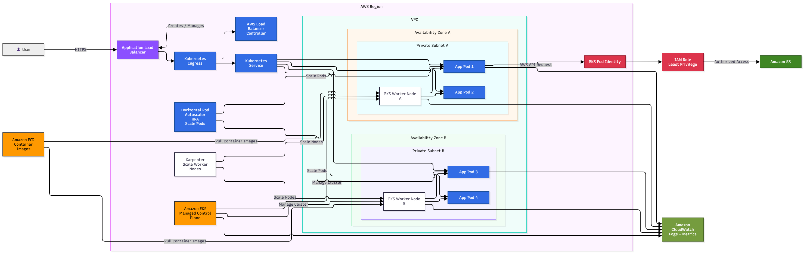

# Amazon EKS Production Architecture

## System Design Question

Design a production-ready Kubernetes architecture on AWS using Amazon EKS.

The system should provide:

- High availability across multiple Availability Zones
- Private worker nodes
- Kubernetes Ingress and Services
- Automatic pod scaling
- Automatic worker node scaling
- Secure IAM access for pods
- Container image storage
- Monitoring and logging

---

## Architecture



---

## Architecture Overview

This architecture runs a containerized application on Amazon EKS.

AWS manages the Kubernetes control plane, while the application workloads run on worker nodes inside private subnets.

The worker nodes are distributed across multiple Availability Zones for high availability.

Users access the application through an Application Load Balancer.

Traffic then flows through Kubernetes Ingress and Kubernetes Service before reaching the application Pods.

---

## Main AWS Services

- Amazon EKS
- Amazon ECR
- Application Load Balancer
- AWS Load Balancer Controller
- Amazon CloudWatch
- AWS IAM
- Amazon S3
- Amazon VPC

Kubernetes components include:

- Ingress
- Service
- Pods
- Worker Nodes
- Horizontal Pod Autoscaler
- Karpenter
- EKS Pod Identity

---

## Main Traffic Flow

```text
User
  ↓
Application Load Balancer
  ↓
Kubernetes Ingress
  ↓
Kubernetes Service
  ↓
Application Pods
```

The Application Load Balancer receives incoming HTTPS traffic.

Kubernetes Ingress defines how incoming requests should be routed.

The Kubernetes Service provides a stable endpoint for the application Pods.

---

## Amazon EKS Control Plane

Amazon EKS provides a managed Kubernetes control plane.

```text
Amazon EKS
     ↓
Managed Kubernetes Control Plane
     ↓
Worker Nodes
```

AWS manages the control plane components, so the application team does not need to manually manage Kubernetes master servers.

---

## Multi-AZ Worker Architecture

Worker nodes run inside private subnets across multiple Availability Zones.

```text
Availability Zone A
        ↓
Private Subnet A
        ↓
Worker Node A
        ↓
Pods


Availability Zone B
        ↓
Private Subnet B
        ↓
Worker Node B
        ↓
Pods
```

This improves availability because the application is not dependent on only one Availability Zone.

---

## Kubernetes Pods

Application containers run inside Kubernetes Pods.

Example:

```text
Worker Node A
├── App Pod 1
└── App Pod 2

Worker Node B
├── App Pod 3
└── App Pod 4
```

If a Pod fails, Kubernetes can create a replacement Pod automatically.

---

## Kubernetes Service

Pods can be created and destroyed dynamically, so their IP addresses can change.

A Kubernetes Service provides a stable network endpoint.

```text
Kubernetes Service
        ↓
       Pods
```

The Service distributes traffic to healthy Pods.

---

## Kubernetes Ingress

Ingress controls HTTP and HTTPS routing into the Kubernetes cluster.

```text
Application Load Balancer
        ↓
Kubernetes Ingress
        ↓
Kubernetes Service
        ↓
Pods
```

This allows external users to access applications running inside the EKS cluster.

---

## AWS Load Balancer Controller

The AWS Load Balancer Controller integrates Kubernetes with AWS load balancers.

```text
Kubernetes Ingress
        ↓
AWS Load Balancer Controller
        ↓
Application Load Balancer
```

The controller can automatically create and manage an Application Load Balancer based on Kubernetes Ingress configuration.

---

## Container Image Flow

Application container images are stored in Amazon ECR.

```text
Developer / CI Pipeline
        ↓
Amazon ECR
        ↓
Worker Nodes
        ↓
Pods
```

When Kubernetes starts a Pod, the container image is pulled from Amazon ECR.

---

## Pod Auto Scaling

The Horizontal Pod Autoscaler automatically adjusts the number of Pods.

```text
Traffic Increases
      ↓
HPA
      ↓
More Pods
```

Example:

```text
3 Pods
  ↓
6 Pods
  ↓
10 Pods
```

HPA can scale based on metrics such as CPU or memory utilization.

---

## Worker Node Auto Scaling

Karpenter can automatically add or remove worker capacity.

```text
Pods Cannot Be Scheduled
        ↓
Karpenter
        ↓
Launch More Worker Nodes
```

This allows the Kubernetes cluster to dynamically increase compute capacity when more Pods need to run.

---

## HPA vs Karpenter

| Component | What It Scales |
|---|---|
| HPA | Kubernetes Pods |
| Karpenter | Worker Nodes |

This is an important difference.

```text
HPA
→ Scale Pods

Karpenter
→ Scale Worker Nodes
```

---

## EKS Pod Identity

Applications should not store permanent AWS credentials inside containers.

EKS Pod Identity allows Kubernetes workloads to use IAM roles.

```text
Application Pod
      ↓
EKS Pod Identity
      ↓
IAM Role
      ↓
AWS Service
```

For example:

```text
Application Pod
      ↓
EKS Pod Identity
      ↓
IAM Role
      ↓
Amazon S3
```

This provides temporary AWS credentials and supports least-privilege access.

---

## IAM Security

Each application should receive only the permissions it actually needs.

For example:

```text
Application Pod
      ↓
IAM Role
      ↓
Read Specific S3 Bucket
```

The application should not receive unnecessary permissions such as full administrator access.

---

## Monitoring and Logging

Amazon CloudWatch provides monitoring for the EKS environment.

CloudWatch can collect:

- Application logs
- Container logs
- Kubernetes logs
- Worker node metrics
- CPU utilization
- Memory utilization
- Pod failures
- Cluster health information

Conceptually:

```text
EKS
Worker Nodes
Pods
  ↓
CloudWatch
```

---

## High Availability

The application runs across multiple Availability Zones.

```text
                   Amazon EKS
                       |
            +----------+----------+
            |                     |
          AZ-A                  AZ-B
            |                     |
     Private Subnet       Private Subnet
            |                     |
      Worker Node           Worker Node
            |                     |
          Pods                  Pods
```

If one worker node or Availability Zone has a problem, workloads can continue running on other available infrastructure.

---

## Failure Handling

### Pod Failure

```text
Pod Failure
    ↓
Kubernetes Detects Failure
    ↓
Replacement Pod
```

### Worker Node Capacity Problem

```text
More Pods Required
      ↓
Insufficient Node Capacity
      ↓
Karpenter
      ↓
Additional Worker Nodes
```

### High Application Traffic

```text
Traffic Increase
      ↓
HPA
      ↓
More Application Pods
```

---

## Security Design

The architecture follows several security practices:

- Worker nodes run in private subnets
- Users do not directly access worker nodes
- IAM permissions follow least privilege
- EKS Pod Identity provides temporary AWS credentials
- Container images are stored in Amazon ECR
- Application traffic enters through the load balancer
- CloudWatch provides centralized monitoring and logging

---

## Architecture Flow Summary

```text
User
 ↓
Application Load Balancer
 ↓
Kubernetes Ingress
 ↓
Kubernetes Service
 ↓
Pods
```

Supporting services:

```text
Amazon ECR
→ Container Images

HPA
→ Scale Pods

Karpenter
→ Scale Worker Nodes

EKS Pod Identity
→ IAM Access

CloudWatch
→ Logs and Metrics
```

---

## Key Design Decisions

| Component | Purpose |
|---|---|
| Amazon EKS | Managed Kubernetes platform |
| EKS Control Plane | Manages Kubernetes cluster |
| Private Worker Nodes | Run application workloads |
| Multi-AZ Deployment | Improves availability |
| Application Load Balancer | Receives external traffic |
| Kubernetes Ingress | Controls HTTP/HTTPS routing |
| Kubernetes Service | Provides stable access to Pods |
| Amazon ECR | Stores container images |
| HPA | Scales Pods |
| Karpenter | Scales worker nodes |
| EKS Pod Identity | Provides secure AWS access |
| IAM Role | Defines AWS permissions |
| CloudWatch | Provides monitoring and logs |

---

## Key Takeaway

The core application path is:

```text
User
→ ALB
→ Ingress
→ Kubernetes Service
→ Pods
```

The production platform adds:

```text
Amazon EKS
+
Multi-AZ Private Worker Nodes
+
Amazon ECR
+
HPA
+
Karpenter
+
EKS Pod Identity
+
CloudWatch
```

This design provides a scalable, highly available, secure, and production-ready Kubernetes platform on AWS.