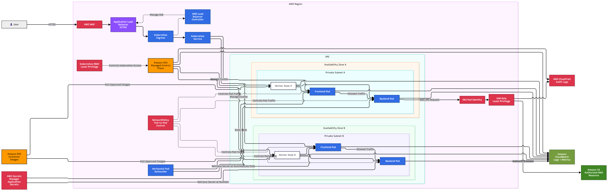

# Secure Kubernetes Architecture on AWS

## System Design Question

Design a secure Kubernetes architecture on AWS using Amazon EKS.

The environment should protect:

- External application traffic
- Kubernetes administrative access
- Pod-to-pod communication
- AWS permissions used by Pods
- Application secrets
- Container images
- Cluster logs and audit activity

---

## Architecture



---

## Architecture Overview

This architecture runs containerized applications on Amazon EKS while applying security controls at multiple layers.

The EKS control plane is managed by AWS.

Application workloads run on worker nodes located in private subnets across multiple Availability Zones.

External application traffic passes through AWS WAF and an Application Load Balancer before reaching Kubernetes workloads.

Inside the cluster, Kubernetes RBAC controls administrative permissions while NetworkPolicy restricts communication between workloads.

EKS Pod Identity provides secure IAM access to AWS services without storing permanent AWS credentials inside containers.

AWS Secrets Manager stores application secrets.

Amazon CloudWatch provides monitoring and logging, while AWS CloudTrail records AWS API activity for auditing.

---

## Main Components

- Amazon EKS
- Amazon ECR
- Application Load Balancer
- AWS WAF
- AWS Load Balancer Controller
- Kubernetes Ingress
- Kubernetes Service
- Kubernetes Pods
- Kubernetes RBAC
- Kubernetes NetworkPolicy
- EKS Pod Identity
- AWS IAM
- AWS Secrets Manager
- Amazon CloudWatch
- AWS CloudTrail

---

## External Traffic Security

The public application traffic follows:

```text
User
  ↓
AWS WAF
  ↓
Application Load Balancer
  ↓
Kubernetes Ingress
  ↓
Kubernetes Service
  ↓
Application Pods
```

AWS WAF helps block unwanted or malicious web requests before they reach the application.

The Application Load Balancer should use HTTPS for encrypted communication.

---

## Private Worker Nodes

Application workloads run on worker nodes inside private subnets.

```text
Availability Zone A
        ↓
Private Subnet A
        ↓
Worker Node
        ↓
Pods
```

```text
Availability Zone B
        ↓
Private Subnet B
        ↓
Worker Node
        ↓
Pods
```

Users do not directly access the worker nodes.

This reduces the attack surface of the Kubernetes environment.

---

## Kubernetes RBAC

Kubernetes Role-Based Access Control controls what users and service accounts can do inside the cluster.

Example:

```text
Developer
   ↓
Kubernetes RBAC
   ↓
Allowed Kubernetes Actions
```

A developer may be allowed to view Pods but not delete production resources.

The main principle is:

```text
Only give the permissions that are required.
```

---

## NetworkPolicy

By default, workloads should not be allowed to communicate with every other workload without a reason.

Kubernetes NetworkPolicy can restrict Pod-to-Pod communication.

Example:

```text
Frontend Pod
     ↓
Allowed
     ↓
Backend Pod
```

while another unnecessary connection can be blocked.

```text
Frontend Pod
     X
Database Administration Pod
```

This creates stronger isolation between workloads.

---

## Secure AWS Access from Pods

Applications often need access to AWS services such as:

- Amazon S3
- DynamoDB
- SQS
- Secrets Manager

Permanent AWS credentials should not be stored inside container images.

Use EKS Pod Identity.

```text
Application Pod
      ↓
EKS Pod Identity
      ↓
IAM Role
      ↓
AWS Service
```

Example:

```text
Backend Pod
    ↓
EKS Pod Identity
    ↓
IAM Role
    ↓
Amazon S3
```

The IAM role should follow least privilege.

---

## Secrets Management

Sensitive values should not be hard-coded into:

- Docker images
- Git repositories
- Application source code
- Kubernetes manifests

AWS Secrets Manager can store sensitive information.

```text
AWS Secrets Manager
        ↓
Application Pod
```

Examples include:

- Database passwords
- API keys
- Application credentials
- Third-party service tokens

The application retrieves the secret when required.

---

## Container Image Security

Container images are stored in Amazon ECR.

```text
Developer / CI Pipeline
        ↓
Amazon ECR
        ↓
EKS Worker Nodes
        ↓
Pods
```

Only approved images should be deployed into the cluster.

Security practices can include:

- Image vulnerability scanning
- Immutable image tags
- Limited ECR permissions
- Removing unnecessary packages
- Avoiding secrets inside images

---

## Load Balancer Security

The Application Load Balancer receives public application traffic.

```text
Internet
   ↓
AWS WAF
   ↓
Application Load Balancer
```

The load balancer should accept HTTPS traffic.

Worker nodes and Pods should not be directly exposed to the internet.

---

## AWS Load Balancer Controller

The AWS Load Balancer Controller integrates Kubernetes with AWS load balancing services.

```text
Kubernetes Ingress
        ↓
AWS Load Balancer Controller
        ↓
Application Load Balancer
```

This allows Kubernetes resources to automatically manage AWS load balancing configuration.

---

## Pod Scaling

The Horizontal Pod Autoscaler can increase or decrease the number of Pods.

```text
Traffic Increase
      ↓
HPA
      ↓
Additional Pods
```

Scaling helps maintain application availability during increased traffic.

---

## Monitoring

Amazon CloudWatch can collect information from:

```text
Amazon EKS
Worker Nodes
Pods
Applications
     ↓
CloudWatch
```

CloudWatch can monitor:

- Pod failures
- Application logs
- Worker node health
- CPU utilization
- Memory utilization
- Cluster events
- Application errors

---

## Audit Logging

AWS CloudTrail records AWS API activity.

```text
AWS API Activity
      ↓
CloudTrail
```

It can help answer questions such as:

- Who changed an IAM role?
- Who modified an EKS resource?
- When was an AWS resource changed?
- Which AWS API operation was performed?

This is important for security investigations and auditing.

---

## Defense in Depth

The architecture uses multiple security layers.

| Layer | Security Control |
|---|---|
| Internet | AWS WAF |
| Transport | HTTPS |
| Load Balancing | Application Load Balancer |
| Kubernetes Access | RBAC |
| Pod Communication | NetworkPolicy |
| AWS Access | EKS Pod Identity + IAM |
| Secrets | AWS Secrets Manager |
| Images | Amazon ECR |
| Monitoring | Amazon CloudWatch |
| Auditing | AWS CloudTrail |

No single security control protects the entire environment.

The controls work together as defense in depth.

---

## Security Flow

```text
User
 ↓
AWS WAF
 ↓
HTTPS ALB
 ↓
Ingress
 ↓
Kubernetes Service
 ↓
Application Pods
```

Internal security:

```text
RBAC
→ Kubernetes permissions

NetworkPolicy
→ Pod communication

Pod Identity
→ AWS permissions

Secrets Manager
→ Sensitive information

CloudWatch
→ Monitoring

CloudTrail
→ Auditing
```

---

## Important Security Principles

### Least Privilege

Users, Pods, and applications should receive only the permissions they require.

### Private Infrastructure

Worker nodes should remain inside private subnets.

### No Hard-Coded Credentials

AWS credentials and application secrets should not be stored inside application code or container images.

### Workload Isolation

NetworkPolicy should restrict unnecessary Pod-to-Pod communication.

### Centralized Monitoring

Security-relevant logs and metrics should be collected for investigation and troubleshooting.

### Auditing

Changes to AWS resources should be recorded through CloudTrail.

---

## Failure and Security Scenarios

### Unauthorized Kubernetes User

```text
User
 ↓
RBAC
 ↓
Access Denied
```

### Unauthorized Pod Communication

```text
Pod A
 ↓
NetworkPolicy
 ↓
Blocked
 ↓
Pod B
```

### Pod Needs AWS Access

```text
Pod
 ↓
EKS Pod Identity
 ↓
IAM Role
 ↓
Authorized AWS Resource
```

### Malicious Web Request

```text
Attacker
 ↓
AWS WAF
 ↓
Request Blocked
```

---

## Key Design Decisions

| Component | Purpose |
|---|---|
| Amazon EKS | Managed Kubernetes platform |
| Private Worker Nodes | Reduce public exposure |
| AWS WAF | Protect public web applications |
| ALB | Securely receives application traffic |
| Kubernetes Ingress | Routes incoming HTTP/HTTPS traffic |
| Kubernetes Service | Provides stable service networking |
| RBAC | Controls Kubernetes permissions |
| NetworkPolicy | Controls Pod-to-Pod communication |
| EKS Pod Identity | Provides secure AWS access to Pods |
| IAM Roles | Enforce least privilege |
| Secrets Manager | Protects application secrets |
| Amazon ECR | Stores container images |
| CloudWatch | Central monitoring and logs |
| CloudTrail | Records AWS API activity |

---

## Key Takeaway

A secure EKS environment should not rely on only one security feature.

The architecture combines:

```text
AWS WAF
+
Private Worker Nodes
+
Kubernetes RBAC
+
NetworkPolicy
+
EKS Pod Identity
+
Least-Privilege IAM
+
Secrets Manager
+
ECR
+
CloudWatch
+
CloudTrail
```

This creates multiple security layers around the Kubernetes cluster, workloads, identities, network communication, secrets, and AWS resources.