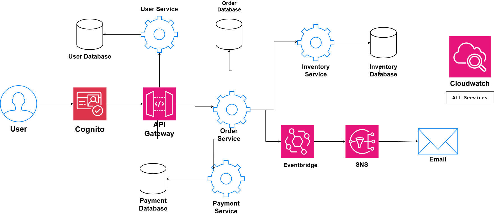

# Microservices Architecture

## System Design Question

Design a microservices architecture where a large application is divided into independent services.

The system should support:

- Independent deployment
- Independent scaling
- Authentication
- API routing
- Database isolation
- Synchronous service communication
- Asynchronous event-driven communication
- Failure isolation
- Centralized monitoring

---

## Architecture



---

## Architecture Overview

This architecture divides the application into multiple independent microservices.

Each microservice is responsible for a specific business capability.

The main services are:

- User Service
- Order Service
- Payment Service
- Inventory Service

Each service owns its own database.

Amazon Cognito provides authentication.

Amazon API Gateway acts as the main entry point and routes requests to the correct microservice.

Services communicate using both synchronous API calls and asynchronous events.

Amazon EventBridge and Amazon SNS are used for event-driven notification processing.

Amazon CloudWatch provides centralized monitoring.

---

## Main Components

- Amazon Cognito
- Amazon API Gateway
- User Service
- Order Service
- Payment Service
- Inventory Service
- User Database
- Order Database
- Payment Database
- Inventory Database
- Amazon EventBridge
- Amazon SNS
- Email Notification
- Amazon CloudWatch

---

## Main Request Flow

The public request flow is:

```text
User
 ↓
Amazon Cognito
 ↓
Amazon API Gateway
 ↓
Microservices
```

Amazon Cognito authenticates the user.

After authentication, API Gateway forwards requests to the correct service.

---

## API Routing

API Gateway can route requests based on URL paths.

Example:

```text
/users/*
   ↓
User Service

/orders/*
   ↓
Order Service

/payments/*
   ↓
Payment Service
```

This creates one common entry point while allowing each service to remain independent.

---

## User Service

The User Service manages user-related functionality.

```text
API Gateway
     ↓
User Service
     ↓
User Database
```

Possible responsibilities include:

- User profile management
- Account information
- User preferences
- User-related application data

The User Service owns the User Database.

---

## Order Service

The Order Service manages the order lifecycle.

```text
API Gateway
     ↓
Order Service
     ↓
Order Database
```

Possible responsibilities include:

- Creating orders
- Updating order status
- Processing order workflows
- Publishing order events

The Order Service owns the Order Database.

---

## Payment Service

The Payment Service handles payment operations.

```text
Order Service
      ↓
Payment Service
      ↓
Payment Database
```

Possible responsibilities include:

- Processing payments
- Recording payment status
- Handling payment failures
- Storing payment transaction information

The Payment Service owns the Payment Database.

---

## Inventory Service

The Inventory Service manages product availability.

```text
Order Service
      ↓
Inventory Service
      ↓
Inventory Database
```

Possible responsibilities include:

- Checking inventory
- Reserving products
- Updating stock quantity
- Reporting product availability

The Inventory Service owns the Inventory Database.

---

## Database Per Service

Each microservice has its own database.

```text
User Service
   ↓
User Database

Order Service
   ↓
Order Database

Payment Service
   ↓
Payment Database

Inventory Service
   ↓
Inventory Database
```

This reduces coupling between services.

A service should not directly modify another service's database.

Instead, services communicate through APIs or events.

---

## Synchronous Communication

Some operations require an immediate response.

For example:

```text
Order Service
      ↓
Inventory Service
```

The Order Service may need to confirm that an item is available before completing an order.

Another example:

```text
Order Service
      ↓
Payment Service
```

The Order Service may need an immediate payment result.

This communication can use:

```text
REST API / HTTP
```

---

## Asynchronous Communication

Not every action needs an immediate response.

After an order is processed, the Order Service can publish an event.

```text
Order Service
      ↓
Amazon EventBridge
      ↓
Amazon SNS
      ↓
Email
```

The Order Service does not need to wait for the email notification to finish.

This improves decoupling and reliability.

---

## Event-Driven Notification Flow

The notification flow is:

```text
Order Completed
      ↓
Order Service
      ↓
EventBridge
      ↓
SNS
      ↓
Email Notification
```

EventBridge routes the event.

SNS delivers the notification to subscribers.

The notification system can operate independently from the main order-processing flow.

---

## Synchronous vs Asynchronous Communication

| Communication Type | Example | When to Use |
|---|---|---|
| Synchronous | Order → Inventory | Immediate response required |
| Synchronous | Order → Payment | Immediate result required |
| Asynchronous | Order → EventBridge | Immediate response not required |
| Asynchronous | EventBridge → SNS | Event distribution |
| Asynchronous | SNS → Email | Background notification |

---

## Failure Isolation

Microservices should fail independently.

For example:

```text
Notification Failure
      ↓
Order Service Still Works
```

If email delivery fails, the entire ordering system should not stop.

Event-driven communication helps isolate failures.

```text
Order Service
      ↓
EventBridge
      ↓
SNS
      ↓
Email Service Failure
```

The core order processing can continue independently.

---

## Independent Scaling

Each service can scale based on its own traffic.

Example:

```text
User Service
→ 2 instances

Order Service
→ 10 instances

Payment Service
→ 4 instances

Inventory Service
→ 3 instances
```

The Order Service may receive much more traffic than the User Service.

Microservices allow each component to scale separately.

---

## Authentication

Amazon Cognito handles user authentication.

```text
User
 ↓
Amazon Cognito
 ↓
Authentication Token
 ↓
API Gateway
```

Only authenticated requests should access protected APIs.

This keeps authentication separate from individual business services.

---

## Monitoring

Amazon CloudWatch provides centralized monitoring.

```text
User Service ───────┐
Order Service ──────┤
Payment Service ────┤
Inventory Service ──┤
Event Processing ───┤
                    ↓
               CloudWatch
```

CloudWatch can monitor:

- Application logs
- Errors
- Request latency
- API failures
- Service health
- Event processing failures
- CPU and memory usage
- Request volume

---

## Benefits of the Architecture

### Independent Deployment

Each microservice can be updated without redeploying the entire application.

### Independent Scaling

High-traffic services can scale without scaling every component.

### Failure Isolation

A failure in one service does not automatically bring down the entire system.

### Database Isolation

Each service owns its own data.

### Loose Coupling

Event-driven communication reduces dependencies between services.

### Easier Team Ownership

Different teams can own different microservices.

---

## Tradeoffs

Microservices provide flexibility, but they also add complexity.

Common challenges include:

- More network communication
- Distributed debugging
- Data consistency
- Service discovery
- Monitoring many services
- Managing API contracts
- Handling partial failures

Microservices should be used when the benefits justify this additional complexity.

---

## Architecture Flow Summary

### External Request Flow

```text
User
 ↓
Cognito
 ↓
API Gateway
 ↓
Microservices
```

### Service Communication

```text
Order Service
   ├──→ Inventory Service
   └──→ Payment Service
```

### Event-Driven Communication

```text
Order Service
      ↓
EventBridge
      ↓
SNS
      ↓
Email
```

### Data Ownership

```text
Each Service
     ↓
Own Database
```

### Monitoring

```text
All Services
     ↓
CloudWatch
```

---

## Key Design Decisions

| Component | Purpose |
|---|---|
| Cognito | User authentication |
| API Gateway | Main API entry point |
| User Service | User-related business logic |
| Order Service | Order processing |
| Payment Service | Payment processing |
| Inventory Service | Inventory management |
| Separate Databases | Service data ownership |
| REST / HTTP | Synchronous communication |
| EventBridge | Event routing |
| SNS | Notification distribution |
| CloudWatch | Centralized monitoring |

---

## Key Takeaway

The architecture follows the main microservices principles:

```text
Independent Services
+
Database Per Service
+
API-Based Communication
+
Event-Driven Communication
+
Independent Scaling
+
Failure Isolation
+
Centralized Monitoring
```

The core request flow is:

```text
User
→ Authentication
→ API Gateway
→ Independent Microservices
→ Independent Databases
```

while background events use:

```text
Microservice
→ EventBridge
→ SNS
→ Notification
```

This design creates a scalable, modular, and loosely coupled application architecture.