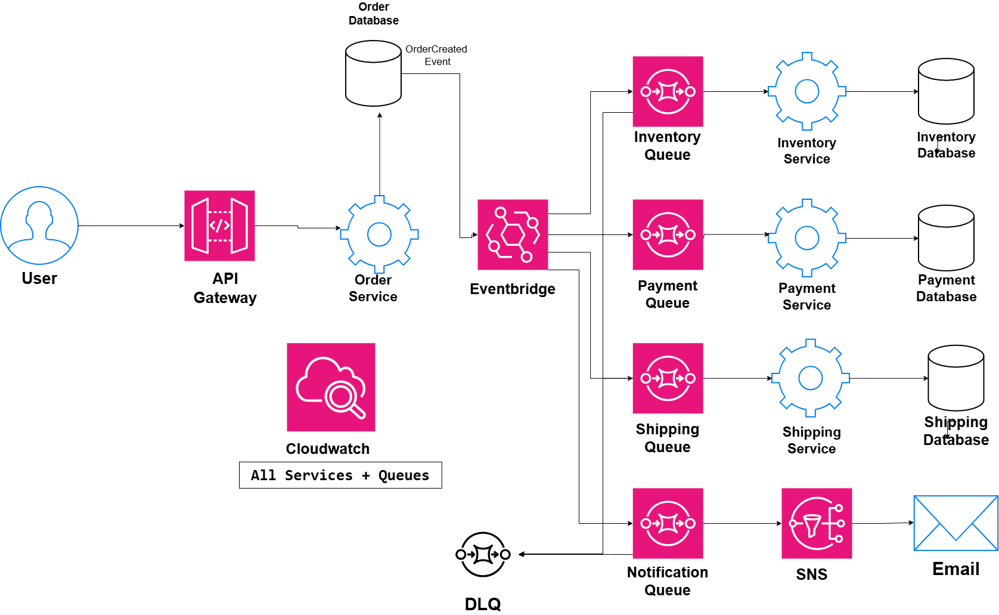

# Decoupled Microservices Architecture

## System Design Question

Design a decoupled microservices architecture where services communicate mainly through events and message queues instead of depending heavily on direct service-to-service calls.

The architecture should provide:

- Loose coupling
- Asynchronous processing
- Independent microservices
- Independent databases
- Queue-based buffering
- Retry handling
- Dead-letter queues
- Failure isolation
- Event-driven communication
- Centralized monitoring

---

## Architecture



---

## Architecture Overview

This architecture uses Amazon EventBridge and Amazon SQS to reduce direct dependencies between microservices.

The main services include:

- Order Service
- Inventory Service
- Payment Service
- Shipping Service
- Notification Service

The Order Service creates an order and publishes an event instead of directly calling every downstream service.

Amazon EventBridge receives the event and routes it to separate Amazon SQS queues.

Each microservice consumes messages from its own queue and processes them independently.

This allows services to continue operating even when another service is temporarily unavailable.

---

## Main Components

- Amazon API Gateway
- Order Service
- Inventory Service
- Payment Service
- Shipping Service
- Notification Service
- Amazon EventBridge
- Amazon SQS
- Dead-Letter Queue
- Amazon SNS
- Amazon CloudWatch
- Independent Databases

---

## Main Request Flow

The initial request follows:

```text
User
 ↓
API Gateway
 ↓
Order Service
 ↓
Order Database
```

The Order Service processes the incoming request and stores the order.

After the order is created, it publishes an event.

```text
Order Service
      ↓
OrderCreated Event
      ↓
Amazon EventBridge
```

The Order Service does not directly call every downstream service.

---

## Event-Driven Communication

Amazon EventBridge acts as the central event router.

```text
Order Service
      ↓
EventBridge
      ↓
Multiple SQS Queues
```

EventBridge can route events to:

```text
Inventory Queue
Payment Queue
Shipping Queue
Notification Queue
```

Each queue is consumed independently.

---

## Inventory Processing

Inventory processing follows:

```text
EventBridge
    ↓
Inventory Queue
    ↓
Inventory Service
    ↓
Inventory Database
```

The Inventory Service can:

- Check product availability
- Reserve inventory
- Update stock
- Store inventory changes

If Inventory Service is temporarily unavailable, messages remain in the queue until they can be processed.

---

## Payment Processing

Payment processing follows:

```text
EventBridge
    ↓
Payment Queue
    ↓
Payment Service
    ↓
Payment Database
```

The Payment Service can:

- Process payments
- Record payment status
- Handle payment failures
- Publish payment-related events

Payment processing is separated from the main Order Service.

---

## Shipping Processing

Shipping follows:

```text
EventBridge
    ↓
Shipping Queue
    ↓
Shipping Service
    ↓
Shipping Database
```

The Shipping Service can process shipping requests independently.

Possible responsibilities include:

- Creating shipments
- Selecting shipping methods
- Updating shipping status
- Tracking delivery information

---

## Notification Processing

Notifications should be asynchronous.

```text
EventBridge
    ↓
Notification Queue
    ↓
Notification Service
    ↓
Amazon SNS
    ↓
Email
```

The main order workflow does not need to wait for email delivery.

This is useful because notification failures should not stop order processing.

---

## Why Use Queues?

Amazon SQS acts as a buffer between the event producer and the consumer.

```text
EventBridge
    ↓
SQS Queue
    ↓
Microservice
```

If the microservice becomes unavailable:

```text
Message
  ↓
SQS Queue
  ↓
Waits Until Consumer Recovers
```

The producer does not need the consumer to be online at the same time.

This greatly reduces coupling.

---

## Retry Handling

When a microservice fails to process a message, SQS can make the message available again.

```text
Queue
  ↓
Service
  ↓
Processing Failure
  ↓
Retry
```

The message can be retried several times.

---

## Dead-Letter Queue

Messages that repeatedly fail processing should not remain in the main queue forever.

After the configured retry limit, failed messages are moved to a Dead-Letter Queue.

```text
Main Queue
   ↓
Processing Failure
   ↓
Retry
   ↓
Retry
   ↓
Retry
   ↓
Dead-Letter Queue
```

The DLQ allows engineers to inspect failed messages without blocking normal processing.

In a production environment, important queues can have separate DLQs.

For example:

```text
Inventory Queue
→ Inventory DLQ

Payment Queue
→ Payment DLQ

Shipping Queue
→ Shipping DLQ

Notification Queue
→ Notification DLQ
```

The architecture diagram can simplify these into one DLQ concept.

---

## Database Per Service

Each service owns its own database.

```text
Order Service
   ↓
Order Database
```

```text
Inventory Service
   ↓
Inventory Database
```

```text
Payment Service
   ↓
Payment Database
```

```text
Shipping Service
   ↓
Shipping Database
```

A microservice should not directly change another service's database.

This helps keep services independent.

---

## Loose Coupling

The most important idea in this architecture is that the producer does not directly depend on the consumer.

Instead of:

```text
Order Service
    ↓
Inventory Service
    ↓
Payment Service
    ↓
Shipping Service
```

the design uses:

```text
Order Service
    ↓
EventBridge
    ↓
SQS Queues
    ↓
Independent Services
```

The Order Service does not need to know:

- Where each service runs
- How many service instances exist
- Whether a service is temporarily offline
- How long each service takes to process a message

---

## Failure Isolation

Suppose the Notification Service is unavailable.

The main order request can still complete.

```text
Order Service
    ↓
EventBridge
    ↓
Notification Queue
    ↓
Message Waits
```

When Notification Service recovers:

```text
Notification Queue
      ↓
Notification Service
      ↓
SNS
      ↓
Email
```

This prevents one service failure from breaking the entire application.

---

## Service Independence

Each consumer can scale independently.

Example:

```text
Inventory Service
→ 3 instances

Payment Service
→ 8 instances

Shipping Service
→ 2 instances

Notification Service
→ 5 instances
```

A high load on Payment Service does not require every other service to scale.

---

## Monitoring

Amazon CloudWatch provides centralized monitoring.

```text
Services
+
Queues
+
EventBridge
   ↓
CloudWatch
```

CloudWatch can monitor:

- Queue depth
- Number of messages waiting
- DLQ messages
- Service errors
- Processing latency
- Failed events
- Retry activity
- EventBridge delivery failures
- Application logs

---

## Queue Depth

Queue depth is an important metric.

For example:

```text
Normal Traffic
Queue Messages = 10
```

During high traffic:

```text
Queue Messages = 10,000
```

A growing queue can indicate that consumers cannot process messages fast enough.

This can be used as a scaling signal.

---

## Main Event Flow

```text
User
 ↓
API Gateway
 ↓
Order Service
 ↓
Order Database
 ↓
OrderCreated Event
 ↓
EventBridge
```

EventBridge then distributes work:

```text
EventBridge
 ├──→ Inventory Queue
 │       ↓
 │   Inventory Service
 │       ↓
 │   Inventory Database
 │
 ├──→ Payment Queue
 │       ↓
 │   Payment Service
 │       ↓
 │   Payment Database
 │
 ├──→ Shipping Queue
 │       ↓
 │   Shipping Service
 │       ↓
 │   Shipping Database
 │
 └──→ Notification Queue
         ↓
     Notification Service
         ↓
        SNS
         ↓
       Email
```

---

## Failure Flow

```text
EventBridge
    ↓
SQS Queue
    ↓
Microservice
    ↓
Failure
    ↓
Retry
    ↓
Retry Limit Reached
    ↓
DLQ
```

This prevents poison messages from blocking the main queue forever.

---

## EventBridge vs SQS

| Service | Main Purpose |
|---|---|
| EventBridge | Routes events |
| SQS | Buffers work for consumers |
| DLQ | Stores repeatedly failed messages |
| SNS | Distributes notifications |

EventBridge decides where an event should go.

SQS holds the work until a consumer can process it.

---

## Synchronous vs Decoupled Architecture

### Tightly Coupled

```text
Order
 ↓
Inventory
 ↓
Payment
 ↓
Shipping
 ↓
Notification
```

A failure can propagate through the entire chain.

### Decoupled

```text
Order
 ↓
EventBridge
 ↓
Queues
 ↓
Independent Consumers
```

A consumer can fail without immediately breaking the producer.

---

## Key Design Decisions

| Component | Purpose |
|---|---|
| API Gateway | Application entry point |
| Order Service | Creates and manages orders |
| EventBridge | Routes business events |
| SQS | Buffers asynchronous work |
| Inventory Service | Processes inventory events |
| Payment Service | Processes payment events |
| Shipping Service | Processes shipping events |
| Notification Service | Processes notifications |
| SNS | Sends notifications |
| DLQ | Stores repeatedly failed messages |
| Separate Databases | Provides service data ownership |
| CloudWatch | Monitoring and troubleshooting |

---

## Benefits

### Loose Coupling

Services do not need direct knowledge of every other service.

### Failure Isolation

One unavailable consumer does not automatically break the entire workflow.

### Better Scalability

Each service can scale based on its own queue workload.

### Improved Reliability

Messages remain available when consumers temporarily fail.

### Independent Deployment

Services can be developed and deployed separately.

### Better Recovery

Failed messages can be investigated through dead-letter queues.

---

## Tradeoffs

A decoupled architecture also introduces additional complexity.

Examples include:

- Eventual consistency
- Duplicate message handling
- Event schema management
- Distributed tracing
- DLQ operations
- Retry strategy
- Event ordering
- More complex debugging

Consumers should be designed to safely handle duplicate messages where possible.

---

## Key Takeaway

The core architecture is:

```text
Producer
  ↓
EventBridge
  ↓
SQS Queue
  ↓
Independent Consumer
```

with reliability provided by:

```text
Retries
+
Dead-Letter Queue
+
CloudWatch Monitoring
```

and service independence provided by:

```text
Independent Microservices
+
Independent Queues
+
Independent Databases
```

This architecture reduces tight dependencies and creates a more scalable, fault-tolerant, and resilient microservices system.