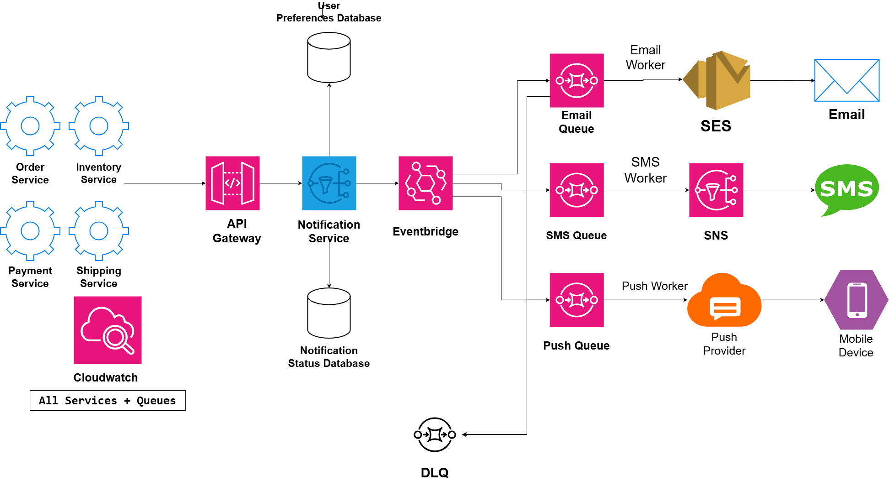

# Notification System

## System Design Question

Design a centralized notification system that can send:

- Email
- SMS
- Push notifications

The system should support:

- Multiple producer applications
- Asynchronous processing
- Independent delivery channels
- User notification preferences
- Notification status tracking
- Retry handling
- Dead-letter queues
- Centralized monitoring

---

## Architecture



---

## Architecture Overview

This architecture provides one centralized notification platform for multiple application services.

Example producers include:

- Order Service
- Inventory Service
- Payment Service
- Shipping Service

Instead of sending notifications directly, these services send notification requests to the centralized Notification Service.

The Notification Service checks user preferences, records notification status, and publishes notification events to Amazon EventBridge.

EventBridge routes the events to separate queues for:

- Email
- SMS
- Push notifications

Each delivery channel processes notifications independently.

This improves scalability, reliability, and failure isolation.

---

## Main Components

- Amazon API Gateway
- Notification Service
- Amazon EventBridge
- Amazon SQS
- Amazon SES
- Amazon SNS
- Push Notification Provider
- User Preferences Database
- Notification Status Database
- Dead-Letter Queue
- Amazon CloudWatch

---

## Producer Services

Different application services can request notifications.

```text
Order Service
Inventory Service
Payment Service
Shipping Service
       ↓
API Gateway
```

These producer services do not need to know how email, SMS, or push delivery works.

They only send a notification request.

---

## Notification Entry Point

The main request flow is:

```text
Application Service
        ↓
API Gateway
        ↓
Notification Service
```

The Notification Service acts as the central notification coordinator.

It can determine:

- Recipient
- Notification type
- Message content
- Preferred delivery channel
- Notification priority

---

## User Preferences

The Notification Service reads user preferences before choosing a delivery channel.

```text
Notification Service
        ↓
User Preferences Database
```

Example preferences:

```text
Email = Enabled
SMS   = Disabled
Push  = Enabled
```

This prevents notifications from being sent through channels the user has disabled.

---

## Notification Status Tracking

The system stores notification status separately.

```text
Notification Service
        ↓
Notification Status Database
```

Example statuses:

```text
QUEUED
PROCESSING
SENT
DELIVERED
FAILED
```

This helps with:

- Troubleshooting
- Delivery tracking
- Retry decisions
- User-visible notification history

---

## Event-Driven Processing

After validation, the Notification Service publishes an event.

```text
Notification Service
        ↓
Amazon EventBridge
```

EventBridge routes the notification to the correct delivery queue.

```text
                  EventBridge
                 /     |      \
                ↓      ↓       ↓
          Email Queue SMS Queue Push Queue
```

This keeps the delivery channels independent.

---

## Email Notification Flow

Email notifications follow:

```text
Email Queue
    ↓
Email Worker
    ↓
Amazon SES
    ↓
Email
```

Amazon SES handles email delivery.

The Email Worker processes messages independently from SMS and push notifications.

---

## SMS Notification Flow

SMS notifications follow:

```text
SMS Queue
   ↓
SMS Worker
   ↓
Amazon SNS
   ↓
SMS
```

The SMS worker consumes notification requests from its own queue.

Problems with SMS delivery do not stop email or push processing.

---

## Push Notification Flow

Push notifications follow:

```text
Push Queue
    ↓
Push Worker
    ↓
Push Notification Provider
    ↓
Mobile Device
```

The provider sends the message to the user's device.

---

## Why Separate Queues?

Each notification channel uses its own queue.

```text
Email Queue

SMS Queue

Push Queue
```

This provides failure isolation.

For example:

```text
SMS Delivery Failure
       ≠
Email Delivery Failure
```

If the SMS system is unavailable, email and push notifications can continue processing.

---

## Independent Scaling

Each notification channel can scale independently.

Example:

```text
Email Workers
→ 10 instances

SMS Workers
→ 3 instances

Push Workers
→ 20 instances
```

If push traffic increases heavily, only the push-processing capacity needs to increase.

---

## Retry Handling

If delivery fails, the message can be retried.

Example:

```text
Email Queue
    ↓
Email Worker
    ↓
Delivery Failure
    ↓
Retry
```

The same behavior applies to SMS and push notifications.

Temporary failures do not immediately cause message loss.

---

## Dead-Letter Queue

Messages that repeatedly fail should eventually move to a Dead-Letter Queue.

```text
Email Queue ────┐
SMS Queue ──────┼──→ DLQ
Push Queue ─────┘
```

The move happens after the configured retry limit is reached.

The DLQ allows engineers to inspect failed messages separately.

---

## Failure Isolation

Suppose the SMS provider becomes unavailable.

```text
SMS Queue
   ↓
SMS Worker
   ↓
Provider Failure
   ↓
Retry
```

Email and push processing can continue normally.

This is one of the major advantages of asynchronous notification architecture.

---

## Monitoring

Amazon CloudWatch provides centralized monitoring.

```text
Notification Service
EventBridge
Email Queue
SMS Queue
Push Queue
Workers
DLQ
   ↓
CloudWatch
```

CloudWatch can monitor:

- Queue depth
- Failed notifications
- DLQ messages
- Email failures
- SMS failures
- Push failures
- Processing latency
- Delivery success rate
- Worker errors

---

## Queue Depth

Queue depth is an important operational metric.

Example:

```text
Email Queue
Messages Waiting = 20
```

During heavy traffic:

```text
Email Queue
Messages Waiting = 20,000
```

A growing queue may indicate that processing capacity is too low.

This can be used as an auto-scaling signal.

---

## Centralized Notification Pattern

Without a centralized notification system, different services may directly call delivery providers.

Example:

```text
Order Service → SES
Payment Service → SNS
Shipping Service → Push Provider
```

This creates duplicated logic and tighter coupling.

A better design is:

```text
Application Services
        ↓
Notification Service
        ↓
EventBridge
        ↓
Delivery Queues
        ↓
Workers
        ↓
Providers
```

This keeps notification logic in one place.

---

## Main Architecture Flow

```text
Order Service
Inventory Service
Payment Service
Shipping Service
       ↓
API Gateway
       ↓
Notification Service
       ↓
EventBridge
```

Then:

```text
EventBridge
 ├──→ Email Queue
 │        ↓
 │    Email Worker
 │        ↓
 │       SES
 │        ↓
 │      Email
 │
 ├──→ SMS Queue
 │        ↓
 │     SMS Worker
 │        ↓
 │       SNS
 │        ↓
 │       SMS
 │
 └──→ Push Queue
          ↓
      Push Worker
          ↓
      Push Provider
          ↓
      Mobile Device
```

---

## Data Flow

The Notification Service also interacts with:

```text
Notification Service
   ├──→ User Preferences Database
   └──→ Notification Status Database
```

This allows the system to decide how notifications should be sent and track their lifecycle.

---

## Failure Flow

```text
Queue
 ↓
Worker
 ↓
Delivery Provider
 ↓
Failure
 ↓
Retry
 ↓
Retry Limit Reached
 ↓
DLQ
```

This prevents failed messages from being silently lost.

---

## Security Considerations

The architecture should follow these practices:

- Use least-privilege IAM permissions
- Do not store provider credentials in source code
- Encrypt sensitive notification data
- Protect notification APIs
- Restrict access to notification records
- Monitor unusual notification volume
- Avoid exposing sensitive information in logs

---

## Key Design Decisions

| Component | Purpose |
|---|---|
| API Gateway | Receives notification requests |
| Notification Service | Central notification coordinator |
| Preferences Database | Stores user channel preferences |
| Status Database | Tracks notification lifecycle |
| EventBridge | Routes notification events |
| Email Queue | Buffers email requests |
| SMS Queue | Buffers SMS requests |
| Push Queue | Buffers push requests |
| Email Worker | Processes email notifications |
| SMS Worker | Processes SMS notifications |
| Push Worker | Processes push notifications |
| Amazon SES | Sends email |
| Amazon SNS | Sends SMS |
| Push Provider | Sends mobile push notifications |
| DLQ | Stores repeatedly failed messages |
| CloudWatch | Monitoring and alerting |

---

## Benefits

### Loose Coupling

Producer applications do not directly depend on notification providers.

### Scalability

Email, SMS, and push channels can scale independently.

### Reliability

Queues protect notifications during temporary service failures.

### Failure Isolation

A failure in one notification channel does not stop the others.

### User Control

Notification preferences determine which channels should be used.

### Delivery Tracking

Notification state can be stored and monitored.

---

## Tradeoffs

This design also introduces additional complexity.

Examples include:

- Duplicate message handling
- Retry management
- DLQ operations
- Delivery-provider failures
- Eventual consistency
- Message ordering
- Tracking delivery status across providers

Workers should be designed to handle repeated messages safely.

---

## Key Takeaway

The main architecture is:

```text
Producer Services
      ↓
Notification Service
      ↓
EventBridge
      ↓
Separate Queues
      ↓
Independent Workers
      ↓
Delivery Providers
```

with reliability provided by:

```text
Retries
+
Dead-Letter Queue
+
CloudWatch Monitoring
```

and user control provided by:

```text
Preferences Database
+
Notification Status Tracking
```

This creates a scalable, asynchronous, reliable, and centralized notification platform.