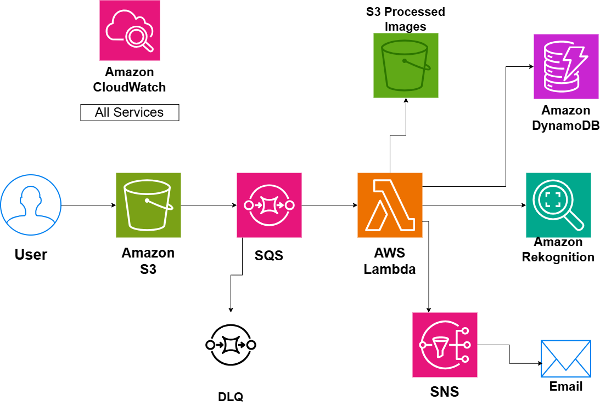

# Image Processing Pipeline

## System Design Question

Design an event-driven image processing pipeline on AWS.

Users should be able to upload images, after which the system should automatically:

- Detect the upload
- Queue the processing job
- Process the image asynchronously
- Store the processed image
- Analyze the image
- Store metadata and processing status
- Send a completion notification
- Retry failed processing
- Move repeatedly failed jobs to a Dead-Letter Queue
- Monitor the entire pipeline

---

## Architecture



---

## Architecture Overview

This architecture provides a scalable and asynchronous image processing system.

Users upload original images to Amazon S3.

An upload event sends a processing job to Amazon SQS.

AWS Lambda consumes messages from the queue and performs image-processing operations.

The Lambda function can:

- Resize images
- Compress images
- Generate thumbnails
- Convert image formats
- Extract metadata

Processed images are stored in a separate S3 bucket.

Amazon Rekognition can analyze images and return information such as detected objects or labels.

Amazon DynamoDB stores metadata and processing status.

Amazon SNS sends a completion notification.

Amazon CloudWatch provides monitoring for the entire pipeline.

---

## Main AWS Services

- Amazon S3
- Amazon SQS
- AWS Lambda
- Amazon Rekognition
- Amazon DynamoDB
- Amazon SNS
- Amazon CloudWatch
- Amazon SQS Dead-Letter Queue

---

## Main Processing Flow

The core processing path is:

```text
User
 ↓
S3 Raw Images
 ↓
SQS Processing Queue
 ↓
AWS Lambda
 ↓
Image Processing
```

After Lambda processes the image, several actions can happen.

```text
AWS Lambda
 ├──→ S3 Processed Images
 ├──→ Amazon Rekognition
 ├──→ Amazon DynamoDB
 └──→ Amazon SNS
```

---

## Image Upload

The user uploads the original image to Amazon S3.

```text
User
 ↓
S3 Raw Images
```

The raw bucket stores the original uploaded files.

Example objects:

```text
uploads/image-001.jpg
uploads/image-002.png
uploads/image-003.jpeg
```

The original image can remain unchanged for future reprocessing if needed.

---

## Upload Event

When a new image is uploaded, the system creates a processing job.

```text
S3 Raw Images
      ↓
Object Created Event
      ↓
SQS Processing Queue
```

The processing worker does not need to run immediately at the exact moment the image is uploaded.

SQS buffers the jobs.

---

## Why Use SQS?

Using SQS between S3 and Lambda provides decoupling.

```text
S3
 ↓
SQS
 ↓
Lambda
```

This is more resilient than tightly connecting every upload directly to image processing.

SQS provides:

- Message buffering
- Retry support
- Traffic smoothing
- Failure isolation
- Better handling of processing spikes

---

## Traffic Spike Example

Suppose thousands of users upload images at the same time.

```text
50,000 Image Uploads
        ↓
       SQS
        ↓
Processing Queue
        ↓
Lambda Workers
```

The queue stores the jobs until processing capacity becomes available.

This prevents the upload system from depending on immediate processing capacity.

---

## Image Processing Lambda

AWS Lambda performs the image-processing work.

```text
SQS
 ↓
Image Processing Lambda
```

Possible tasks include:

- Resize an image
- Generate thumbnails
- Compress files
- Convert image format
- Extract dimensions
- Add watermarks
- Validate image type

Lambda provides serverless compute, so there are no application servers to manage.

---

## Processed Image Storage

After successful processing, Lambda writes the result to another S3 bucket.

```text
AWS Lambda
    ↓
S3 Processed Images
```

This separates original images from processed output.

For example:

```text
Raw Bucket
uploads/photo.jpg
```

can produce:

```text
Processed Bucket
thumbnails/photo.jpg
optimized/photo.jpg
```

---

## Raw vs Processed Storage

```text
S3 Raw Images
→ Original user uploads

S3 Processed Images
→ Resized / compressed / transformed files
```

Keeping them separate makes the processing lifecycle easier to manage.

---

## Image Analysis

AWS Lambda can send an image to Amazon Rekognition.

```text
AWS Lambda
    ↓
Amazon Rekognition
```

Rekognition can perform image analysis such as:

- Object detection
- Label detection
- Text detection
- Face detection
- Content moderation

For example:

```text
Image
 ↓
Rekognition
 ↓
Labels

Person
Car
Building
Outdoor
```

---

## Metadata Storage

Amazon DynamoDB stores information about each image.

```text
AWS Lambda
    ↓
Amazon DynamoDB
```

Possible metadata:

```text
image_id
original_path
processed_path
status
detected_labels
upload_time
processing_time
```

Example:

```text
image_id = img-001
status = COMPLETED
processed_path = processed/img-001.jpg
labels = Person, Outdoor
```

---

## Processing Status

Useful image states include:

```text
UPLOADED
QUEUED
PROCESSING
COMPLETED
FAILED
```

DynamoDB can store the current state of each processing job.

This helps applications show processing progress to users.

---

## Completion Notification

After processing completes, Lambda can publish a message to Amazon SNS.

```text
AWS Lambda
    ↓
Amazon SNS
    ↓
Email
```

Example notification:

```text
Image processing completed successfully.
```

This can notify:

- Users
- Administrators
- Downstream systems

---

## Retry Handling

If Lambda cannot successfully process a message, the message can become available again in SQS.

```text
SQS
 ↓
Lambda
 ↓
Failure
 ↓
Retry
```

Temporary problems do not immediately result in lost processing jobs.

---

## Dead-Letter Queue

Messages that repeatedly fail should eventually move to a Dead-Letter Queue.

```text
SQS Processing Queue
        ↓
Processing Failure
        ↓
Retry
        ↓
Retry
        ↓
Retry Limit Reached
        ↓
DLQ
```

The DLQ keeps failed jobs separate from normal processing.

Engineers can later inspect and reprocess them.

---

## Failure Example

Suppose an uploaded file is corrupted.

```text
Corrupted Image
      ↓
SQS
      ↓
Lambda
      ↓
Processing Failure
      ↓
Retries
      ↓
DLQ
```

The bad file does not prevent valid images from continuing through the pipeline.

---

## Automatic Scaling

AWS Lambda automatically scales based on incoming work.

Conceptually:

```text
More SQS Messages
       ↓
More Lambda Concurrency
       ↓
More Images Processed
```

This makes the architecture suitable for workloads where upload traffic changes significantly over time.

---

## Monitoring

Amazon CloudWatch monitors the processing pipeline.

```text
S3
SQS
Lambda
DynamoDB
Rekognition
SNS
DLQ
 ↓
CloudWatch
```

Important metrics include:

- Lambda errors
- Lambda duration
- Lambda throttles
- SQS queue depth
- Age of oldest message
- DLQ message count
- Processing failures
- Rekognition errors
- Notification failures

---

## Queue Depth

Queue depth indicates how much processing work is waiting.

Normal situation:

```text
SQS Queue
10 Messages
```

High traffic:

```text
SQS Queue
10,000 Messages
```

If the queue continues growing, processing capacity may not be keeping up with incoming uploads.

---

## Failure Isolation

The queue separates image upload from image processing.

Without a queue:

```text
User Upload
   ↓
Processing Failure
   ↓
Upload Experience Affected
```

With SQS:

```text
User Upload
   ↓
S3
   ↓
SQS
   ↓
Processing Happens Independently
```

This improves reliability.

---

## Event-Driven Architecture

The system is event-driven.

```text
Image Uploaded
      ↓
S3 Event
      ↓
SQS Message
      ↓
Lambda Processing
```

Services react to events instead of constantly checking for new work.

---

## Main Architecture Flow

```text
User
 ↓
S3 Raw Images
 ↓
SQS Processing Queue
 ↓
AWS Lambda
```

Then:

```text
AWS Lambda
 ├──→ S3 Processed Images
 ├──→ Amazon Rekognition
 ├──→ Amazon DynamoDB
 └──→ Amazon SNS
             ↓
           Email
```

Failure handling:

```text
SQS
 ↓
Retries
 ↓
DLQ
```

Monitoring:

```text
All Services
     ↓
CloudWatch
```

---

## Security Considerations

The architecture should follow good security practices.

Examples:

- S3 buckets should not be publicly writable
- Use least-privilege IAM roles
- Encrypt S3 objects
- Encrypt SQS messages
- Encrypt DynamoDB data
- Restrict Lambda permissions
- Do not store credentials in Lambda source code
- Log important failures
- Limit who can access raw images
- Limit who can access processed images

---

## Key Design Decisions

| Component | Purpose |
|---|---|
| S3 Raw Images | Stores original uploads |
| SQS | Buffers processing jobs |
| Lambda | Processes images |
| S3 Processed Images | Stores transformed output |
| Rekognition | Performs image analysis |
| DynamoDB | Stores metadata and status |
| SNS | Sends completion notifications |
| DLQ | Stores repeatedly failed jobs |
| CloudWatch | Monitoring and troubleshooting |

---

## Benefits

### Asynchronous Processing

Users do not have to wait for image processing to complete during upload.

### Scalability

Lambda can scale processing capacity automatically.

### Reliability

SQS buffers jobs when processing is slow or temporarily unavailable.

### Failure Isolation

A failed image does not stop other images from being processed.

### AI Integration

Rekognition provides image-analysis capabilities.

### Processing Tracking

DynamoDB can track the current status of every image.

---

## Tradeoffs

This architecture also introduces some challenges:

- Eventual consistency
- Duplicate message processing
- Lambda concurrency management
- Large-image processing limits
- DLQ operations
- Retry tuning
- Processing cost
- Monitoring multiple asynchronous components

The Lambda processor should be designed to safely handle duplicate messages.

---

## Key Takeaway

The core pipeline is:

```text
User
 ↓
S3 Raw Images
 ↓
SQS
 ↓
Lambda
 ↓
S3 Processed Images
```

with additional processing through:

```text
Lambda
→ Rekognition
→ DynamoDB
→ SNS
```

and reliability through:

```text
SQS
+
Retries
+
DLQ
+
CloudWatch
```

This creates a scalable, asynchronous, event-driven image processing platform on AWS.