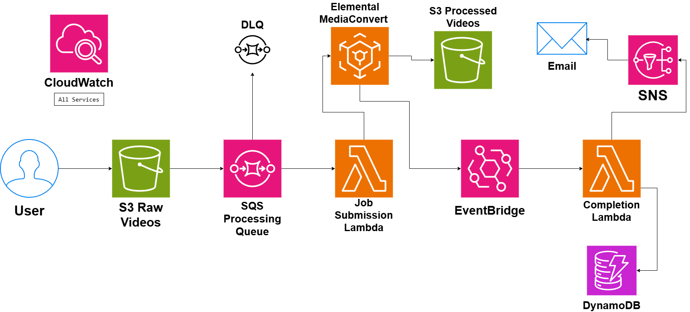

# Video Processing Architecture

## System Design Question

Design a scalable and asynchronous video-processing architecture on AWS.

Users should be able to upload videos, after which the system should automatically:

- Store the original video
- Queue the processing job
- Submit a transcoding job
- Generate processed video outputs
- Track processing status
- Notify the user when processing completes
- Retry failed jobs
- Move repeatedly failed jobs to a Dead-Letter Queue
- Monitor the complete pipeline

---

## Architecture



---

## Architecture Overview

This architecture provides an asynchronous video-processing pipeline using managed AWS services.

Users upload raw videos to Amazon S3.

Amazon SQS buffers the processing jobs.

A Job Submission Lambda consumes messages from the queue and submits video-processing jobs to AWS Elemental MediaConvert.

MediaConvert performs the heavy video-transcoding work and stores processed videos in a separate Amazon S3 bucket.

MediaConvert job-status events are sent to Amazon EventBridge.

EventBridge invokes a Completion Lambda when processing finishes or fails.

The Completion Lambda updates the processing status in Amazon DynamoDB and sends a notification through Amazon SNS.

Amazon CloudWatch provides centralized monitoring.

---

## Main AWS Services

- Amazon S3
- Amazon SQS
- AWS Lambda
- AWS Elemental MediaConvert
- Amazon EventBridge
- Amazon DynamoDB
- Amazon SNS
- Amazon CloudWatch
- Amazon SQS Dead-Letter Queue

---

## Main Processing Flow

The main upload and processing flow is:

```text
User
 ↓
S3 Raw Videos
 ↓
SQS Processing Queue
 ↓
Job Submission Lambda
 ↓
AWS Elemental MediaConvert
 ↓
S3 Processed Videos
```

This keeps the upload process separate from the heavy video-processing work.

---

## Raw Video Storage

Users upload the original video to Amazon S3.

```text
User
 ↓
S3 Raw Videos
```

Possible uploaded files include:

```text
video.mp4
lecture.mov
movie.mkv
```

The raw video can be kept unchanged for future processing or reprocessing.

---

## Processing Queue

After a video is uploaded, a processing job is placed into Amazon SQS.

```text
S3 Raw Videos
      ↓
SQS Processing Queue
```

SQS provides a buffer between upload and processing.

This is useful because video-transcoding jobs may take significantly longer than normal application requests.

---

## Why Use SQS?

Amazon SQS provides:

- Asynchronous processing
- Message buffering
- Retry support
- Traffic smoothing
- Failure isolation
- Better handling of sudden upload spikes

Example:

```text
10,000 Video Uploads
        ↓
       SQS
        ↓
Jobs Wait Until Processing Capacity Is Available
```

The user does not need to wait for the entire transcoding process to finish.

---

## Job Submission Lambda

The Job Submission Lambda consumes video-processing requests from SQS.

```text
SQS
 ↓
Job Submission Lambda
```

The Lambda function does not perform the heavy transcoding itself.

Instead, it submits a job to MediaConvert.

```text
Job Submission Lambda
        ↓
AWS Elemental MediaConvert
```

This keeps Lambda lightweight.

---

## AWS Elemental MediaConvert

MediaConvert performs the actual video-transcoding work.

Possible outputs include:

```text
1080p
720p
480p
360p
Thumbnail Images
```

MediaConvert can also generate different:

- Bitrates
- Codecs
- Streaming formats
- Resolutions

---

## Processed Video Storage

After transcoding, MediaConvert stores the output in a processed-video S3 bucket.

```text
MediaConvert
     ↓
S3 Processed Videos
```

Example structure:

```text
processed/
├── 1080p/
├── 720p/
├── 480p/
└── thumbnails/
```

The original and processed videos are stored separately.

---

## Raw vs Processed Storage

```text
S3 Raw Videos
→ Original uploaded files

S3 Processed Videos
→ Transcoded and optimized outputs
```

This separation makes the processing lifecycle easier to manage.

---

## MediaConvert Completion Event

MediaConvert produces job-status events.

```text
MediaConvert
     ↓
EventBridge
```

Possible events include:

```text
PROGRESSING
COMPLETE
ERROR
```

Amazon EventBridge routes these events to the Completion Lambda.

---

## Completion Lambda

The completion flow is:

```text
MediaConvert
     ↓
EventBridge
     ↓
Completion Lambda
```

The Completion Lambda handles post-processing tasks.

It can:

```text
Update processing status
Store output information
Send completion notification
Record processing failure
```

---

## Status Tracking

The Completion Lambda updates Amazon DynamoDB.

```text
Completion Lambda
       ↓
DynamoDB
```

Possible video metadata includes:

```text
video_id
original_path
processed_path
job_id
status
upload_time
processing_time
```

Useful states include:

```text
UPLOADED
QUEUED
PROCESSING
COMPLETED
FAILED
```

---

## Example Status Record

```text
video_id = video-001
job_id = mc-job-1001
status = COMPLETED
processed_path = s3://processed-videos/video-001/
```

This allows applications to check whether a video is still processing or already complete.

---

## Completion Notification

After successful processing:

```text
Completion Lambda
       ↓
Amazon SNS
       ↓
Email
```

Example notification:

```text
Your video has finished processing.
```

SNS can also notify other downstream applications.

---

## Failure Handling

There are two main failure areas.

### Queue Processing Failure

```text
SQS
 ↓
Job Submission Lambda
 ↓
Failure
 ↓
Retry
```

If the Lambda continues to fail:

```text
SQS
 ↓
Retry Limit Reached
 ↓
DLQ
```

---

## Dead-Letter Queue

The DLQ stores repeatedly failed jobs.

```text
SQS Processing Queue
        ↓
Processing Failure
        ↓
Retry
        ↓
Retry
        ↓
Retry Limit Reached
        ↓
DLQ
```

This prevents bad messages from remaining in the main processing queue forever.

Engineers can later investigate or reprocess them.

---

## MediaConvert Failure

A MediaConvert job can also fail.

```text
MediaConvert
     ↓
ERROR Event
     ↓
EventBridge
     ↓
Completion Lambda
     ↓
DynamoDB
status = FAILED
```

The failure can also trigger an SNS notification.

---

## Monitoring

Amazon CloudWatch provides centralized monitoring.

```text
SQS
Lambda
MediaConvert
EventBridge
DynamoDB
SNS
DLQ
 ↓
CloudWatch
```

Important metrics include:

- SQS queue depth
- Age of oldest SQS message
- Lambda errors
- Lambda duration
- Lambda throttles
- MediaConvert job failures
- MediaConvert processing duration
- EventBridge failures
- DLQ message count
- SNS delivery failures

---

## Queue Depth

Queue depth shows how many video jobs are waiting.

Normal situation:

```text
SQS Queue
10 Jobs
```

Heavy traffic:

```text
SQS Queue
5,000 Jobs
```

A growing queue may indicate that processing is slower than incoming uploads.

---

## Scalability

The architecture can handle changing video-processing workloads.

```text
More Uploads
    ↓
More SQS Messages
    ↓
Lambda Submits More Jobs
    ↓
MediaConvert Processes Jobs
```

The upload path remains separate from the processing workload.

---

## Asynchronous Processing

The user does not wait for the video to finish processing.

```text
User Upload
    ↓
S3
    ↓
Processing Happens in Background
```

This is especially important for large video files.

---

## Failure Isolation

Suppose MediaConvert temporarily fails.

The upload system can still accept new files.

```text
User
 ↓
S3
 ↓
SQS
```

Jobs remain queued until they can be processed.

A processing problem does not automatically break the upload system.

---

## Event-Driven Completion

The system does not continuously ask MediaConvert whether a job is finished.

Instead:

```text
MediaConvert
     ↓
Status Event
     ↓
EventBridge
     ↓
Completion Lambda
```

This creates a more efficient event-driven design.

---

## Complete Architecture Flow

```text
User
 ↓
S3 Raw Videos
 ↓
SQS Processing Queue
 ↓
Job Submission Lambda
 ↓
MediaConvert
 ├──→ S3 Processed Videos
 └──→ EventBridge
          ↓
     Completion Lambda
       ├──→ DynamoDB
       └──→ SNS
              ↓
            Email
```

Failure path:

```text
SQS
 ↓
Retries
 ↓
DLQ
```

Monitoring:

```text
All Services
     ↓
CloudWatch
```

---

## Security Considerations

The architecture should follow good security practices.

Examples:

- Keep S3 buckets private
- Use least-privilege IAM roles
- Encrypt raw videos
- Encrypt processed videos
- Encrypt SQS messages
- Restrict MediaConvert permissions
- Restrict DynamoDB access
- Do not hard-code AWS credentials
- Monitor suspicious processing activity
- Log important failures

---

## Key Design Decisions

| Component | Purpose |
|---|---|
| S3 Raw Videos | Stores original uploads |
| SQS | Buffers processing requests |
| Job Submission Lambda | Creates MediaConvert jobs |
| MediaConvert | Performs video transcoding |
| S3 Processed Videos | Stores transcoded outputs |
| EventBridge | Receives MediaConvert status events |
| Completion Lambda | Handles completed or failed jobs |
| DynamoDB | Stores metadata and status |
| SNS | Sends completion notifications |
| DLQ | Stores repeatedly failed messages |
| CloudWatch | Monitoring and troubleshooting |

---

## Benefits

### Asynchronous Processing

Users do not wait for video transcoding to complete.

### Managed Video Processing

MediaConvert performs heavy transcoding without custom processing servers.

### Scalability

The architecture can handle large numbers of video-processing jobs.

### Reliability

SQS buffers jobs during temporary failures or traffic spikes.

### Failure Isolation

Problems in processing do not directly affect video uploads.

### Status Tracking

DynamoDB tracks each video's processing lifecycle.

### Event-Driven Completion

EventBridge reacts automatically when MediaConvert changes job state.

---

## Tradeoffs

This design introduces some complexity.

Examples include:

- Long-running processing jobs
- MediaConvert cost
- Retry management
- DLQ operations
- Duplicate processing requests
- Large storage requirements
- Eventual consistency
- Monitoring asynchronous components

The system should use unique job identifiers and idempotent processing where possible.

---

## Key Takeaway

The main processing pipeline is:

```text
User
 ↓
S3 Raw Videos
 ↓
SQS
 ↓
Lambda
 ↓
MediaConvert
 ↓
S3 Processed Videos
```

Job completion is handled separately:

```text
MediaConvert
 ↓
EventBridge
 ↓
Completion Lambda
 ├──→ DynamoDB
 └──→ SNS → Email
```

Reliability is provided through:

```text
SQS
+
Retries
+
DLQ
+
CloudWatch
```

This creates a scalable, asynchronous, event-driven video-processing architecture on AWS.