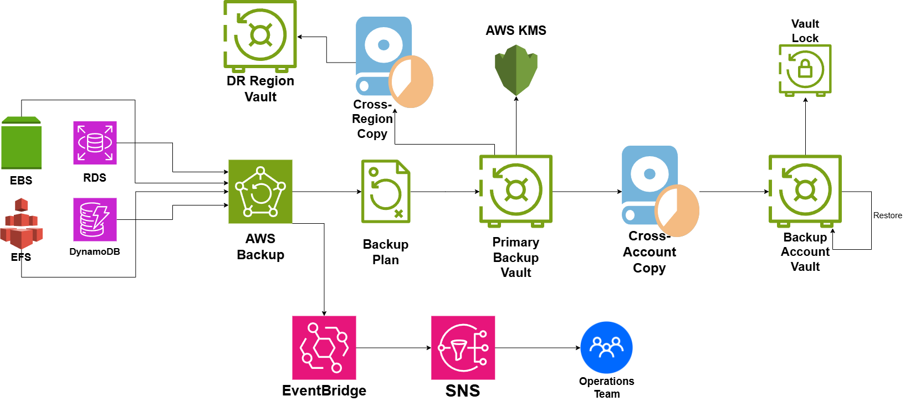

# AWS Backup Architecture

## System Design Question

Design a centralized backup architecture on AWS that protects important production workloads from:

- Accidental deletion
- Application failure
- Infrastructure failure
- Account compromise
- Regional disaster
- Ransomware or malicious deletion

The system should support scheduled backups, encrypted backup storage, cross-region copies, cross-account copies, retention policies, restore operations, and centralized monitoring.

---

## Architecture



---

## Architecture Overview

This architecture uses AWS Backup as the centralized backup service.

Production resources such as:

- Amazon EBS
- Amazon RDS
- Amazon EFS
- Amazon DynamoDB

are protected through AWS Backup.

A Backup Plan defines when backups are created and how long they are retained.

Recovery points are stored in a Primary Backup Vault.

AWS KMS provides encryption for backup data.

Copies of backups are stored in:

- A Disaster Recovery Region
- A Separate Backup Account

This protects against both regional failure and production-account compromise.

AWS Backup Vault Lock helps protect backup recovery points from early deletion.

Amazon EventBridge and Amazon SNS notify the Operations Team about backup events and failures.

---

## Main AWS Services

- AWS Backup
- AWS Backup Plan
- AWS Backup Vault
- AWS Backup Vault Lock
- AWS KMS
- Amazon EBS
- Amazon RDS
- Amazon EFS
- Amazon DynamoDB
- Amazon EventBridge
- Amazon SNS

---

## Protected Resources

The architecture protects multiple AWS data services.

```text
Amazon EBS ──────┐
Amazon RDS ──────┤
Amazon EFS ──────┼──→ AWS Backup
DynamoDB ────────┘
```

AWS Backup provides one centralized place to manage backup policies for supported resources.

---

## AWS Backup

AWS Backup acts as the main backup orchestration service.

```text
Production Resources
        ↓
AWS Backup
```

It can manage:

- Backup schedules
- Retention periods
- Recovery points
- Backup copies
- Restore operations
- Backup lifecycle policies

This reduces the need to manage separate backup logic for every AWS service.

---

## Backup Plan

A Backup Plan defines the backup policy.

```text
AWS Backup
    ↓
Backup Plan
```

The plan can define:

- Backup frequency
- Backup schedule
- Retention period
- Lifecycle rules
- Copy actions

Example policy:

```text
Daily Backup
→ Retain 30 Days

Weekly Backup
→ Retain 90 Days

Monthly Backup
→ Retain 1 Year
```

The exact policy depends on business and compliance requirements.

---

## Primary Backup Vault

Backup recovery points are stored in the Primary Backup Vault.

```text
AWS Backup
    ↓
Backup Plan
    ↓
Primary Backup Vault
```

The vault provides a centralized location for backup recovery points.

---

## Encryption with AWS KMS

Backups should be encrypted.

```text
AWS KMS
   ↓
Primary Backup Vault
```

AWS KMS provides encryption-key management for protected backup data.

Encryption helps protect backup data at rest.

---

## Cross-Region Backup Copy

A regional disaster could make resources in the primary region unavailable.

To reduce this risk, backup recovery points are copied to another AWS Region.

```text
Primary Backup Vault
        ↓
Cross-Region Copy
        ↓
DR Region Vault
```

This provides geographic separation.

For example:

```text
Primary Region
us-east-1

        ↓

Disaster Recovery Region
us-west-2
```

If the primary region has a major outage, recovery data remains available in another region.

---

## Cross-Account Backup Copy

Regional protection alone does not protect against a compromised production account.

The architecture also copies backups to a separate AWS account.

```text
Primary Backup Vault
        ↓
Cross-Account Copy
        ↓
Backup Account Vault
```

This creates stronger isolation between:

```text
Production Account
```

and:

```text
Backup Account
```

If permissions or resources in the production account are compromised, isolated backup copies can remain protected.

---

## Cross-Region vs Cross-Account

These controls solve different problems.

| Protection | Main Purpose |
|---|---|
| Cross-Region Copy | Protect against regional failure |
| Cross-Account Copy | Protect against production-account compromise |
| Vault Lock | Protect against backup deletion |

Using them together creates stronger backup resilience.

---

## AWS Backup Vault Lock

The Backup Account Vault uses AWS Backup Vault Lock.

```text
Backup Account Vault
        ↓
Vault Lock
```

Vault Lock can prevent recovery points from being deleted before their retention period expires.

This is useful for protection against:

- Ransomware
- Malicious administrators
- Accidental deletion
- Early retention changes

---

## Retention Policy

Backup retention should match business recovery requirements.

Example:

```text
Daily Backups
→ 30 Days

Weekly Backups
→ 90 Days

Monthly Backups
→ 1 Year

Compliance Backups
→ Multiple Years
```

Older backups can be retained longer when required.

---

## Restore Process

Backups are useful only if they can be restored.

The restore path is:

```text
Backup Vault
     ↓
Restore
     ↓
Recovered Resource
```

Examples include:

```text
EBS Recovery Point
        ↓
Restored EBS Volume
```

```text
RDS Recovery Point
        ↓
Restored RDS Database
```

```text
EFS Recovery Point
        ↓
Restored EFS File System
```

Restore procedures should be tested regularly.

---

## Disaster Recovery Scenario

Suppose the primary AWS Region becomes unavailable.

```text
Primary Region
     ↓
Unavailable
```

Recovery can use:

```text
DR Region Vault
      ↓
Restore
      ↓
Recovered Resource
```

This provides backup-based disaster recovery.

---

## Account Compromise Scenario

Suppose the production account is compromised.

```text
Production Account
      ↓
Compromised
```

The separate backup account still contains isolated recovery points.

```text
Backup Account Vault
        ↓
Vault Lock
        ↓
Protected Recovery Points
```

This provides stronger protection than keeping every backup inside the production account.

---

## Monitoring and Notifications

Backup jobs should be monitored.

The architecture uses:

```text
AWS Backup
    ↓
EventBridge
    ↓
SNS
    ↓
Operations Team
```

Events can include:

- Backup job completed
- Backup job failed
- Copy job failed
- Restore failed
- Backup expired
- Recovery point created

The Operations Team can investigate failed backup operations quickly.

---

## Backup Failure Example

```text
AWS Backup Job
      ↓
Failure
      ↓
EventBridge
      ↓
SNS
      ↓
Operations Team
```

This helps prevent silent backup failures.

---

## Centralized Backup Pattern

Without centralized backup management:

```text
EBS → Separate Policy

RDS → Separate Policy

EFS → Separate Policy

DynamoDB → Separate Policy
```

This becomes difficult to manage.

AWS Backup creates:

```text
Multiple AWS Resources
        ↓
AWS Backup
        ↓
Central Backup Policy
```

This makes backup management more consistent.

---

## Main Architecture Flow

```text
EBS ───────┐
RDS ───────┤
EFS ───────┼──→ AWS Backup
DynamoDB ──┘
                 ↓
            Backup Plan
                 ↓
        Primary Backup Vault
```

Then the vault is protected through multiple copies:

```text
                 Primary Backup Vault
                   /             \
                  ↓               ↓
         Cross-Region Copy   Cross-Account Copy
                  ↓               ↓
          DR Region Vault   Backup Account Vault
                                  ↓
                              Vault Lock
```

Encryption:

```text
AWS KMS
   ↓
Backup Vault
```

Monitoring:

```text
AWS Backup
    ↓
EventBridge
    ↓
SNS
    ↓
Operations Team
```

Restore:

```text
Backup Vault
    ↓
Restore
    ↓
Recovered Resource
```

---

## Security Considerations

The architecture should follow these practices:

- Encrypt backup data using KMS
- Use least-privilege IAM permissions
- Restrict access to backup vaults
- Use a separate backup account
- Enable Vault Lock where appropriate
- Restrict backup deletion permissions
- Monitor backup policy changes
- Monitor failed backup jobs
- Protect KMS keys
- Regularly test restoration procedures

---

## Recovery Objectives

Backup architecture should be designed around two important concepts.

### Recovery Point Objective — RPO

RPO determines how much data loss is acceptable.

Example:

```text
Backup Every 24 Hours
→ Maximum Data Loss ≈ 24 Hours
```

More frequent backups can reduce RPO.

### Recovery Time Objective — RTO

RTO determines how quickly the system must be restored.

Example:

```text
Required Recovery Time
→ 4 Hours
```

Backup policies should support the organization's RPO and RTO requirements.

---

## Backup vs High Availability

Backups and high availability solve different problems.

High availability helps keep applications running during infrastructure failures.

Backups help recover data after:

- Accidental deletion
- Corruption
- Security incidents
- Regional disasters
- Human mistakes

A production system often needs both.

---

## Key Design Decisions

| Component | Purpose |
|---|---|
| AWS Backup | Central backup orchestration |
| Backup Plan | Defines schedule and retention |
| Primary Backup Vault | Stores recovery points |
| AWS KMS | Encrypts backup data |
| Cross-Region Copy | Protects against regional disaster |
| DR Region Vault | Stores geographically separate backups |
| Cross-Account Copy | Protects against account compromise |
| Backup Account Vault | Stores isolated backup copies |
| Vault Lock | Prevents unwanted backup deletion |
| EventBridge | Routes backup events |
| SNS | Sends backup alerts |
| Operations Team | Responds to failures |
| Restore | Recovers protected resources |

---

## Benefits

### Centralized Management

One service manages backups across multiple AWS resources.

### Disaster Recovery

Cross-region copies protect against regional failure.

### Account Isolation

Cross-account copies protect recovery points from production-account compromise.

### Ransomware Protection

Vault Lock helps prevent unwanted deletion of recovery points.

### Encryption

KMS protects backup data at rest.

### Monitoring

Backup failures can automatically alert the Operations Team.

### Recoverability

Recovery points can be restored when production data is lost or corrupted.

---

## Tradeoffs

This architecture introduces some additional cost and operational work.

Examples include:

- Cross-region data transfer cost
- Additional backup storage
- Separate account management
- KMS key management
- Retention planning
- Restore testing
- Compliance requirements

Long retention periods and multiple backup copies should be balanced against cost and recovery requirements.

---

## Key Takeaway

The main backup architecture is:

```text
Production Resources
        ↓
AWS Backup
        ↓
Backup Plan
        ↓
Primary Backup Vault
```

Resilience is added through:

```text
Primary Backup Vault
   ├──→ Cross-Region Copy → DR Region Vault
   └──→ Cross-Account Copy → Backup Account Vault
```

Security is added through:

```text
AWS KMS
+
Vault Lock
+
Least-Privilege Access
```

Operational visibility is provided through:

```text
AWS Backup
→ EventBridge
→ SNS
→ Operations Team
```

The combination of centralized backup policies, encryption, cross-region copies, cross-account isolation, Vault Lock, monitoring, and tested restores creates a strong production backup architecture.