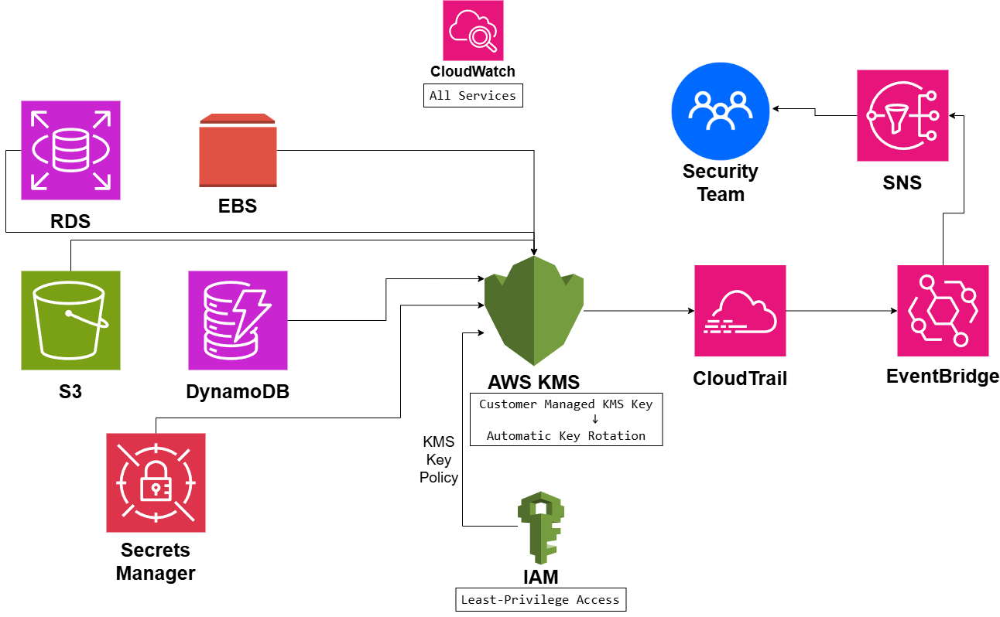

# Encryption and Key Management Architecture

## System Design Question

Design a centralized encryption and key-management architecture on AWS.

The system should protect sensitive data stored in services such as:

- Amazon S3
- Amazon RDS
- Amazon EBS
- Amazon DynamoDB
- AWS Secrets Manager

The architecture should support:

- Centralized key management
- Customer-managed KMS keys
- Encryption at rest
- Least-privilege access
- KMS key policies
- Automatic key rotation
- Audit logging
- Monitoring
- Security alerting
- Encryption in transit using HTTPS/TLS

---

## Architecture



---

## Architecture Overview

This architecture uses AWS KMS as the central key-management service.

AWS services such as S3, RDS, EBS, DynamoDB, and Secrets Manager use KMS keys to protect data at rest.

A customer-managed KMS key allows the organization to control:

- Permissions
- Key policies
- Rotation
- Lifecycle
- Auditing

IAM roles and KMS key policies determine which identities can use or manage the key.

AWS CloudTrail records KMS-related API activity.

Amazon EventBridge and Amazon SNS can alert the Security Team about important key-management events.

Amazon CloudWatch provides centralized monitoring.

---

## Main AWS Services

- AWS KMS
- AWS IAM
- Amazon S3
- Amazon RDS
- Amazon EBS
- Amazon DynamoDB
- AWS Secrets Manager
- AWS CloudTrail
- Amazon CloudWatch
- Amazon EventBridge
- Amazon SNS

---

## Centralized Key Management

AWS KMS acts as the central key-management service.

```text
Amazon S3 ───────┐
Amazon RDS ──────┤
Amazon EBS ──────┤
DynamoDB ────────┼──→ AWS KMS
Secrets Manager ─┘
```

This provides a consistent encryption strategy across multiple AWS services.

---

## Customer-Managed KMS Key

The architecture uses a customer-managed KMS key.

```text
AWS KMS
   ↓
Customer Managed Key
```

A customer-managed key gives the organization more control over:

- Key policy
- Administrative permissions
- Key usage permissions
- Rotation settings
- Monitoring
- Key lifecycle

---

## Encryption at Rest

The main data services use KMS-backed encryption.

### Amazon S3

```text
Amazon S3
   ↓
SSE-KMS
   ↓
AWS KMS
```

S3 objects can be encrypted using a KMS key.

---

### Amazon RDS

```text
Amazon RDS
   ↓
KMS Encryption
   ↓
AWS KMS
```

KMS protects RDS storage at rest.

---

### Amazon EBS

```text
Amazon EBS
   ↓
KMS Encryption
   ↓
AWS KMS
```

EBS volumes and snapshots can be encrypted using KMS.

---

### Amazon DynamoDB

```text
Amazon DynamoDB
      ↓
KMS Encryption
      ↓
AWS KMS
```

DynamoDB table data can be protected using KMS-managed encryption.

---

### AWS Secrets Manager

```text
Secrets Manager
      ↓
AWS KMS
```

Secrets stored in Secrets Manager are encrypted at rest.

---

## IAM-Based Access Control

IAM determines which identities are allowed to use the KMS key.

```text
Application / User
       ↓
IAM Role
       ↓
AWS KMS
```

Important KMS permissions can include:

```text
kms:Encrypt
kms:Decrypt
kms:GenerateDataKey
```

Access should follow the principle of least privilege.

---

## Least Privilege

Applications should only receive the KMS permissions they actually need.

Example:

```text
Application A
    ↓
IAM Role A
    ↓
Can Decrypt Key A
```

while another application may not have access:

```text
Application B
    X
Cannot Decrypt Key A
```

This limits the impact of compromised workloads.

---

## KMS Key Policy

KMS key policies provide another important authorization layer.

```text
IAM
 ↓
KMS Key Policy
 ↓
Customer Managed Key
```

The key policy defines:

- Who can administer the key
- Who can use the key
- Which AWS services can use the key
- Which principals can decrypt protected data

---

## Automatic Key Rotation

Customer-managed KMS keys can use automatic rotation.

```text
Customer Managed Key
        ↓
Automatic Key Rotation
```

Rotation reduces the long-term exposure of key material.

The application does not need to manually re-encrypt all existing data every time the key rotates.

---

## Envelope Encryption

AWS KMS commonly uses envelope encryption.

Instead of encrypting large amounts of application data directly with the KMS key:

```text
KMS Key
   ↓
Generates / Protects Data Key
   ↓
Data Key
   ↓
Encrypts Application Data
```

The KMS key protects the data-encryption key.

The data-encryption key protects the actual application data.

This provides efficient encryption for large workloads.

---

## Encryption in Transit

KMS primarily protects encryption keys and data at rest.

Data moving across networks should use HTTPS or TLS.

```text
Application
   ↓
HTTPS / TLS
   ↓
AWS Service
```

The distinction is:

```text
AWS KMS
→ Encryption at Rest

HTTPS / TLS
→ Encryption in Transit
```

Both are important for a complete data-protection strategy.

---

## CloudTrail Auditing

AWS CloudTrail records KMS API activity.

```text
AWS KMS
   ↓
CloudTrail
```

CloudTrail can record operations such as:

```text
Encrypt
Decrypt
GenerateDataKey
CreateKey
DisableKey
EnableKey
ScheduleKeyDeletion
```

This is valuable for auditing and security investigations.

---

## Security Monitoring

Amazon CloudWatch provides operational visibility.

```text
AWS KMS
CloudTrail
Applications
    ↓
CloudWatch
```

CloudWatch can help monitor:

- Application encryption failures
- Decryption failures
- Access-denied events
- Operational errors
- Security-related alarms

---

## Security Alerting

Important KMS events can trigger automated alerts.

```text
CloudTrail
   ↓
EventBridge
   ↓
SNS
   ↓
Security Team
```

For example, a dangerous action such as:

```text
DisableKey
```

or:

```text
ScheduleKeyDeletion
```

can generate an immediate notification.

---

## Key Deletion Alert Example

```text
ScheduleKeyDeletion API Call
          ↓
CloudTrail
          ↓
EventBridge Rule
          ↓
SNS
          ↓
Security Team
```

This provides visibility into potentially destructive key-management actions.

---

## Monitoring Flow

The architecture provides multiple visibility layers.

```text
AWS Services
    ↓
AWS KMS
    ↓
CloudTrail
    ↓
EventBridge
    ↓
SNS
    ↓
Security Team
```

CloudWatch provides additional operational monitoring.

---

## Data Protection Layers

This architecture uses several layers of protection.

| Layer | Security Control |
|---|---|
| Data at Rest | AWS KMS |
| Data in Transit | HTTPS / TLS |
| Access Control | IAM |
| Key Authorization | KMS Key Policy |
| Key Lifecycle | Automatic Rotation |
| Audit Logging | CloudTrail |
| Monitoring | CloudWatch |
| Security Alerting | EventBridge + SNS |

---

## Key Management Principles

### Centralize Key Management

Use AWS KMS instead of managing encryption keys separately inside applications.

### Use Customer-Managed Keys

Customer-managed keys provide greater control over access and lifecycle.

### Apply Least Privilege

Only authorized identities should be able to use or administer encryption keys.

### Rotate Keys

Use automatic rotation where appropriate.

### Audit Every Important Action

Use CloudTrail to record key-related API activity.

### Alert on Dangerous Changes

Key disablement and deletion actions should generate security alerts.

---

## Main Architecture Flow

```text
Amazon S3 ───────┐
Amazon RDS ──────┤
Amazon EBS ──────┤
DynamoDB ────────┼──→ AWS KMS
Secrets Manager ─┘
```

Access control:

```text
IAM
 ↓
KMS Key Policy
 ↓
Customer Managed KMS Key
```

Rotation:

```text
Customer Managed Key
        ↓
Automatic Key Rotation
```

Auditing and alerting:

```text
AWS KMS
   ↓
CloudTrail
   ↓
EventBridge
   ↓
SNS
   ↓
Security Team
```

Monitoring:

```text
All Services
    ↓
CloudWatch
```

---

## Security Considerations

The architecture should follow these practices:

- Use least-privilege IAM permissions
- Restrict key administrators
- Restrict key users
- Avoid overly broad `kms:*` permissions
- Monitor key deletion requests
- Monitor key disablement
- Use automatic rotation
- Encrypt data in transit with TLS
- Protect CloudTrail logs
- Use separate keys for sensitive workloads when appropriate
- Avoid exposing key identifiers unnecessarily

---

## Key Design Decisions

| Component | Purpose |
|---|---|
| AWS KMS | Centralized key management |
| Customer-Managed Key | Provides organizational control |
| IAM | Controls who can use KMS |
| KMS Key Policy | Controls key administration and usage |
| Amazon S3 | Encrypted object storage |
| Amazon RDS | Encrypted database storage |
| Amazon EBS | Encrypted block storage |
| DynamoDB | Encrypted NoSQL data |
| Secrets Manager | Encrypted secret storage |
| CloudTrail | Audits KMS API activity |
| CloudWatch | Monitoring and alerting |
| EventBridge | Detects important security events |
| SNS | Notifies Security Team |
| HTTPS / TLS | Encrypts data in transit |

---

## Benefits

### Centralized Encryption Control

Multiple AWS services use one consistent key-management platform.

### Strong Access Control

IAM and KMS key policies restrict who can use encryption keys.

### Better Auditing

CloudTrail records key-management API activity.

### Automatic Rotation

Key material can rotate without requiring manual application changes.

### Security Visibility

Dangerous key actions can trigger automatic alerts.

### Compliance Support

Centralized encryption and auditing help support security and compliance requirements.

---

## Tradeoffs

This design introduces additional operational considerations:

- KMS usage costs
- Key-policy complexity
- IAM policy management
- Key lifecycle planning
- Cross-account access configuration
- Monitoring requirements
- Dependency on correct encryption configuration

Poorly designed key policies can either block legitimate applications or grant excessive access.

---

## Key Takeaway

The core architecture is:

```text
AWS Data Services
      ↓
AWS KMS
      ↓
Customer Managed Key
```

Access is controlled through:

```text
IAM
+
KMS Key Policies
+
Least Privilege
```

Key lifecycle protection comes from:

```text
Automatic Key Rotation
```

Security visibility comes from:

```text
CloudTrail
→ EventBridge
→ SNS
→ Security Team
```

and complete data protection combines:

```text
KMS
→ Encryption at Rest

HTTPS / TLS
→ Encryption in Transit
```

This architecture provides centralized, auditable, least-privilege encryption and key management across AWS workloads.