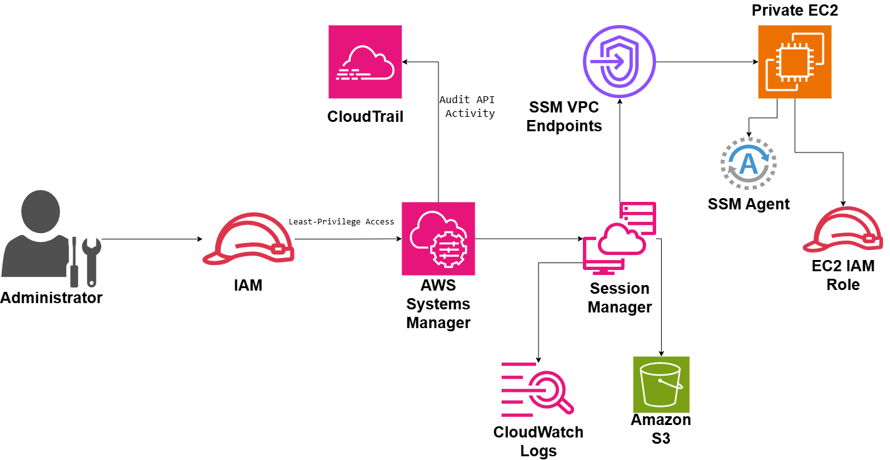

# Bastionless Server Management

## System Design Question

Design a secure server-management architecture on AWS without using a bastion host.

Administrators should be able to access private EC2 instances without:

- Public IP addresses
- Internet-facing SSH
- Port 22 exposure
- Long-lived SSH keys
- Bastion hosts

The architecture should use AWS Systems Manager Session Manager, IAM, VPC endpoints, logging, and auditing.

---

## Architecture



---

## Architecture Overview

This architecture replaces traditional SSH bastion hosts with AWS Systems Manager Session Manager.

Administrators authenticate through AWS IAM and use Session Manager to connect to EC2 instances running in private subnets.

The EC2 instances do not require public IP addresses or inbound SSH access.

Each EC2 instance runs the SSM Agent and uses an EC2 IAM Role to communicate securely with AWS Systems Manager.

VPC endpoints allow private communication with Systems Manager without requiring public internet access.

Session activity is logged to Amazon CloudWatch Logs and Amazon S3.

AWS CloudTrail records Systems Manager API activity for auditing.

---

## Main AWS Services

- Amazon EC2
- AWS Systems Manager
- Session Manager
- AWS IAM
- VPC Interface Endpoints
- AWS CloudTrail
- Amazon CloudWatch Logs
- Amazon S3

---

## Traditional Bastion Architecture

A traditional design often looks like:

```text
Administrator
     ↓
Internet
     ↓
Bastion Host
     ↓
SSH
     ↓
Private EC2
```

This introduces additional operational and security responsibilities.

The bastion host must be:

- Patched
- Monitored
- Secured
- Highly available
- Protected from SSH attacks
- Managed with SSH keys

---

## Bastionless Architecture

This design removes the bastion host.

```text
Administrator
     ↓
AWS IAM
     ↓
AWS Systems Manager
     ↓
Session Manager
     ↓
Private EC2
```

There is no need for direct inbound SSH access.

---

## Administrator Authentication

The administrator starts with an AWS identity.

```text
Administrator
     ↓
AWS IAM
```

IAM policies control which Systems Manager actions the administrator can perform.

Permissions should follow least privilege.

Example:

```text
Administrator A
→ Access Production Web Servers

Administrator B
→ Access Development Servers
```

Not every administrator should automatically have access to every instance.

---

## Least-Privilege Access

IAM policies should restrict access based on:

- EC2 instance
- Resource tags
- Environment
- Team
- Administrative role

Conceptually:

```text
Administrator
     ↓
IAM Policy
     ↓
Only Authorized EC2 Instances
```

This provides identity-based server access.

---

## AWS Systems Manager

AWS Systems Manager acts as the central server-management service.

```text
IAM
 ↓
AWS Systems Manager
```

Systems Manager allows administrators to manage EC2 instances without exposing those instances directly to the internet.

---

## Session Manager

Session Manager provides interactive access to managed instances.

```text
Administrator
     ↓
IAM
     ↓
Systems Manager
     ↓
Session Manager
     ↓
Private EC2
```

This removes the need for:

```text
SSH Keys
Bastion Hosts
Public IP Addresses
Inbound Port 22
```

---

## Private EC2 Instance

The EC2 instance remains private.

```text
Private EC2
```

The instance should have:

```text
No Public IP
No Internet-Facing SSH
No Bastion Dependency
```

This reduces the attack surface.

---

## SSM Agent

The EC2 instance runs the AWS Systems Manager Agent.

```text
Private EC2
     ↓
SSM Agent
```

The SSM Agent communicates with AWS Systems Manager and enables administrative sessions.

---

## EC2 IAM Role

The EC2 instance uses an IAM instance role.

```text
Private EC2
     ↓
EC2 IAM Role
```

The role gives the instance permission to communicate with Systems Manager.

This avoids storing permanent AWS credentials on the server.

---

## Private Systems Manager Connectivity

The architecture uses VPC interface endpoints.

```text
Private EC2
     ↓
SSM VPC Endpoints
     ↓
AWS Systems Manager
```

This allows Systems Manager traffic to remain on the AWS network path.

The instance does not need public internet access for Systems Manager connectivity.

---

## Why Use VPC Endpoints?

Without private endpoints, EC2 instances may need outbound internet or NAT connectivity to reach public AWS service endpoints.

With VPC endpoints:

```text
Private EC2
     ↓
VPC Endpoint
     ↓
Systems Manager
```

This improves isolation and reduces unnecessary internet dependency.

---

## No Inbound SSH

A major security advantage is that Session Manager does not require direct inbound SSH access.

Traditional SSH:

```text
Internet
   ↓
TCP 22
   ↓
EC2
```

Bastionless access:

```text
Administrator
     ↓
IAM
     ↓
Session Manager
     ↓
EC2
```

The EC2 security group does not need an internet-facing SSH rule.

---

## Session Logging

Administrative sessions should be logged.

The architecture stores session activity in:

```text
Session Manager
   ├──→ CloudWatch Logs
   └──→ Amazon S3
```

This improves accountability and troubleshooting.

---

## CloudWatch Logs

Session Manager activity can be sent to CloudWatch Logs.

```text
Session Manager
      ↓
CloudWatch Logs
```

This can provide centralized operational visibility.

---

## Amazon S3 Session Logs

Session logs can also be stored in Amazon S3.

```text
Session Manager
      ↓
Amazon S3
```

S3 can provide longer-term storage for session records.

Access to these logs should be tightly controlled.

---

## CloudTrail Auditing

AWS CloudTrail records Systems Manager API activity.

```text
AWS Systems Manager
        ↓
CloudTrail
```

CloudTrail can help answer:

- Who started the session?
- When was the session started?
- Which instance was accessed?
- Which IAM identity performed the action?
- Which Systems Manager API call was used?

---

## Audit Flow

```text
Administrator
     ↓
IAM
     ↓
Systems Manager API
     ↓
CloudTrail
```

This provides a strong audit trail for administrative access.

---

## Security Benefits

### No Bastion Host

There is no public jump server to manage or protect.

### No Public IP

Private EC2 instances remain private.

### No Inbound Port 22

The architecture does not depend on direct SSH exposure.

### IAM-Based Access

Access is controlled using AWS identities and IAM policies.

### Central Logging

Session activity can be stored centrally.

### API Auditing

CloudTrail records Systems Manager activity.

### Private AWS Connectivity

VPC endpoints allow private connectivity to Systems Manager.

---

## Main Architecture Flow

```text
Administrator
     ↓
AWS IAM
     ↓
AWS Systems Manager
     ↓
Session Manager
     ↓
SSM VPC Endpoints
     ↓
Private EC2
```

The EC2 instance includes:

```text
Private EC2
├── SSM Agent
└── EC2 IAM Role
```

Logging:

```text
Session Manager
├──→ CloudWatch Logs
└──→ Amazon S3
```

Auditing:

```text
Systems Manager
      ↓
CloudTrail
```

---

## Bastion Host vs Session Manager

| Traditional Bastion | Session Manager |
|---|---|
| Requires bastion host | No bastion required |
| Often requires SSH keys | IAM-based access |
| Requires inbound SSH | No direct inbound SSH |
| Public attack surface | Private server access |
| Bastion needs patching | Managed AWS service |
| SSH access harder to audit centrally | CloudTrail + session logs |

---

## Security Considerations

The architecture should follow these practices:

- Use least-privilege IAM policies
- Restrict Session Manager access
- Keep EC2 instances private
- Avoid public IP addresses
- Avoid internet-facing SSH
- Require MFA for sensitive administrator access
- Encrypt session logs
- Restrict S3 log-bucket permissions
- Protect CloudWatch log groups
- Monitor Systems Manager activity
- Audit access through CloudTrail
- Keep the SSM Agent updated

---

## Optional MFA

For sensitive environments, require MFA.

```text
Administrator
     ↓
MFA
     ↓
IAM
     ↓
Session Manager
```

This adds another layer of protection before server access is granted.

---

## Failure and Security Scenarios

### SSH Attack

Traditional architecture:

```text
Attacker
   ↓
Public SSH Endpoint
   ↓
Potential Attack Surface
```

Bastionless architecture:

```text
No Public SSH Endpoint
```

The attack path is removed.

### Stolen SSH Key

Traditional systems may depend heavily on private SSH keys.

With Session Manager:

```text
No Long-Lived SSH Key Required
```

Access is controlled through IAM.

### Unauthorized Administrator

```text
Administrator
     ↓
IAM Policy
     ↓
Access Denied
```

IAM prevents unauthorized sessions.

---

## Key Design Decisions

| Component | Purpose |
|---|---|
| AWS IAM | Controls administrator access |
| AWS Systems Manager | Central management service |
| Session Manager | Provides interactive server access |
| Private EC2 | Runs workloads without public exposure |
| SSM Agent | Enables Systems Manager communication |
| EC2 IAM Role | Gives instance SSM permissions |
| VPC Endpoints | Provide private SSM connectivity |
| CloudWatch Logs | Stores session logs |
| Amazon S3 | Stores long-term session records |
| CloudTrail | Audits Systems Manager API activity |

---

## Benefits

### Smaller Attack Surface

There is no internet-facing bastion host.

### Simplified Operations

No jump server needs to be patched and maintained.

### Better Identity Control

Access is based on IAM instead of only SSH keys.

### Improved Auditing

CloudTrail and session logs provide visibility into administrative access.

### Private Connectivity

VPC endpoints keep management traffic private.

### Easier Access Management

Access can be granted or revoked through IAM policies.

---

## Tradeoffs

This architecture still requires careful configuration.

Important considerations include:

- IAM policy design
- VPC endpoint configuration
- SSM Agent health
- Session logging configuration
- CloudWatch and S3 costs
- Emergency-access procedures
- Systems Manager regional availability

Administrators should also have a documented recovery procedure if normal Systems Manager access becomes unavailable.

---

## Key Takeaway

The traditional model is:

```text
Internet
→ Bastion Host
→ SSH
→ Private EC2
```

The bastionless model is:

```text
Administrator
→ IAM
→ Systems Manager
→ Session Manager
→ Private EC2
```

with additional security through:

```text
SSM Agent
+
EC2 IAM Role
+
VPC Endpoints
+
CloudWatch Logs
+
Amazon S3
+
CloudTrail
```

This creates a private, identity-based, auditable, and lower-maintenance server-management architecture on AWS.