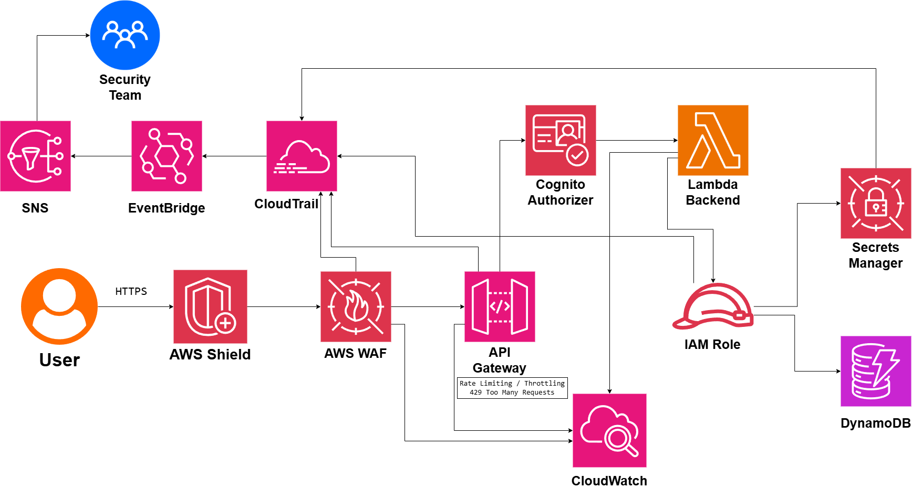

# API Security Architecture

## System Design Question

Design a secure API architecture on AWS for web and mobile applications.

The API should protect against:

- Unauthorized access
- Invalid or stolen tokens
- Malicious web requests
- DDoS attacks
- Excessive requests
- Application abuse
- Hard-coded credentials
- Unauthorized backend access

The architecture should include authentication, authorization, WAF protection, throttling, least-privilege IAM, monitoring, auditing, and security alerts.

---

## Architecture



---

## Architecture Overview

This architecture protects a public API using multiple security layers.

Users connect over HTTPS.

AWS Shield provides DDoS protection.

AWS WAF filters malicious requests before they reach Amazon API Gateway.

Amazon Cognito provides authentication and authorization using tokens.

API Gateway acts as the secure API entry point and can apply throttling and rate limiting.

AWS Lambda runs the backend application logic.

The Lambda function uses an IAM role with least-privilege permissions to access services such as DynamoDB and AWS Secrets Manager.

Amazon CloudWatch provides operational monitoring.

AWS CloudTrail records security and configuration activity.

Amazon EventBridge and Amazon SNS send important security alerts to the Security Team.

---

## Main AWS Services

- AWS Shield
- AWS WAF
- Amazon API Gateway
- Amazon Cognito
- AWS Lambda
- AWS IAM
- AWS Secrets Manager
- Amazon DynamoDB
- Amazon CloudWatch
- AWS CloudTrail
- Amazon EventBridge
- Amazon SNS

---

## Main Request Flow

The main API request path is:

```text
User
 ↓
HTTPS
 ↓
AWS Shield
 ↓
AWS WAF
 ↓
API Gateway
 ↓
Cognito Authorizer
 ↓
Lambda Backend
```

Each layer provides a different type of protection.

---

## HTTPS / TLS

All client communication should use HTTPS.

```text
User
 ↓
HTTPS / TLS
 ↓
AWS API
```

TLS protects data while it is moving across the network.

This prevents sensitive information from being transmitted in plain text.

---

## AWS Shield

AWS Shield provides protection against distributed denial-of-service attacks.

```text
Internet
 ↓
AWS Shield
 ↓
AWS WAF
```

Shield helps protect the public API infrastructure from large-scale network attacks.

---

## AWS WAF

AWS WAF filters malicious HTTP requests.

```text
User Request
    ↓
AWS WAF
    ↓
Allowed Request
    ↓
API Gateway
```

WAF can use rules such as:

- Managed rule groups
- IP blocking
- Rate-based rules
- SQL injection protection
- Common exploit protection
- Bot filtering

Malicious requests can be blocked before reaching the backend.

---

## API Gateway

Amazon API Gateway acts as the main API entry point.

```text
AWS WAF
   ↓
API Gateway
```

API Gateway can provide:

- Request routing
- Authentication integration
- Authorization
- Throttling
- Rate limiting
- Logging
- API management

---

## Rate Limiting and Throttling

API Gateway can limit the number of requests a client can make.

```text
Client
 ↓
API Gateway
 ↓
Rate Limit
 ↓
Backend
```

When a client exceeds the allowed rate:

```text
429 Too Many Requests
```

This helps protect the backend from abuse and traffic spikes.

---

## Authentication

Amazon Cognito authenticates users.

```text
User
 ↓
Amazon Cognito
 ↓
Authentication Token
```

After successful authentication, the user receives a token such as a JWT.

---

## Cognito Authorizer

API Gateway can use Cognito as an authorizer.

```text
User
 ↓
JWT Token
 ↓
API Gateway
 ↓
Cognito Authorizer
```

The authorizer verifies that the token is valid before the request reaches the backend.

---

## Authentication vs Authorization

Authentication answers:

```text
Who are you?
```

Authorization answers:

```text
What are you allowed to do?
```

Example:

```text
Normal User
→ GET /profile
→ POST /orders
```

while:

```text
Normal User
X
DELETE /admin/users
```

The API should enforce both.

---

## Lambda Backend

After successful authorization:

```text
API Gateway
     ↓
Lambda Backend
```

AWS Lambda runs the application logic.

The backend should not contain permanent AWS credentials.

---

## IAM Role

The Lambda function uses an IAM execution role.

```text
Lambda
 ↓
IAM Role
```

The role should follow least privilege.

For example:

```text
Lambda
 ↓
IAM Role
 ├──→ DynamoDB
 └──→ Secrets Manager
```

The Lambda function should only receive the permissions it actually needs.

---

## Least-Privilege Access

Avoid policies such as:

```text
Action: "*"
Resource: "*"
```

Instead:

```text
Lambda Role
→ Read specific DynamoDB table
→ Read specific secret
```

This reduces the impact of a compromised application.

---

## Secrets Management

Sensitive values should be stored in AWS Secrets Manager.

```text
Lambda Backend
     ↓
IAM Role
     ↓
Secrets Manager
```

Examples include:

- API keys
- Database credentials
- Third-party tokens
- Application secrets

These values should not be hard-coded into application source code.

---

## DynamoDB Access

The Lambda backend can access DynamoDB through its IAM role.

```text
Lambda
 ↓
IAM Role
 ↓
DynamoDB
```

The role should only allow access to the required tables and operations.

---

## CloudWatch Monitoring

Amazon CloudWatch provides operational visibility.

```text
API Gateway
Lambda
WAF
 ↓
CloudWatch
```

Important metrics include:

- API request count
- 4xx responses
- 5xx responses
- API latency
- Lambda errors
- Lambda duration
- Lambda throttles
- WAF blocked requests
- API Gateway throttling

---

## CloudWatch Alerts

CloudWatch alarms can notify teams when important thresholds are exceeded.

Examples:

```text
High 5xx Error Rate
      ↓
CloudWatch Alarm
```

or:

```text
High Lambda Error Rate
      ↓
CloudWatch Alarm
```

This improves operational response.

---

## CloudTrail Auditing

AWS CloudTrail records AWS API and configuration activity.

```text
AWS Services
    ↓
CloudTrail
```

CloudTrail can record activity involving:

- API Gateway
- AWS WAF
- IAM
- Secrets Manager
- Lambda
- Other AWS control-plane actions

This helps answer:

- Who changed the API?
- Who modified a WAF rule?
- Who changed IAM permissions?
- Who changed a secret?
- When was a security configuration modified?

---

## Security Alerting

Important security events can be routed automatically.

```text
Security Event
     ↓
CloudTrail
     ↓
EventBridge
     ↓
SNS
     ↓
Security Team
```

This allows the Security Team to react quickly to suspicious activity.

---

## EventBridge

Amazon EventBridge can detect specific security events.

Examples include:

- IAM policy changes
- WAF configuration changes
- API Gateway changes
- Secret changes
- Other important control-plane activity

Conceptually:

```text
CloudTrail Event
      ↓
EventBridge Rule
```

---

## SNS Notifications

EventBridge can send important events to Amazon SNS.

```text
EventBridge
    ↓
SNS
    ↓
Security Team
```

SNS can deliver alerts through supported notification channels.

---

## Example Security Event

Suppose someone changes a sensitive IAM policy.

```text
IAM Policy Change
      ↓
CloudTrail
      ↓
EventBridge
      ↓
SNS
      ↓
Security Team
```

This provides near-real-time visibility into important security changes.

---

## Defense in Depth

This architecture uses multiple security controls.

| Layer | Security Control |
|---|---|
| Network Edge | AWS Shield |
| Application Edge | AWS WAF |
| Transport | HTTPS / TLS |
| API Entry | API Gateway |
| Authentication | Amazon Cognito |
| Authorization | Cognito Authorizer |
| Abuse Protection | API Throttling |
| Backend Permissions | IAM Role |
| Secrets | Secrets Manager |
| Monitoring | CloudWatch |
| Auditing | CloudTrail |
| Security Events | EventBridge |
| Alerts | SNS |

No single security control protects the entire API.

The layers work together.

---

## Main Security Flow

```text
User
 ↓
HTTPS
 ↓
AWS Shield
 ↓
AWS WAF
 ↓
API Gateway
 ↓
Cognito Authorizer
 ↓
Lambda Backend
```

Backend permissions:

```text
Lambda
 ↓
IAM Role
 ├──→ Secrets Manager
 └──→ DynamoDB
```

Monitoring:

```text
API Gateway
WAF
Lambda
 ↓
CloudWatch
```

Auditing and alerting:

```text
Security Activity
      ↓
CloudTrail
      ↓
EventBridge
      ↓
SNS
      ↓
Security Team
```

---

## API Abuse Example

Suppose one client sends too many requests.

```text
Client
 ↓
API Gateway
 ↓
Throttling Limit Reached
 ↓
429 Too Many Requests
```

The backend is protected from unnecessary load.

---

## Invalid Token Example

```text
User
 ↓
Invalid JWT
 ↓
Cognito Authorizer
 ↓
Access Denied
```

The request never reaches the Lambda backend.

---

## Malicious Request Example

```text
Attacker
 ↓
Malicious HTTP Request
 ↓
AWS WAF
 ↓
Request Blocked
```

This reduces the number of malicious requests reaching the API.

---

## Backend Credential Protection

Avoid:

```text
API_KEY="hard-coded-secret"
```

inside application code.

Use:

```text
Lambda
 ↓
IAM Role
 ↓
Secrets Manager
```

This reduces credential exposure.

---

## Security Principles

### Use HTTPS Everywhere

Protect API traffic in transit.

### Authenticate Every Protected Request

Use Cognito to verify user identity.

### Enforce Authorization

Users should only access allowed API operations.

### Filter Malicious Traffic

Use AWS WAF.

### Limit Request Rate

Use API Gateway throttling.

### Protect the Backend

Use least-privilege IAM roles.

### Centralize Secrets

Use Secrets Manager instead of hard-coded credentials.

### Monitor Continuously

Use CloudWatch.

### Audit Configuration Changes

Use CloudTrail.

### Alert on Important Events

Use EventBridge and SNS.

---

## Key Design Decisions

| Component | Purpose |
|---|---|
| HTTPS / TLS | Encrypts API traffic |
| AWS Shield | DDoS protection |
| AWS WAF | Filters malicious traffic |
| API Gateway | Secure API entry point |
| Cognito | User authentication |
| Cognito Authorizer | Token validation and authorization |
| API Throttling | Protects against request abuse |
| Lambda | Backend application logic |
| IAM Role | Controls backend AWS permissions |
| Secrets Manager | Protects sensitive credentials |
| DynamoDB | Backend data storage |
| CloudWatch | Monitoring and logs |
| CloudTrail | Audit trail |
| EventBridge | Detects security events |
| SNS | Sends security alerts |
| Security Team | Responds to incidents |

---

## Benefits

### Strong Authentication

Only authenticated users can access protected APIs.

### Layered Security

Shield, WAF, Cognito, IAM, and throttling provide multiple security layers.

### Reduced Attack Surface

Malicious traffic can be blocked before reaching the backend.

### Least-Privilege Backend Access

Lambda only receives the AWS permissions it needs.

### Better Secret Protection

Sensitive credentials are stored outside application code.

### Centralized Monitoring

CloudWatch provides visibility into API and application health.

### Strong Auditing

CloudTrail records important AWS configuration changes.

### Automated Security Alerts

EventBridge and SNS notify the Security Team about important events.

---

## Tradeoffs

This architecture introduces additional configuration and operational work.

Examples include:

- WAF rule management
- Cognito configuration
- IAM policy complexity
- API throttling tuning
- CloudWatch cost
- CloudTrail log management
- Security alert tuning
- False-positive WAF rules

Security controls should be tested and adjusted based on real application traffic.

---

## Key Takeaway

The main API security path is:

```text
User
→ HTTPS
→ AWS Shield
→ AWS WAF
→ API Gateway
→ Cognito Authorizer
→ Lambda Backend
```

Backend access is protected through:

```text
IAM
+
Least Privilege
+
Secrets Manager
```

API abuse is controlled through:

```text
Rate Limiting
+
Throttling
```

Monitoring and security visibility are provided through:

```text
CloudWatch
+
CloudTrail
+
EventBridge
+
SNS
```

This creates a layered, secure, monitored, and auditable API architecture on AWS.