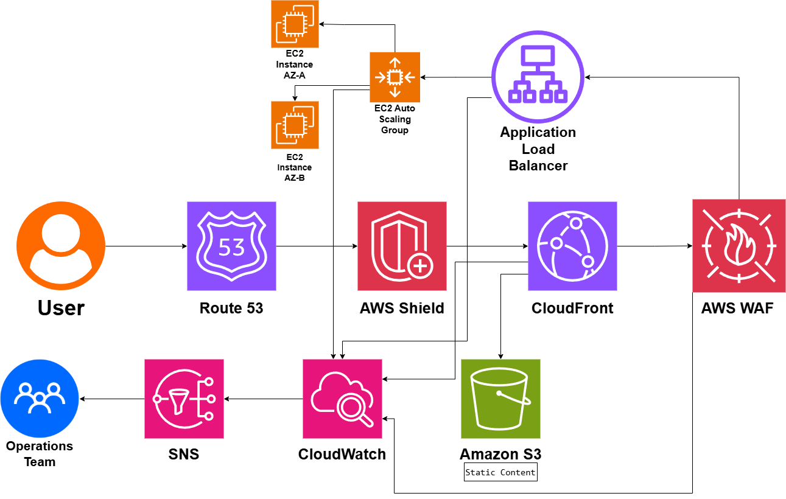

# DDoS-Resistant Web Architecture

## System Design Question

Design a highly available and DDoS-resistant web architecture on AWS.

The application should remain available during:

- Large traffic spikes
- DDoS attacks
- HTTP floods
- Bot traffic
- Malicious web requests
- Individual EC2 instance failures
- Availability Zone failures

The architecture should use edge protection, caching, load balancing, Auto Scaling, multi-AZ deployment, and centralized monitoring.

---

## Architecture



---

## Architecture Overview

This architecture protects a public web application using multiple layers of AWS security and availability services.

Amazon Route 53 provides DNS resolution.

AWS Shield provides DDoS protection.

Amazon CloudFront acts as the CDN and edge layer.

AWS WAF filters malicious HTTP requests.

An Application Load Balancer distributes dynamic traffic to EC2 instances running inside an Auto Scaling Group across multiple Availability Zones.

Amazon S3 stores static content such as images, JavaScript, and CSS files.

Amazon CloudWatch monitors the architecture, while Amazon SNS sends alerts to the Operations Team.

---

## Main AWS Services

- Amazon Route 53
- AWS Shield
- Amazon CloudFront
- AWS WAF
- Application Load Balancer
- Amazon EC2
- EC2 Auto Scaling
- Amazon S3
- Amazon CloudWatch
- Amazon SNS

---

## Main Request Flow

The main request path is:

```text
User
 ↓
Route 53
 ↓
AWS Shield
 ↓
CloudFront
 ↓
AWS WAF
 ↓
Application Load Balancer
 ↓
EC2 Auto Scaling Group
 ↓
EC2 Instances
```

This architecture blocks or absorbs unwanted traffic before it reaches the application servers.

---

## Amazon Route 53

Route 53 provides DNS resolution for the application.

```text
User
 ↓
Route 53
 ↓
CloudFront
```

The user accesses the application using a domain name instead of directly connecting to backend infrastructure.

---

## AWS Shield

AWS Shield helps protect AWS resources against distributed denial-of-service attacks.

```text
Internet
 ↓
AWS Shield
 ↓
CloudFront
```

Shield provides protection against large-scale network and transport-layer attacks.

It helps prevent malicious traffic from overwhelming the application infrastructure.

---

## Amazon CloudFront

CloudFront acts as the global CDN and edge layer.

```text
User
 ↓
CloudFront Edge Location
 ↓
Origin
```

CloudFront provides several benefits:

- Caches static content
- Reduces traffic reaching the origin
- Improves global performance
- Absorbs large traffic volumes at the edge
- Integrates with AWS WAF
- Helps hide the application origin

---

## Static Content Offload

Static content is stored in Amazon S3.

```text
CloudFront
   ↓
Amazon S3
Static Content
```

Examples include:

```text
/images/*
/css/*
/js/*
```

CloudFront can cache these files at edge locations.

This reduces unnecessary requests to EC2 instances.

---

## Dynamic Application Traffic

Dynamic requests are sent toward the application backend.

```text
CloudFront
 ↓
AWS WAF
 ↓
Application Load Balancer
 ↓
EC2 Instances
```

Examples include:

```text
/login
/profile
/orders
/dashboard
```

These requests require application processing and cannot always be served from cache.

---

## AWS WAF

AWS WAF filters malicious web traffic.

```text
CloudFront
 ↓
AWS WAF
 ↓
Application Load Balancer
```

WAF can use:

- AWS Managed Rules
- Rate-based rules
- IP reputation rules
- Bot controls
- Geo restrictions
- SQL injection protection
- Common web exploit protection

Malicious requests can be blocked before reaching EC2.

---

## Rate-Based Protection

WAF can block clients sending excessive requests.

Conceptually:

```text
Client
 ↓
Too Many Requests
 ↓
AWS WAF
 ↓
Request Blocked
```

This helps protect against HTTP floods and abusive clients.

---

## Application Load Balancer

The Application Load Balancer distributes incoming requests across healthy EC2 instances.

```text
Application Load Balancer
          ↓
     EC2 Instances
```

The ALB performs health checks and avoids routing requests to unhealthy instances.

---

## Multi-AZ Application Layer

The EC2 application layer runs across multiple Availability Zones.

```text
               Application Load Balancer
                    /             \
                   ↓               ↓
            EC2 Instance      EC2 Instance
               AZ-A               AZ-B
```

This improves availability.

If one instance or Availability Zone fails, traffic can continue through healthy infrastructure.

---

## EC2 Auto Scaling

The application runs inside an Auto Scaling Group.

```text
Traffic Increase
      ↓
EC2 Auto Scaling
      ↓
More EC2 Instances
```

When traffic decreases:

```text
Traffic Decrease
      ↓
Auto Scaling
      ↓
Remove Extra Capacity
```

This allows the application layer to adjust capacity automatically.

---

## DDoS Protection Strategy

The architecture uses several layers.

```text
AWS Shield
→ DDoS protection
```

```text
CloudFront
→ Edge absorption and caching
```

```text
AWS WAF
→ Application-layer filtering
```

```text
Auto Scaling
→ Additional application capacity
```

These controls work together.

Auto Scaling alone should not be treated as the main DDoS defense.

The goal is to block malicious traffic as early as possible.

---

## Origin Protection

Attackers should not bypass CloudFront and directly target the Application Load Balancer.

Conceptually:

```text
Internet
   X
Direct ALB Access
```

Preferred path:

```text
Internet
 ↓
CloudFront
 ↓
AWS WAF
 ↓
ALB
```

The ALB should only accept approved origin traffic where possible.

This can be implemented using appropriate origin restrictions and security controls.

---

## HTTPS / TLS

Traffic should be encrypted in transit.

```text
User
 ↓
HTTPS
 ↓
CloudFront
```

The connection between CloudFront and the application origin should also use HTTPS where appropriate.

```text
CloudFront
 ↓
HTTPS
 ↓
Application Load Balancer
```

TLS protects application traffic from interception.

---

## Monitoring

Amazon CloudWatch provides centralized monitoring.

```text
CloudFront
AWS WAF
ALB
EC2
Auto Scaling
 ↓
CloudWatch
```

Important metrics include:

- CloudFront request count
- CloudFront error rates
- WAF blocked requests
- ALB request count
- ALB target health
- ALB 4xx errors
- ALB 5xx errors
- EC2 CPU utilization
- Auto Scaling activity
- Traffic spikes

---

## Security and Operations Alerts

CloudWatch alarms can publish alerts to Amazon SNS.

```text
CloudWatch
 ↓
SNS
 ↓
Operations Team
```

Example:

```text
High Request Rate
      ↓
CloudWatch Alarm
      ↓
SNS
      ↓
Operations Team
```

This gives the operations team visibility into unusual traffic or system problems.

---

## Example DDoS Scenario

Suppose a large number of malicious clients attack the website.

```text
Attack Traffic
     ↓
AWS Shield
     ↓
CloudFront
     ↓
AWS WAF
```

The architecture attempts to absorb and filter malicious traffic before it reaches the origin.

Only allowed traffic continues toward:

```text
Application Load Balancer
        ↓
EC2 Application
```

---

## Example Bot Attack

```text
Bot Traffic
    ↓
CloudFront
    ↓
AWS WAF
    ↓
Bot / Rate Rule
    ↓
Blocked
```

This reduces unnecessary backend processing.

---

## Traffic Spike Scenario

A legitimate traffic spike may occur during a sale or major event.

```text
Large Legitimate Traffic Spike
            ↓
CloudFront Cache
            ↓
Reduced Origin Requests
```

Dynamic requests continue to:

```text
ALB
 ↓
Auto Scaling Group
 ↓
Additional EC2 Instances
```

The architecture handles legitimate scale differently from malicious traffic.

---

## Instance Failure

If one EC2 instance fails:

```text
EC2 Instance Failure
        ↓
ALB Health Check
        ↓
Instance Removed from Traffic
        ↓
Auto Scaling Launches Replacement
```

This improves application availability.

---

## Availability Zone Failure

If AZ-A becomes unavailable:

```text
AZ-A Failure
    ↓
EC2 in AZ-A unavailable
```

The ALB can continue routing traffic to healthy capacity in AZ-B.

```text
ALB
 ↓
EC2 in AZ-B
```

This provides multi-AZ resilience.

---

## Main Architecture Flow

```text
User
 ↓
Route 53
 ↓
AWS Shield
 ↓
CloudFront
 ↓
AWS WAF
 ↓
Application Load Balancer
 ↓
EC2 Auto Scaling Group
 ├── EC2 AZ-A
 └── EC2 AZ-B
```

Static content:

```text
CloudFront
 ↓
Amazon S3
```

Monitoring:

```text
CloudFront
WAF
ALB
EC2
 ↓
CloudWatch
 ↓
SNS
 ↓
Operations Team
```

---

## Security Layers

| Layer | Security / Availability Control |
|---|---|
| DNS | Route 53 |
| DDoS Protection | AWS Shield |
| CDN / Edge | CloudFront |
| Web Filtering | AWS WAF |
| Transport Security | HTTPS / TLS |
| Load Distribution | Application Load Balancer |
| Compute Scaling | EC2 Auto Scaling |
| Availability | Multi-AZ EC2 |
| Static Content | Amazon S3 |
| Monitoring | CloudWatch |
| Alerting | SNS |

---

## Security Considerations

The architecture should follow these practices:

- Use HTTPS everywhere
- Restrict direct access to the origin
- Use AWS WAF managed rules
- Configure rate-based WAF rules
- Monitor blocked traffic
- Use Auto Scaling across multiple AZs
- Keep S3 buckets private where appropriate
- Allow CloudFront to access S3 securely
- Monitor unusual traffic patterns
- Create CloudWatch alarms
- Regularly review WAF rules
- Avoid relying on scaling alone for DDoS protection

---

## Benefits

### DDoS Resistance

Shield and CloudFront help absorb large attack volumes.

### Application Protection

AWS WAF filters malicious HTTP traffic.

### Reduced Origin Load

CloudFront caches static content.

### High Availability

The application runs across multiple Availability Zones.

### Automatic Scaling

EC2 capacity adjusts based on demand.

### Better Failure Recovery

ALB health checks and Auto Scaling replace failed instances.

### Central Monitoring

CloudWatch provides operational visibility.

### Automated Alerts

SNS notifies the Operations Team about important events.

---

## Tradeoffs

This architecture introduces some operational complexity and cost.

Examples include:

- CloudFront configuration
- WAF rule tuning
- False-positive WAF blocks
- Auto Scaling configuration
- Multi-AZ infrastructure cost
- CloudWatch monitoring cost
- Origin-access configuration

Security rules should be tested carefully so legitimate users are not blocked.

---

## Key Takeaway

The main DDoS-resistant path is:

```text
User
→ Route 53
→ AWS Shield
→ CloudFront
→ AWS WAF
→ ALB
→ Auto Scaling EC2
```

Static traffic is offloaded through:

```text
CloudFront
→ Amazon S3
```

High availability comes from:

```text
Application Load Balancer
+
EC2 Auto Scaling
+
Multiple Availability Zones
```

Operational visibility comes from:

```text
CloudWatch
→ SNS
→ Operations Team
```

The most important principle is to **stop or absorb malicious traffic at the edge before it reaches the application origin**.