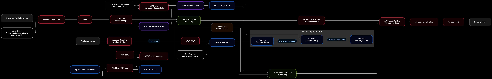

# Zero-Trust Cloud Architecture

## System Design Question

Design a Zero-Trust cloud architecture on AWS.

The architecture should follow these principles:

- Never trust automatically
- Always verify identity
- Use least-privilege access
- Use short-lived credentials
- Verify users and workloads separately
- Keep internal applications private
- Restrict service-to-service communication
- Protect secrets
- Encrypt sensitive data
- Continuously monitor activity
- Detect suspicious behavior
- Alert the Security Team automatically

---

## Architecture



---

## Architecture Overview

This architecture applies Zero-Trust principles to users, administrators, applications, workloads, and AWS resources.

Users are not trusted simply because they are inside a company network.

Every request must be based on identity, authorization, and least-privilege access.

Human users authenticate through IAM Identity Center and MFA.

AWS STS provides temporary credentials instead of permanent access keys.

AWS Verified Access controls access to private applications.

AWS Systems Manager provides secure administrative access to private EC2 instances without requiring public SSH.

Applications use workload-specific IAM roles to access AWS resources and Secrets Manager.

Security Groups provide micro-segmentation between application layers.

CloudTrail, CloudWatch, GuardDuty, and Security Hub provide continuous monitoring and threat detection.

High-severity security findings can be routed through EventBridge and SNS to the Security Team.

---

## Main AWS Services

- AWS IAM Identity Center
- AWS IAM
- AWS STS
- AWS Verified Access
- AWS Systems Manager
- Amazon Cognito
- AWS WAF
- AWS Secrets Manager
- AWS KMS
- Amazon EC2
- AWS CloudTrail
- Amazon CloudWatch
- Amazon GuardDuty
- AWS Security Hub
- Amazon EventBridge
- Amazon SNS

---

## Zero-Trust Principle

Traditional network security often assumes:

```text
Inside Network
= Trusted

Outside Network
= Untrusted
```

Zero Trust removes that assumption.

```text
User / Workload
      ↓
Verify Identity
      ↓
Check Authorization
      ↓
Grant Minimum Access
      ↓
Monitor Activity
```

Location alone does not create trust.

---

## Human Identity

Employees and administrators authenticate through IAM Identity Center.

```text
Employee / Administrator
        ↓
IAM Identity Center
        ↓
MFA
```

Multi-factor authentication provides an additional identity-verification layer.

---

## Temporary AWS Credentials

Permanent access keys should be avoided where possible.

The preferred model is:

```text
Verified User
     ↓
IAM Role
     ↓
AWS STS
     ↓
Temporary Credentials
```

Temporary credentials expire automatically.

This reduces the risk associated with long-lived credentials.

---

## Least-Privilege IAM

Users should receive only the permissions required for their role.

```text
User
 ↓
IAM Role
 ↓
Authorized Resources Only
```

For example:

```text
Developer
→ Development Resources
```

while:

```text
Developer
X
Production Administration
```

unless explicitly authorized.

---

## Private Application Access

Internal applications should not automatically become public just because employees need access.

AWS Verified Access can protect internal applications.

```text
Employee
   ↓
Identity Verification
   ↓
AWS Verified Access
   ↓
Private Application
```

Access is evaluated based on identity and policy.

---

## Bastionless Server Administration

Administrators should not directly SSH into private servers from the internet.

Use AWS Systems Manager.

```text
Administrator
     ↓
IAM + MFA
     ↓
AWS Systems Manager
     ↓
Private EC2
```

This removes the need for:

- Public SSH
- Bastion hosts
- Long-lived SSH keys

---

## Workload Identity

Applications and workloads also need identities.

Examples:

```text
EC2
 ↓
IAM Role
 ↓
AWS Resource
```

```text
Lambda
 ↓
Execution Role
 ↓
AWS Resource
```

```text
EKS Pod
 ↓
Pod Identity
 ↓
AWS Resource
```

Workloads should not share permanent AWS credentials.

---

## Application Users

External application users can authenticate using Amazon Cognito.

```text
Application User
      ↓
Amazon Cognito
      ↓
JWT Token
      ↓
Application
```

The application verifies the identity before granting access.

---

## Secrets Management

Applications should not store sensitive credentials directly in source code.

Use AWS Secrets Manager.

```text
Application
    ↓
IAM Role
    ↓
AWS Secrets Manager
```

Examples include:

- Database passwords
- API keys
- Application credentials
- Third-party tokens

---

## Encryption

AWS KMS protects sensitive information at rest.

```text
Sensitive Data
     ↓
AWS KMS
     ↓
Encrypted Data
```

Secrets Manager can use KMS encryption.

Data moving across the network should use:

```text
HTTPS / TLS
```

This gives:

```text
AWS KMS
→ Encryption at Rest

HTTPS / TLS
→ Encryption in Transit
```

---

## Micro-Segmentation

Zero Trust also applies to network communication.

A frontend should not automatically communicate with every backend resource.

Example:

```text
Frontend Security Group
          ↓
Backend Security Group
          ↓
Database Security Group
```

Only required traffic should be allowed.

For example:

```text
Frontend
→ Backend
```

may be allowed, while:

```text
Frontend
X
Database Administration Interface
```

may be blocked.

---

## Public Application Protection

Public applications can use AWS WAF.

```text
Internet User
     ↓
AWS WAF
     ↓
Application
```

WAF can filter:

- Malicious HTTP requests
- Suspicious IP addresses
- Common exploits
- Excessive requests
- Bot traffic

---

## CloudTrail Auditing

AWS CloudTrail records important AWS API activity.

```text
IAM
STS
Systems Manager
Secrets Manager
Other AWS Services
        ↓
CloudTrail
```

CloudTrail helps answer:

- Who performed the action?
- When did it happen?
- Which resource was affected?
- Which identity was used?
- Which API operation was called?

---

## CloudWatch Monitoring

Amazon CloudWatch provides operational visibility.

```text
Applications
EC2
AWS Services
    ↓
CloudWatch
```

CloudWatch can monitor:

- Application errors
- Resource health
- Latency
- Availability
- Authentication failures
- Operational problems

---

## GuardDuty Threat Detection

Amazon GuardDuty provides managed threat detection.

```text
AWS Activity
     ↓
GuardDuty
```

GuardDuty can identify suspicious activity such as:

- Credential misuse
- Suspicious API behavior
- Compromised workloads
- Unexpected network activity

---

## Security Hub

AWS Security Hub provides a centralized view of security findings.

```text
GuardDuty
   ↓
Security Hub
```

Other security findings can also be centralized there.

This gives the Security Team one place to review important issues.

---

## Automated Security Alerting

High-severity findings can trigger automated notifications.

```text
Security Hub
    ↓
EventBridge
    ↓
SNS
    ↓
Security Team
```

For example:

```text
High-Severity Finding
        ↓
EventBridge
        ↓
SNS
        ↓
Security Team
```

This improves response time.

---

## Continuous Verification

Zero Trust does not stop after the initial login.

The system continues to evaluate activity.

```text
Authenticate
     ↓
Authorize
     ↓
Grant Minimum Access
     ↓
Monitor
     ↓
Detect Suspicious Activity
     ↓
Alert Security Team
```

This continuous verification is a core Zero-Trust principle.

---

## Human Access Flow

```text
Employee / Administrator
        ↓
IAM Identity Center
        ↓
MFA
        ↓
IAM Role
        ↓
AWS STS
        ↓
Temporary Credentials
```

---

## Private Application Flow

```text
Verified Employee
       ↓
AWS Verified Access
       ↓
Private Application
```

---

## Server Management Flow

```text
Administrator
     ↓
IAM + MFA
     ↓
AWS Systems Manager
     ↓
Private EC2
```

---

## Workload Access Flow

```text
Application / Workload
        ↓
Workload IAM Role
        ↓
Secrets Manager / AWS Resource
```

---

## Network Isolation Flow

```text
Frontend SG
    ↓
Allowed Traffic Only
    ↓
Backend SG
    ↓
Allowed Traffic Only
    ↓
Database SG
```

---

## Monitoring and Detection Flow

```text
CloudTrail
CloudWatch
GuardDuty
    ↓
Security Hub
    ↓
EventBridge
    ↓
SNS
    ↓
Security Team
```

---

## Identity Types

Zero Trust should consider different identities.

| Identity | Example Control |
|---|---|
| Employee | IAM Identity Center |
| Administrator | MFA + IAM |
| AWS User Session | STS |
| Application User | Cognito |
| EC2 Workload | IAM Role |
| Lambda Workload | Execution Role |
| EKS Workload | Pod Identity |

Every identity should receive only the access it needs.

---

## Security Layers

| Security Area | Control |
|---|---|
| Human Authentication | IAM Identity Center |
| Strong Authentication | MFA |
| AWS Authorization | IAM |
| Temporary Access | STS |
| Private App Access | Verified Access |
| Server Management | Systems Manager |
| Customer Authentication | Cognito |
| Web Protection | AWS WAF |
| Workload Identity | IAM Roles |
| Secret Storage | Secrets Manager |
| Encryption | AWS KMS |
| Segmentation | Security Groups |
| Audit Logging | CloudTrail |
| Monitoring | CloudWatch |
| Threat Detection | GuardDuty |
| Security Findings | Security Hub |
| Automated Events | EventBridge |
| Alerts | SNS |

---

## Example Compromised Credential Scenario

Suppose a user's permanent password is compromised.

Zero Trust reduces the impact through:

```text
MFA
+
Temporary STS Credentials
+
Least-Privilege IAM
```

The attacker does not automatically receive unrestricted access.

Suspicious activity can also be detected through:

```text
CloudTrail
+
GuardDuty
+
Security Hub
```

---

## Example Compromised Workload

Suppose one application workload is compromised.

The application should have:

```text
Dedicated IAM Role
+
Limited Security Group Access
+
Limited Secret Access
```

Therefore:

```text
Compromised Workload
        ↓
Limited Permissions
        ↓
Reduced Blast Radius
```

This is an important Zero-Trust goal.

---

## Example Unauthorized Network Access

```text
Frontend
   ↓
Attempts Unauthorized Connection
   ↓
Security Group
   ↓
Blocked
```

The network location alone does not give the frontend unrestricted access.

---

## Key Security Principles

### Never Trust Automatically

Network location does not automatically create trust.

### Verify Identity

Every user and workload must have an identity.

### Use MFA

Sensitive human access should require stronger authentication.

### Use Short-Lived Credentials

Prefer STS temporary credentials over permanent access keys.

### Apply Least Privilege

Give the minimum permissions required.

### Segment Workloads

Only allow required service-to-service communication.

### Protect Secrets

Store sensitive credentials in Secrets Manager.

### Encrypt Data

Use KMS for sensitive data at rest and TLS for data in transit.

### Continuously Monitor

Use CloudWatch and CloudTrail.

### Detect Threats

Use GuardDuty and Security Hub.

### Automate Alerts

Use EventBridge and SNS.

---

## Key Design Decisions

| Component | Purpose |
|---|---|
| IAM Identity Center | Central human identity |
| MFA | Strong authentication |
| IAM Role | Least-privilege permissions |
| AWS STS | Temporary credentials |
| Verified Access | Private application access |
| Systems Manager | Bastionless server access |
| Cognito | Application-user identity |
| AWS WAF | Protects public applications |
| Workload IAM Role | Workload-specific identity |
| Secrets Manager | Central secret storage |
| AWS KMS | Encryption |
| Security Groups | Micro-segmentation |
| CloudTrail | AWS API auditing |
| CloudWatch | Operational monitoring |
| GuardDuty | Threat detection |
| Security Hub | Central security findings |
| EventBridge | Automated security events |
| SNS | Security notifications |

---

## Benefits

### Smaller Attack Surface

Internal applications and servers do not need direct public exposure.

### Strong Identity Controls

Users and workloads must prove their identities.

### Reduced Credential Risk

Temporary credentials reduce the impact of credential theft.

### Limited Blast Radius

Least privilege and segmentation prevent one compromise from automatically exposing everything.

### Better Visibility

CloudTrail, CloudWatch, GuardDuty, and Security Hub provide continuous security information.

### Faster Incident Response

EventBridge and SNS can automatically notify the Security Team.

---

## Tradeoffs

Zero Trust adds additional security controls and operational complexity.

Examples include:

- IAM policy management
- Identity Center configuration
- MFA administration
- Verified Access policies
- Workload identity management
- Security Group design
- Monitoring costs
- Security alert tuning
- More complex access troubleshooting

The additional complexity is intentional because access decisions become more explicit and controlled.

---

## Key Takeaway

Zero Trust replaces:

```text
Inside Network
= Trusted
```

with:

```text
Verify Every Identity
+
Authorize Every Request
+
Grant Minimum Access
+
Continuously Monitor
```

Human access uses:

```text
Identity Center
→ MFA
→ IAM
→ STS Temporary Credentials
```

Workload access uses:

```text
Workload
→ IAM Role
→ Authorized Resource
```

Network security uses:

```text
Security Groups
→ Only Required Communication
```

Security visibility uses:

```text
CloudTrail
+
CloudWatch
+
GuardDuty
+
Security Hub
→ EventBridge
→ SNS
→ Security Team
```

This architecture creates an identity-focused, least-privilege, continuously monitored Zero-Trust environment on AWS.