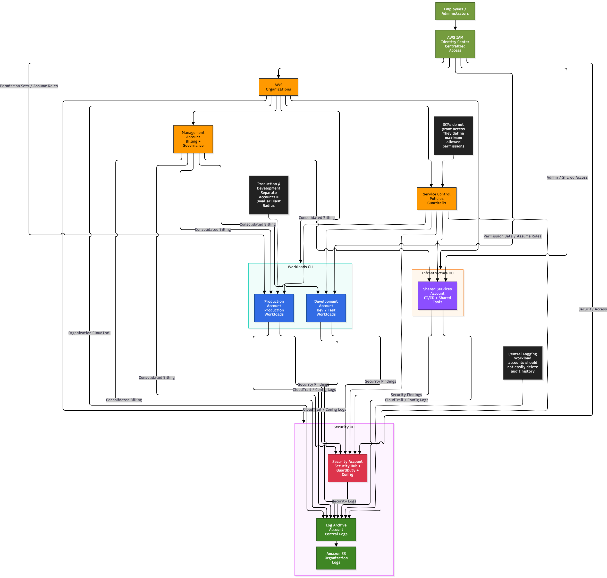

# Multi-Account AWS Architecture

## System Design Question

Design a scalable and secure multi-account architecture on AWS.

The organization should separate production, development, security, logging, and shared infrastructure into different AWS accounts.

The architecture should provide:

- Strong production isolation
- Reduced blast radius
- Centralized governance
- Centralized human access
- Centralized logging
- Centralized security monitoring
- Cross-account access
- Service Control Policies
- Consolidated billing
- Better cost visibility

---

## Architecture



---

## Architecture Overview

This architecture uses AWS Organizations to centrally manage multiple AWS accounts.

Instead of placing all workloads inside one AWS account, the environment is separated into dedicated accounts based on responsibility.

The main accounts include:

- Management Account
- Production Account
- Development Account
- Security Account
- Log Archive Account
- Shared Services Account

Organizational Units group similar accounts together.

Service Control Policies provide governance guardrails.

AWS IAM Identity Center provides centralized human access.

Security findings are centralized in the Security Account.

Audit and configuration logs are stored in the Log Archive Account.

The Management Account provides centralized governance and consolidated billing.

---

## Main AWS Services

- AWS Organizations
- AWS IAM Identity Center
- AWS IAM
- Service Control Policies
- AWS CloudTrail
- AWS Config
- Amazon GuardDuty
- AWS Security Hub
- Amazon S3

---

## Why Use Multiple AWS Accounts?

A single-account environment might look like:

```text
One AWS Account
├── Production
├── Development
├── Security
└── Logging
```

This creates a larger blast radius.

A better architecture is:

```text
AWS Organization
├── Management Account
├── Production Account
├── Development Account
├── Security Account
├── Log Archive Account
└── Shared Services Account
```

Separate accounts provide stronger isolation.

---

## AWS Organizations

AWS Organizations provides centralized account management.

```text
AWS Organizations
       ↓
Management Account
       ↓
Organizational Units
       ↓
Member Accounts
```

The Management Account controls organization-level governance.

Application workloads should not normally run inside the Management Account.

---

## Organizational Units

Accounts are grouped into Organizational Units.

```text
AWS Organization
│
├── Security OU
│   ├── Security Account
│   └── Log Archive Account
│
├── Workloads OU
│   ├── Production Account
│   └── Development Account
│
└── Infrastructure OU
    └── Shared Services Account
```

This makes governance easier because policies can be applied to groups of accounts.

---

## Management Account

The Management Account handles:

- AWS Organizations
- Account management
- Governance
- Consolidated billing

Conceptually:

```text
Management Account
→ Organizations
→ Governance
→ Billing
```

It should remain highly protected.

---

## Production Account

The Production Account contains production workloads.

```text
Production Account
      ↓
Production Workloads
```

Examples might include:

- EC2
- ECS
- EKS
- Lambda
- RDS
- S3

Production should remain isolated from development.

```text
Production
≠
Development
```

---

## Development Account

The Development Account is used for:

- Development
- Testing
- Experimentation
- Lower-risk workloads

```text
Developers
    ↓
Development Account
```

Developers should not automatically receive production permissions.

---

## Security Account

The Security Account centralizes security operations.

It can contain services such as:

```text
GuardDuty
Security Hub
AWS Config
```

Member accounts send security findings to the Security Account.

```text
Production ───────┐
Development ──────┼──→ Security Account
Shared Services ──┘
```

This gives the security team one central view of the organization.

---

## Log Archive Account

The Log Archive Account stores centralized audit logs.

```text
All AWS Accounts
       ↓
Log Archive Account
       ↓
Amazon S3
```

Possible logs include:

- CloudTrail
- AWS Config
- Security logs
- Account activity

Keeping logs in a separate account makes it harder for compromised workload accounts to delete their own audit history.

---

## Organization CloudTrail

An organization-wide CloudTrail can collect AWS API activity from member accounts.

```text
AWS Organization
      ↓
Organization CloudTrail
      ↓
Log Archive Account
      ↓
Amazon S3
```

This provides centralized auditing across the AWS environment.

---

## Centralized Security Monitoring

Security findings from member accounts are centralized.

```text
Production Account
Development Account
Shared Services Account
       ↓
GuardDuty / Security Findings
       ↓
Security Account
```

The Security Account can act as the delegated administrator for security services.

---

## AWS Security Hub

Security Hub provides a centralized view of findings.

```text
GuardDuty
AWS Config
Other Findings
     ↓
Security Hub
     ↓
Security Account
```

This allows security teams to investigate findings across multiple AWS accounts.

---

## AWS IAM Identity Center

Human access should be centralized.

```text
Employees
   ↓
IAM Identity Center
   ↓
Permission Sets
   ↓
AWS Accounts
```

Example access:

```text
Developer
→ Development Account

Cloud Engineer
→ Production Read Access

Security Engineer
→ Security Account

Administrator
→ Restricted Administrative Accounts
```

This avoids manually creating separate IAM users in every account.

---

## Cross-Account Access

Cross-account access should use roles.

```text
IAM Identity Center
       ↓
Assume Role
       ↓
AWS Account
```

This avoids sharing permanent AWS credentials between accounts.

---

## Service Control Policies

AWS Organizations can apply Service Control Policies.

```text
AWS Organizations
       ↓
SCP
       ↓
Organizational Unit
       ↓
Member Accounts
```

SCPs define the maximum permissions available inside an account.

Important:

```text
SCP
≠
Permission Grant
```

An SCP does not give a user permission.

It acts as a governance guardrail.

---

## Example SCP Guardrails

Possible controls include:

```text
Deny disabling CloudTrail
```

```text
Deny leaving the AWS Organization
```

```text
Restrict unsupported AWS Regions
```

```text
Protect security services
```

These policies help prevent dangerous actions.

---

## Centralized Logging

Logging should remain separate from application workloads.

```text
Production ───────┐
Development ──────┤
Security ─────────┼──→ Log Archive Account
Shared Services ──┘
```

The Log Archive Account provides stronger protection for audit evidence.

---

## Shared Services Account

The Shared Services Account can host common infrastructure.

Examples include:

- CI/CD systems
- Artifact repositories
- Directory services
- Shared networking tools
- Internal DNS
- Automation systems

```text
Shared Services Account
       ↓
Shared Infrastructure
```

This avoids duplicating common infrastructure in every workload account.

---

## Consolidated Billing

AWS Organizations provides consolidated billing.

```text
Production ───────┐
Development ──────┤
Security ─────────┤
Log Archive ──────┼──→ Management Account
Shared Services ──┘
```

This provides organization-wide billing while still allowing account-level cost visibility.

---

## Production Isolation

Production should have stronger controls than development.

Example:

```text
Developer
→ Development Account
```

but:

```text
Developer
X
Production Admin
```

unless explicitly authorized.

This reduces the chance that a development mistake affects production.

---

## Blast Radius Reduction

Suppose the Development Account is compromised.

In a single-account environment, the attacker may potentially reach production resources.

With separate accounts:

```text
Development Compromised
        ↓
Account Boundary
        ↓
Production Remains Isolated
```

This is one of the main benefits of multi-account architecture.

---

## Main Architecture Flow

```text
AWS Organizations
       ↓
Management Account
       ↓
Organizational Units
       ↓
Separate AWS Accounts
```

Account structure:

```text
Security OU
├── Security Account
└── Log Archive Account

Workloads OU
├── Production Account
└── Development Account

Infrastructure OU
└── Shared Services Account
```

---

## Identity Flow

```text
Employees
   ↓
IAM Identity Center
   ↓
Permission Sets
   ↓
Cross-Account Roles
   ↓
AWS Accounts
```

---

## Logging Flow

```text
All Accounts
    ↓
Organization CloudTrail
    ↓
Log Archive Account
    ↓
Amazon S3
```

---

## Security Flow

```text
Member Accounts
      ↓
GuardDuty / Config / Findings
      ↓
Security Hub
      ↓
Security Account
```

---

## Governance Flow

```text
AWS Organizations
       ↓
Service Control Policies
       ↓
Organizational Units
       ↓
Member Accounts
```

---

## Billing Flow

```text
All Member Accounts
       ↓
Management Account
       ↓
Consolidated Billing
```

---

## Security Principles

### Separate Environments

Production and development should use different AWS accounts.

### Centralize Identity

Use IAM Identity Center instead of separate IAM users in every account.

### Use Guardrails

Use SCPs to prevent dangerous organization-wide actions.

### Centralize Security

Collect security findings in a dedicated Security Account.

### Centralize Logs

Store audit logs in a dedicated Log Archive Account.

### Use Cross-Account Roles

Avoid sharing credentials between AWS accounts.

### Protect the Management Account

Do not use it for normal workloads.

---

## Key Design Decisions

| Component | Purpose |
|---|---|
| AWS Organizations | Central account management |
| Management Account | Governance and billing |
| Organizational Units | Group related accounts |
| Production Account | Production workloads |
| Development Account | Development and testing |
| Security Account | Central security operations |
| Log Archive Account | Central audit logging |
| Shared Services Account | Common infrastructure |
| IAM Identity Center | Central human access |
| SCPs | Organization guardrails |
| CloudTrail | API auditing |
| AWS Config | Configuration/compliance monitoring |
| GuardDuty | Threat detection |
| Security Hub | Central security findings |
| Amazon S3 | Long-term log storage |

---

## Benefits

### Stronger Isolation

Production and development are separated by AWS account boundaries.

### Smaller Blast Radius

A compromise in one account has less direct impact on other accounts.

### Better Governance

SCPs apply organization-wide restrictions.

### Central Identity

IAM Identity Center simplifies access management.

### Better Security Visibility

Security findings are centralized.

### Stronger Audit Protection

Logs are stored outside workload accounts.

### Better Cost Visibility

Costs can be tracked by account.

---

## Tradeoffs

Multi-account environments introduce additional complexity.

Examples include:

- Cross-account IAM
- SCP management
- Account provisioning
- Centralized networking
- Logging configuration
- Security-service delegation
- CI/CD deployment across accounts
- Cost allocation

Automation and standardized account provisioning become increasingly important as the organization grows.

---

## Key Takeaway

The core multi-account architecture is:

```text
AWS Organizations
+
Organizational Units
+
Separate AWS Accounts
```

Governance comes from:

```text
Service Control Policies
+
Management Account
```

Human access comes from:

```text
IAM Identity Center
→ Permission Sets
→ Cross-Account Roles
```

Security visibility comes from:

```text
Member Accounts
→ Security Account
→ GuardDuty / Security Hub
```

Audit protection comes from:

```text
Organization CloudTrail
→ Log Archive Account
→ Amazon S3
```

The main principle is to use **AWS account boundaries as a security and governance control**, not simply as a billing container.