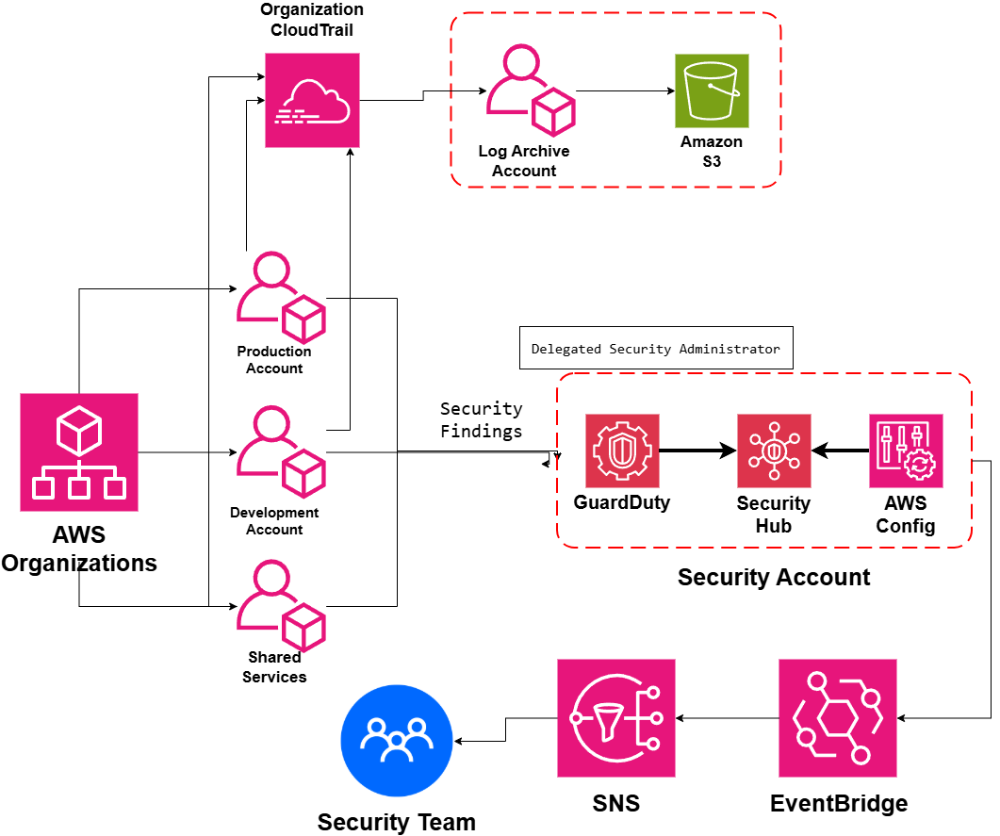

# Centralized Security Account Architecture

## System Design Question

Design a centralized security architecture for a multi-account AWS environment.

The organization should have multiple workload accounts, but security findings, compliance information, audit logs, and alerts should be managed centrally.

The architecture should provide:

- Centralized threat detection
- Centralized security findings
- Centralized compliance visibility
- Separate log archival
- Organization-wide audit logging
- Delegated security administration
- Automated security alerts
- Cross-account security monitoring

---

## Architecture



---

## Architecture Overview

This architecture uses a dedicated Security Account to centralize security operations across multiple AWS accounts.

Example member accounts include:

- Production Account
- Development Account
- Shared Services Account

AWS Organizations provides the multi-account structure.

Amazon GuardDuty detects suspicious activity across member accounts.

AWS Config evaluates resource configuration and compliance.

AWS Security Hub aggregates findings inside the dedicated Security Account.

The Security Account acts as the delegated security administrator for centralized security services.

High-severity findings can be routed through Amazon EventBridge and Amazon SNS to the Security Team.

Audit logs are handled separately.

An organization-wide AWS CloudTrail sends logs to a dedicated Log Archive Account, where Amazon S3 provides centralized long-term storage.

This separation keeps security operations and audit evidence independent.

---

## Main AWS Services

- AWS Organizations
- Amazon GuardDuty
- AWS Security Hub
- AWS Config
- AWS CloudTrail
- Amazon EventBridge
- Amazon SNS
- Amazon S3

---

## AWS Account Structure

The organization contains multiple AWS accounts.

```text id="m18fvj"
AWS Organizations
│
├── Production Account
├── Development Account
├── Shared Services Account
├── Security Account
└── Log Archive Account
```

Each account has a different responsibility.

This reduces the blast radius and separates security duties.

---

## Workload Accounts

The main workload accounts include:

```text id="quzmhf"
Production Account
Development Account
Shared Services Account
```

These accounts generate:

- AWS API activity
- Resource configuration changes
- Security findings
- Threat detections
- Compliance findings

Security information is collected centrally instead of being managed separately in every account.

---

## Dedicated Security Account

The Security Account is the central location for security operations.

It contains services such as:

```text id="s1drp6"
Amazon GuardDuty
AWS Security Hub
AWS Config
```

Conceptually:

```text id="tpy5h8"
Member Accounts
      ↓
Security Findings
      ↓
Security Account
```

This gives the Security Team one place to investigate security issues.

---

## Delegated Security Administrator

AWS Organizations can delegate administration of supported security services to the Security Account.

```text id="v42ybx"
AWS Organizations
      ↓
Delegated Security Administrator
      ↓
Security Account
```

This allows the Security Account to centrally manage services such as:

- GuardDuty
- Security Hub

without using the Management Account for daily security operations.

---

## Amazon GuardDuty

GuardDuty provides managed threat detection.

```text id="sqa8fe"
Production Account ──────┐
Development Account ─────┼──→ GuardDuty
Shared Services Account ─┘
```

GuardDuty can detect suspicious activity such as:

- Credential misuse
- Suspicious API activity
- Compromised EC2 behavior
- Unexpected network communication
- Potential malware activity

Findings are centralized in the Security Account.

---

## AWS Security Hub

Security Hub acts as the central findings platform.

```text id="tcyhkg"
GuardDuty ──────┐
                ├──→ Security Hub
AWS Config ─────┘
```

Security Hub allows the Security Team to view and prioritize findings from multiple accounts.

This reduces the need to manually inspect every AWS account.

---

## AWS Config

AWS Config records resource configuration and evaluates compliance.

```text id="mguemk"
Member Accounts
      ↓
AWS Config
      ↓
Security Account
```

Possible findings include:

- Public S3 buckets
- Unencrypted resources
- Open security groups
- Disabled logging
- Configuration drift

These findings can be centralized for organization-wide compliance visibility.

---

## Centralized Security Findings

The security flow is:

```text id="ix0vjj"
Production
Development
Shared Services
      ↓
GuardDuty + AWS Config
      ↓
Security Hub
      ↓
Security Account
```

This gives the Security Team centralized visibility across the AWS organization.

---

## Security Alerting

Important findings can trigger automated notifications.

```text id="36sxq7"
Security Hub
     ↓
EventBridge
     ↓
SNS
     ↓
Security Team
```

Examples include:

- High-severity GuardDuty finding
- Critical compliance failure
- Suspicious credential activity
- Important security configuration change

---

## High-Severity Finding Example

```text id="mcyxsa"
GuardDuty Detects Threat
        ↓
Security Hub
        ↓
EventBridge
        ↓
SNS
        ↓
Security Team
```

This provides faster visibility into important security incidents.

---

## Log Archive Account

The Log Archive Account has a different responsibility from the Security Account.

It stores audit evidence.

```text id="x27nf4"
Log Archive Account
      ↓
Amazon S3
```

Possible logs include:

- Organization CloudTrail logs
- AWS Config logs
- Security logs
- Other audit data

---

## Organization CloudTrail

An organization-wide CloudTrail records AWS API activity from member accounts.

```text id="5xtq71"
All AWS Accounts
       ↓
Organization CloudTrail
       ↓
Log Archive Account
       ↓
Amazon S3
```

This creates centralized API auditing across the organization.

---

## Why Separate Security and Log Archive Accounts?

These accounts have different purposes.

### Security Account

```text id="d1c1qi"
Security Account
→ Detect threats
→ Aggregate findings
→ Investigate incidents
→ Manage security services
```

### Log Archive Account

```text id="an8p3c"
Log Archive Account
→ Store audit logs
→ Preserve evidence
→ Provide long-term retention
```

Separating them provides stronger security and operational isolation.

---

## Audit Log Protection

Workload accounts should not be able to easily delete their own audit history.

```text id="5xcdqy"
Production Account
       ↓
CloudTrail
       ↓
Separate Log Archive Account
```

Even if the Production Account is compromised, centralized logs can remain protected in another account.

---

## Cross-Account Security Visibility

The Security Account receives findings from multiple AWS accounts.

```text id="1t7c7f"
Production ───────┐
Development ──────┼──→ Security Account
Shared Services ──┘
```

This allows the Security Team to operate from one central location.

---

## Main Security Flow

```text id="mu9jlg"
Production Account
Development Account
Shared Services Account
        ↓
Security Findings
        ↓
GuardDuty + AWS Config
        ↓
Security Hub
        ↓
EventBridge
        ↓
SNS
        ↓
Security Team
```

---

## Main Audit Flow

```text id="chiz2j"
All AWS Accounts
      ↓
Organization CloudTrail
      ↓
Log Archive Account
      ↓
Amazon S3
```

The security and logging paths remain separate.

---

## Threat Detection Flow

```text id="op37rh"
AWS Account Activity
        ↓
GuardDuty
        ↓
Security Hub
        ↓
Security Team
```

This provides centralized threat detection.

---

## Compliance Flow

```text id="8b7xbt"
AWS Resources
     ↓
AWS Config
     ↓
Compliance Findings
     ↓
Security Hub
```

This helps identify resources that do not follow organizational requirements.

---

## Optional Automated Remediation

The architecture can be extended with automated remediation.

For example:

```text id="m5l0sh"
Security Hub
     ↓
EventBridge
     ↓
Lambda
     ↓
Automated Remediation
```

Example:

```text id="9wq2kd"
Public S3 Bucket Detected
        ↓
EventBridge
        ↓
Lambda
        ↓
Enable Block Public Access
```

This is optional and should be used carefully.

---

## Security Operations Model

The overall operating model becomes:

```text id="rly746"
Workload Accounts
      ↓
Generate Findings
      ↓
Security Account
      ↓
Security Team
```

while:

```text id="j4wwyc"
Workload Accounts
      ↓
Generate Audit Logs
      ↓
Log Archive Account
```

This creates clear security responsibilities.

---

## Security Principles

### Centralize Findings

The Security Team should not need to manually inspect every account.

### Separate Audit Evidence

Logs should be stored outside workload accounts.

### Use Delegated Administration

Daily security operations should run from the Security Account.

### Protect Logs

Audit evidence should be difficult for workload administrators to modify or delete.

### Automate Important Alerts

High-severity findings should quickly reach the Security Team.

### Maintain Account Isolation

Security operations and workloads should remain separated.

---

## Key Design Decisions

| Component | Purpose |
|---|---|
| AWS Organizations | Multi-account organization |
| Production Account | Production workloads |
| Development Account | Development workloads |
| Shared Services Account | Shared infrastructure |
| Security Account | Central security operations |
| Log Archive Account | Central audit-log storage |
| GuardDuty | Threat detection |
| Security Hub | Central findings aggregation |
| AWS Config | Configuration and compliance |
| Organization CloudTrail | Organization-wide API auditing |
| Amazon S3 | Long-term audit-log storage |
| EventBridge | Routes security events |
| SNS | Sends security notifications |
| Security Team | Investigates and responds |

---

## Benefits

### Central Security Visibility

One Security Account provides visibility across multiple workload accounts.

### Better Threat Detection

GuardDuty findings are centralized.

### Central Compliance

AWS Config findings can be reviewed from one place.

### Stronger Audit Protection

CloudTrail logs are stored in a separate account.

### Reduced Blast Radius

Security operations are separated from application workloads.

### Faster Incident Response

EventBridge and SNS automatically notify the Security Team.

### Better Governance

AWS Organizations provides centralized account management.

---

## Tradeoffs

This architecture introduces additional operational complexity.

Examples include:

- Security-service delegation
- Cross-account permissions
- Security Hub configuration
- GuardDuty organization management
- Config aggregation
- Log lifecycle management
- S3 storage costs
- Alert tuning
- False-positive findings

Automation becomes increasingly important as the number of accounts grows.

---

## Key Takeaway

The centralized security model is:

```text id="8dlhg2"
Member Accounts
      ↓
Security Findings
      ↓
Central Security Account
      ↓
Security Hub
      ↓
Security Team
```

Threat detection comes from:

```text id="jizvmt"
Amazon GuardDuty
```

Compliance visibility comes from:

```text id="ol2b5e"
AWS Config
```

Audit evidence is stored separately:

```text id="eked5z"
All Accounts
→ Organization CloudTrail
→ Log Archive Account
→ Amazon S3
```

Automated alerts use:

```text id="b4o7a7"
Security Hub
→ EventBridge
→ SNS
→ Security Team
```

The main principle is to **detect centrally, investigate centrally, alert centrally, and store audit evidence separately**.