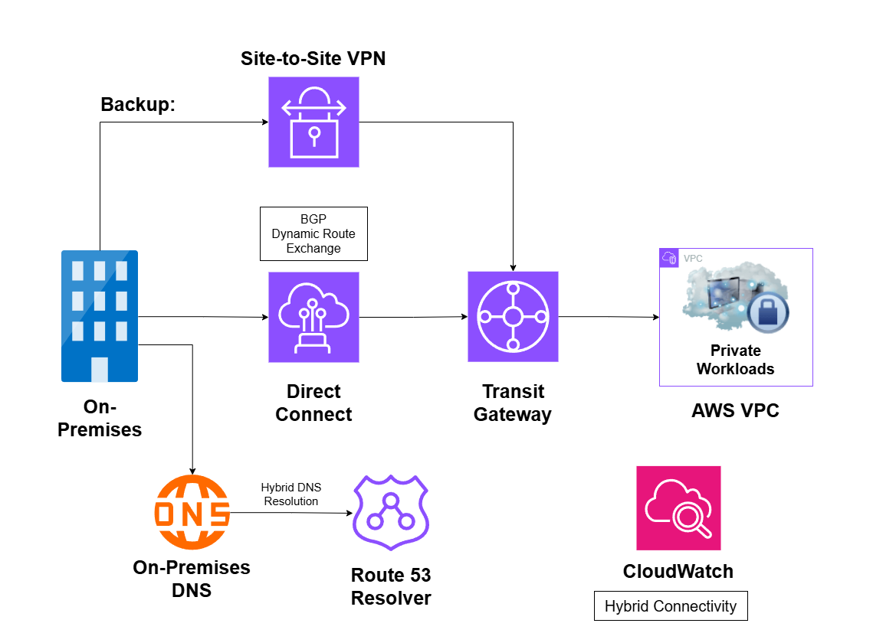

# Hybrid Cloud Connectivity Architecture

## System Design Question

Design a hybrid cloud connectivity architecture that securely connects an on-premises data center to AWS.

The architecture should provide:

- Private connectivity
- High availability
- Backup connectivity
- Dynamic routing
- Centralized routing
- Hybrid DNS resolution
- Private AWS workloads
- Monitoring of connectivity health

---

## Architecture



---

## Architecture Overview

This architecture connects an on-premises environment to AWS using two network paths.

The primary connection uses AWS Direct Connect.

The backup connection uses AWS Site-to-Site VPN.

Both paths connect to AWS Transit Gateway, which acts as the central routing hub for AWS networks.

The AWS VPC contains private workloads that are not directly exposed to the internet.

BGP provides dynamic route exchange between the on-premises network and AWS.

Amazon Route 53 Resolver provides hybrid DNS resolution between on-premises DNS and AWS private resources.

Amazon CloudWatch provides monitoring for the hybrid network.

---

## Main AWS Services

- AWS Direct Connect
- AWS Site-to-Site VPN
- AWS Transit Gateway
- Amazon VPC
- Amazon Route 53 Resolver
- Amazon CloudWatch

---

## Main Connectivity Flow

The primary network path is:

```text
On-Premises
    ↓
AWS Direct Connect
    ↓
AWS Transit Gateway
    ↓
Amazon VPC
    ↓
Private Workloads
```

This provides private connectivity between the company network and AWS.

---

## On-Premises Environment

The company operates an on-premises data center containing:

- Internal applications
- Corporate servers
- DNS infrastructure
- Network routers

Conceptually:

```text
On-Premises Network
        ↓
Customer Network Router
```

The customer-side network connects to AWS using Direct Connect and VPN.

---

## AWS Direct Connect

AWS Direct Connect provides a dedicated network connection between the on-premises environment and AWS.

```text
On-Premises
    ↓
Direct Connect
    ↓
Transit Gateway
```

Direct Connect is useful for:

- Private connectivity
- Predictable network performance
- Large data transfers
- Reduced dependence on the public internet
- Hybrid cloud workloads

---

## Primary Connectivity Path

During normal operation:

```text
On-Premises
    ↓
Direct Connect
    ↓
Transit Gateway
    ↓
AWS VPC
```

Direct Connect acts as the preferred connectivity path.

---

## Site-to-Site VPN

AWS Site-to-Site VPN provides encrypted IPsec connectivity.

```text
On-Premises
    ↓
Site-to-Site VPN
    ↓
Transit Gateway
```

The VPN acts as a secondary connection.

---

## Backup Connectivity

If Direct Connect becomes unavailable:

```text
Direct Connect Failure
        ↓
Site-to-Site VPN
        ↓
Transit Gateway
        ↓
AWS VPC
```

This gives the architecture a backup network path.

---

## Direct Connect vs VPN

| Connection | Main Purpose |
|---|---|
| Direct Connect | Primary private connectivity |
| Site-to-Site VPN | Encrypted backup connectivity |

Using both reduces dependence on a single connection method.

---

## AWS Transit Gateway

AWS Transit Gateway acts as the central routing hub.

```text
Direct Connect ───────┐
                      ↓
                Transit Gateway
                      ↓
                 Amazon VPC
                      ↑
Site-to-Site VPN ─────┘
```

Transit Gateway simplifies connectivity as the environment grows.

Instead of creating many individual network connections, multiple networks can connect through one routing hub.

---

## Transit Gateway Scalability

A larger environment could use:

```text
                   Transit Gateway
                  /       |       \
                 ↓        ↓        ↓
              VPC A     VPC B     VPC C
```

This makes Transit Gateway useful for large hybrid and multi-VPC architectures.

---

## AWS VPC

The AWS workloads run inside an Amazon VPC.

```text
Transit Gateway
      ↓
Amazon VPC
      ↓
Private Workloads
```

The workloads can remain private while still communicating with the on-premises network.

---

## Private Workloads

Examples of private AWS workloads may include:

- EC2 instances
- Databases
- Internal applications
- EKS workloads
- Enterprise services

The architecture does not require these resources to be publicly accessible.

---

## Dynamic Routing with BGP

Border Gateway Protocol provides dynamic route exchange.

```text
On-Premises Network
        ↕
       BGP
        ↕
AWS Connectivity
```

BGP allows AWS and the on-premises router to advertise available network routes.

This is better than manually maintaining large numbers of static routes.

---

## BGP Route Exchange

Conceptually:

```text
On-Premises CIDRs
       ↓
      BGP
       ↓
AWS Transit Gateway
```

and:

```text
AWS VPC CIDRs
      ↓
     BGP
      ↓
On-Premises Router
```

Both sides learn which networks are reachable.

---

## Example Routing

For example:

```text
On-Premises Network
10.0.0.0/16
```

and:

```text
AWS VPC
10.100.0.0/16
```

The architecture allows:

```text
10.0.0.0/16
      ↔
10.100.0.0/16
```

through the hybrid connection.

---

## Hybrid DNS

Applications often need to resolve DNS names across both environments.

The architecture uses Route 53 Resolver.

```text
On-Premises DNS
      ↔
Route 53 Resolver
      ↔
AWS Private DNS
```

This allows resources in each environment to resolve names in the other environment.

---

## On-Premises to AWS DNS

An on-premises server may need to resolve an AWS private hostname.

```text
On-Premises Application
        ↓
On-Premises DNS
        ↓
Route 53 Resolver
        ↓
AWS Private DNS
```

This allows internal AWS resources to be accessed using DNS names instead of hard-coded IP addresses.

---

## AWS to On-Premises DNS

AWS workloads may also need to resolve internal on-premises names.

```text
AWS Workload
     ↓
Route 53 Resolver
     ↓
On-Premises DNS
```

This creates two-way hybrid DNS integration.

---

## Route 53 Resolver Endpoints

A production hybrid DNS architecture can use:

```text
Inbound Resolver Endpoint
```

for DNS queries entering AWS.

And:

```text
Outbound Resolver Endpoint
```

for DNS queries sent from AWS toward on-premises DNS.

For this system design, these are represented by the Route 53 Resolver component.

---

## High Availability

The architecture avoids relying only on a single network path.

```text
                 On-Premises
                  /        \
                 ↓          ↓
        Direct Connect     VPN
                 \          /
                  ↓        ↓
               Transit Gateway
                      ↓
                   AWS VPC
```

This improves connectivity resilience.

---

## Direct Connect Redundancy

A production design can improve Direct Connect availability by using redundant connections.

Conceptually:

```text
On-Premises
   ├──→ Direct Connect 1
   └──→ Direct Connect 2
```

The exact redundancy level depends on business availability requirements.

---

## Failover Behavior

Normal operation:

```text
On-Premises
    ↓
Direct Connect
    ↓
AWS
```

Failure condition:

```text
Direct Connect Unavailable
        ↓
VPN Backup Path
        ↓
AWS
```

Routing preferences should be configured so traffic uses the intended primary and backup paths.

---

## Monitoring

Amazon CloudWatch provides visibility into hybrid connectivity.

```text
Direct Connect
Site-to-Site VPN
Transit Gateway
       ↓
CloudWatch
```

Important things to monitor include:

- VPN tunnel status
- Direct Connect health
- Network throughput
- Packet errors
- Connection state
- Route changes
- Transit Gateway traffic

---

## Connectivity Failure Monitoring

For example:

```text
VPN Tunnel Down
      ↓
CloudWatch
      ↓
Operational Investigation
```

or:

```text
Direct Connect Problem
        ↓
CloudWatch
        ↓
Network Team
```

Monitoring is important because hybrid connectivity can become a dependency for many applications.

---

## Security Considerations

The architecture should follow these practices:

- Use private connectivity where possible
- Encrypt VPN traffic with IPsec
- Restrict routes to required networks
- Avoid overlapping CIDR ranges
- Monitor route advertisements
- Restrict Transit Gateway attachments
- Protect DNS resolver endpoints
- Use least-privilege network access
- Monitor Direct Connect and VPN health
- Maintain documented failover procedures

---

## Avoid Overlapping CIDRs

Hybrid networking becomes difficult if network ranges overlap.

For example, avoid:

```text
On-Premises
10.0.0.0/16
```

and:

```text
AWS VPC
10.0.0.0/16
```

using the same address range.

Instead, plan unique CIDRs.

Example:

```text
On-Premises
10.0.0.0/16

AWS
10.100.0.0/16
```

This makes routing much simpler.

---

## Main Architecture Flow

```text
On-Premises
    ↓
Direct Connect
    ↓
Transit Gateway
    ↓
Amazon VPC
    ↓
Private Workloads
```

Backup:

```text
On-Premises
    ↓
Site-to-Site VPN
    ↓
Transit Gateway
```

Routing:

```text
BGP
→ Dynamic Route Exchange
```

DNS:

```text
On-Premises DNS
↔
Route 53 Resolver
```

Monitoring:

```text
Hybrid Connectivity
      ↓
CloudWatch
```

---

## Failure Scenario

Suppose the Direct Connect connection fails.

```text
Direct Connect
      ↓
Unavailable
```

Traffic can use:

```text
Site-to-Site VPN
      ↓
Transit Gateway
      ↓
AWS VPC
```

This keeps the hybrid environment connected while the primary path is unavailable.

---

## Key Design Decisions

| Component | Purpose |
|---|---|
| On-Premises Network | Existing enterprise environment |
| Direct Connect | Primary private AWS connectivity |
| Site-to-Site VPN | Encrypted backup connectivity |
| BGP | Dynamic route exchange |
| Transit Gateway | Central AWS routing hub |
| Amazon VPC | Hosts AWS workloads |
| Private Workloads | Internal AWS applications |
| Route 53 Resolver | Hybrid DNS |
| CloudWatch | Connectivity monitoring |

---

## Benefits

### Private Connectivity

Direct Connect reduces dependence on public-internet connectivity.

### Resilience

The VPN provides an alternative path if Direct Connect becomes unavailable.

### Centralized Routing

Transit Gateway simplifies connectivity between hybrid networks and AWS VPCs.

### Dynamic Routing

BGP automatically exchanges network routes.

### Hybrid DNS

Applications can resolve resources across both environments.

### Private Workloads

AWS workloads do not need direct internet exposure.

### Better Visibility

CloudWatch provides operational monitoring.

---

## Tradeoffs

Hybrid connectivity introduces additional complexity.

Examples include:

- Direct Connect cost
- Network-provider coordination
- BGP configuration
- VPN configuration
- Route management
- Transit Gateway costs
- DNS forwarding rules
- CIDR planning
- Failover testing

Network documentation and regular failover testing are important in production environments.

---

## Key Takeaway

The primary connectivity path is:

```text
On-Premises
→ Direct Connect
→ Transit Gateway
→ AWS VPC
→ Private Workloads
```

Resilience is provided by:

```text
Site-to-Site VPN
→ Backup Connectivity
```

Dynamic routing is provided by:

```text
BGP
```

Hybrid DNS is provided by:

```text
On-Premises DNS
↔
Route 53 Resolver
```

Operational visibility comes from:

```text
CloudWatch
```

This design creates a private, resilient, dynamically routed, and DNS-integrated hybrid cloud connection between an on-premises environment and AWS.