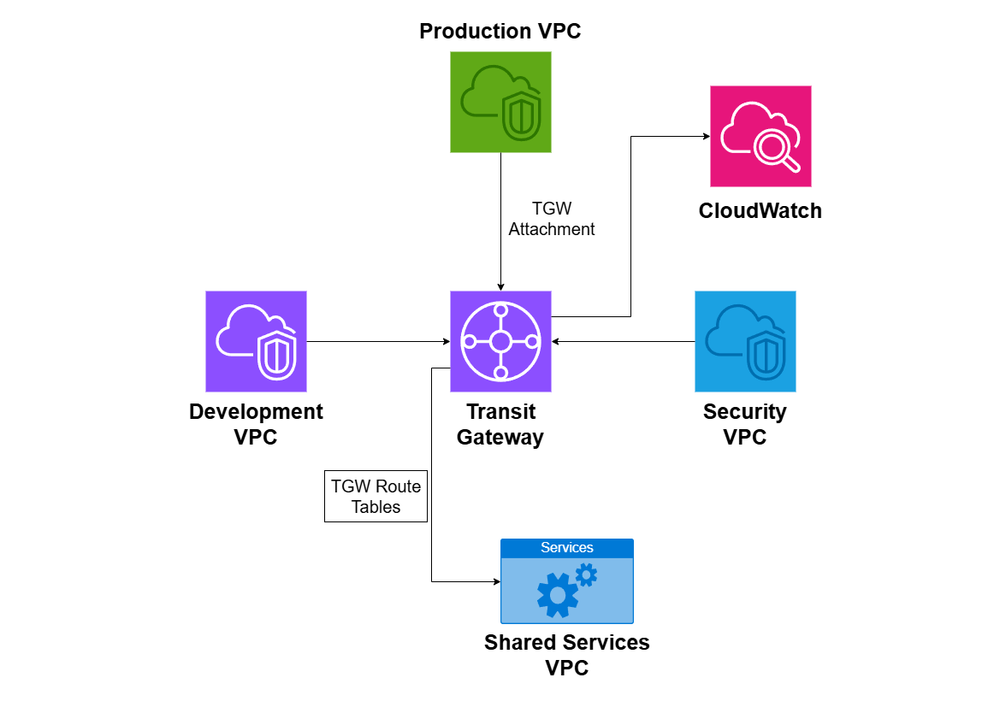

# Hub-and-Spoke Network Architecture

## System Design Question

Design a scalable hub-and-spoke network architecture on AWS.

The company has multiple VPCs for different environments and functions, including:

- Production
- Development
- Security
- Shared Services

Instead of creating direct VPC-to-VPC connections between every environment, the architecture should use AWS Transit Gateway as a central routing hub.

The design should support:

- Centralized routing
- Controlled VPC-to-VPC communication
- Environment isolation
- Shared services access
- Security inspection
- Scalable network growth
- Centralized monitoring

---

## Architecture



---

## Architecture Overview

This architecture uses AWS Transit Gateway as the central network hub.

Multiple VPCs connect to Transit Gateway as spokes.

The main VPCs are:

- Production VPC
- Development VPC
- Security VPC
- Shared Services VPC

Each VPC connects to the Transit Gateway through a Transit Gateway attachment.

Transit Gateway route tables control which VPCs are allowed to communicate.

This avoids creating many individual VPC peering connections and provides a more scalable network architecture.

Amazon CloudWatch provides monitoring for Transit Gateway and network activity.

---

## Main AWS Services

- AWS Transit Gateway
- Amazon VPC
- Transit Gateway Attachments
- Transit Gateway Route Tables
- Amazon CloudWatch

Optional supporting services can include:

- VPC Flow Logs
- AWS Network Firewall
- AWS Direct Connect
- AWS Site-to-Site VPN

---

## Hub-and-Spoke Model

The main design pattern is:

```text
                 Production VPC
                       |
                       |
               Transit Gateway
                /      |      \
               /       |       \
              ↓        ↓        ↓
      Development   Security   Shared Services
          VPC          VPC          VPC
```

The Transit Gateway is the hub.

The VPCs are the spokes.

---

## Why Use Hub-and-Spoke?

Without a central hub, VPCs may require many direct connections.

For example:

```text
Production ↔ Development
Production ↔ Security
Production ↔ Shared Services
Development ↔ Security
Development ↔ Shared Services
Security ↔ Shared Services
```

As more VPCs are added, this becomes harder to manage.

With Transit Gateway:

```text
Production ────────┐
Development ───────┤
Security ──────────┼──→ Transit Gateway
Shared Services ───┘
```

The network becomes much easier to scale.

---

## AWS Transit Gateway

AWS Transit Gateway acts as the central routing hub.

```text
Multiple VPCs
     ↓
Transit Gateway
     ↓
Central Routing
```

Transit Gateway simplifies communication between:

- VPCs
- Shared services
- Security environments
- Hybrid networks
- Future AWS accounts and VPCs

---

## Transit Gateway Attachments

Each VPC connects to Transit Gateway using an attachment.

Conceptually:

```text
Production VPC
      ↓
TGW Attachment
      ↓
Transit Gateway
```

The same pattern applies to:

```text
Development VPC
Security VPC
Shared Services VPC
```

A VPC being attached does not automatically mean it should communicate with every other VPC.

Routing policies control that behavior.

---

## Transit Gateway Route Tables

Transit Gateway route tables determine where traffic is allowed to go.

```text
Transit Gateway
      ↓
TGW Route Tables
      ↓
Routing Policies
      ↓
Allowed Networks
```

These route tables are a major security and isolation control.

---

## Example Routing Policy

A possible design is:

```text
Production → Shared Services ✅
Production → Security ✅

Development → Shared Services ✅
Development → Security ✅

Development → Production ❌
```

This allows both environments to use common services while keeping Development isolated from Production.

---

## Production VPC

The Production VPC contains production workloads.

```text
Production VPC
      ↓
Transit Gateway
```

Production should only communicate with approved networks.

For example:

```text
Production
→ Security VPC
→ Shared Services VPC
```

Direct access from Development can remain blocked.

---

## Development VPC

The Development VPC contains development and testing workloads.

```text
Development VPC
       ↓
Transit Gateway
```

Development may need access to:

- Shared CI/CD services
- DNS
- Monitoring
- Security tooling

but it does not automatically need access to Production.

---

## Security VPC

The Security VPC can host centralized network-security services.

Examples include:

- AWS Network Firewall
- Inspection appliances
- IDS/IPS systems
- Security tooling
- Traffic-analysis systems

Conceptually:

```text
Spoke VPC
   ↓
Transit Gateway
   ↓
Security VPC
   ↓
Inspection
```

This creates a central security location.

---

## Shared Services VPC

The Shared Services VPC contains services used by multiple environments.

Examples include:

- DNS
- Directory services
- CI/CD systems
- Artifact repositories
- Monitoring tools
- Internal management services

Conceptually:

```text
Production ───────┐
Development ──────┼──→ Shared Services VPC
Security ─────────┘
```

This avoids duplicating shared infrastructure in every VPC.

---

## Controlled Communication

One of the most important ideas is:

```text
Connected
≠
Allowed to Communicate with Everything
```

The Transit Gateway route tables determine which destinations are reachable.

This provides stronger segmentation between environments.

---

## Development and Production Isolation

A common policy is:

```text
Development VPC
      X
Production VPC
```

This prevents development workloads from directly accessing production resources unless there is an approved requirement.

This reduces the blast radius of:

- Misconfiguration
- Compromised development workloads
- Human mistakes
- Testing activity

---

## Centralized Security Routing

Traffic can optionally be routed through the Security VPC.

For example:

```text
Production VPC
      ↓
Transit Gateway
      ↓
Security VPC
      ↓
Network Inspection
```

The same approach can be used for Development or other VPCs.

This centralizes network-security controls.

---

## Monitoring

Amazon CloudWatch provides monitoring for Transit Gateway.

```text
Transit Gateway
      ↓
CloudWatch
```

Monitoring can include:

- Traffic volume
- Attachment activity
- Packet drops
- Network throughput
- Routing problems
- Connectivity failures

---

## VPC Flow Logs

VPC Flow Logs can provide additional traffic visibility.

```text
VPC Network Traffic
        ↓
VPC Flow Logs
        ↓
Security / Operations Analysis
```

Flow logs can help investigate:

- Unexpected connections
- Rejected traffic
- Network failures
- Suspicious communication patterns

---

## Optional Hybrid Connectivity

The hub can also connect to an on-premises environment.

```text
On-Premises
     ↓
Direct Connect / VPN
     ↓
Transit Gateway
     ↓
AWS VPCs
```

This allows Transit Gateway to act as the central routing hub for both cloud and hybrid networks.

---

## Scaling the Architecture

As the organization grows, additional VPCs can be attached.

For example:

```text
                   Transit Gateway
               /    /    |    \    \
              ↓    ↓     ↓     ↓    ↓
           Prod   Dev  Security Shared Data
```

This is much easier to manage than creating separate VPC peering connections between every network.

---

## Hub-and-Spoke vs VPC Peering

### VPC Peering

```text
VPC A ↔ VPC B
VPC A ↔ VPC C
VPC B ↔ VPC C
```

As the number of VPCs increases, the connection model becomes more complex.

### Transit Gateway

```text
VPC A ──┐
VPC B ──┤
VPC C ──┼──→ Transit Gateway
VPC D ──┘
```

This creates a centralized and scalable routing model.

---

## Main Architecture Flow

```text
Production VPC ────────┐
Development VPC ───────┤
Security VPC ──────────┼──→ Transit Gateway
Shared Services VPC ───┘
```

Routing control:

```text
Transit Gateway
      ↓
TGW Route Tables
      ↓
Controlled Communication
```

Monitoring:

```text
Transit Gateway
      ↓
CloudWatch
```

---

## Security Principles

### Segment Environments

Production and Development should not automatically communicate.

### Centralize Routing

Use Transit Gateway instead of creating a large mesh of network connections.

### Apply Explicit Routing

Only create routes that are actually required.

### Centralize Security

Use the Security VPC for common inspection controls when appropriate.

### Monitor Network Activity

Use CloudWatch and VPC Flow Logs.

### Reduce Blast Radius

Keep workloads separated by VPC and route policy.

---

## Key Design Decisions

| Component | Purpose |
|---|---|
| Transit Gateway | Central network hub |
| Production VPC | Production workloads |
| Development VPC | Development workloads |
| Security VPC | Centralized security and inspection |
| Shared Services VPC | Shared infrastructure |
| TGW Attachments | Connect VPCs to the hub |
| TGW Route Tables | Control routing and isolation |
| CloudWatch | Network monitoring |
| VPC Flow Logs | Traffic visibility |

---

## Benefits

### Simplified Networking

Transit Gateway replaces many individual VPC-to-VPC connections.

### Better Scalability

New VPCs can be attached without redesigning the entire network.

### Stronger Isolation

Route tables control which environments can communicate.

### Central Security

Traffic inspection can be centralized in a Security VPC.

### Shared Infrastructure

Common services can be hosted centrally.

### Better Visibility

CloudWatch and Flow Logs provide network monitoring.

---

## Tradeoffs

This architecture introduces additional planning and cost.

Examples include:

- Transit Gateway attachment costs
- Transit Gateway data-processing charges
- Route-table management
- More complex traffic inspection
- Central hub dependency
- Need for careful CIDR planning

Incorrect routing can either block required communication or accidentally expose environments to each other.

---

## Key Takeaway

The core hub-and-spoke architecture is:

```text
Multiple VPC Spokes
       ↓
AWS Transit Gateway
       ↓
Transit Gateway Route Tables
       ↓
Controlled Communication
```

Production isolation is maintained through:

```text
Development
X
Production
```

while shared connectivity can remain available:

```text
Production
→ Shared Services

Development
→ Shared Services
```

Monitoring is provided through:

```text
Transit Gateway
→ CloudWatch
```

The main principle is to use **Transit Gateway as the central routing hub while Transit Gateway route tables enforce segmentation between network spokes**.