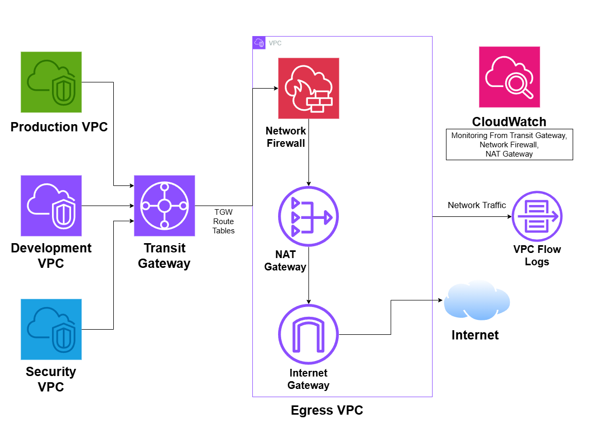

# Centralized Egress Architecture

## System Design Question

Design a centralized outbound internet architecture for multiple private AWS VPCs.

The company wants all internet-bound traffic from workload VPCs to pass through one controlled egress path instead of giving every VPC its own NAT Gateway.

The architecture should provide:

- Centralized outbound routing
- Centralized traffic inspection
- Shared NAT Gateway
- Internet access for private workloads
- No direct internet egress from spoke VPCs
- Transit Gateway routing
- Network monitoring
- Flow visibility
- Consistent outbound security controls

---

## Architecture



---

## Architecture Overview

This architecture uses AWS Transit Gateway and a dedicated Egress VPC to centralize outbound internet access.

The workload VPCs include:

- Production VPC
- Development VPC
- Security VPC

These spoke VPCs do not have their own direct internet egress path.

Instead, internet-bound traffic is routed to AWS Transit Gateway.

Transit Gateway forwards the traffic to the centralized Egress VPC.

Inside the Egress VPC, AWS Network Firewall inspects the traffic before it reaches the NAT Gateway.

The NAT Gateway provides outbound address translation.

The Internet Gateway then provides connectivity to the public internet.

Amazon CloudWatch provides centralized monitoring, while VPC Flow Logs provide visibility into network traffic.

---

## Main AWS Services

- AWS Transit Gateway
- Amazon VPC
- AWS Network Firewall
- NAT Gateway
- Internet Gateway
- Transit Gateway Route Tables
- Amazon CloudWatch
- VPC Flow Logs

---

## Main Traffic Flow

The primary outbound path is:

```text
Private Workload
      ↓
Spoke VPC
      ↓
Transit Gateway
      ↓
Egress VPC
      ↓
AWS Network Firewall
      ↓
NAT Gateway
      ↓
Internet Gateway
      ↓
Internet
```

All outbound internet traffic uses the same centralized security path.

---

## Spoke VPCs

The architecture contains multiple workload VPCs.

```text
Production VPC

Development VPC

Security VPC
```

These VPCs contain private workloads.

They do not require their own public NAT Gateway or Internet Gateway for normal outbound access.

---

## No Direct Internet Egress

A key rule is:

```text
Spoke VPC
    X
Direct Internet
```

Instead:

```text
Spoke VPC
    ↓
Transit Gateway
    ↓
Central Egress VPC
```

This ensures internet traffic passes through centralized security controls.

---

## Spoke VPC Routing

The spoke VPC route tables send internet-bound traffic to Transit Gateway.

Conceptually:

```text
0.0.0.0/0
     ↓
Transit Gateway
```

This means the workload VPC does not send internet traffic directly to a local NAT Gateway.

---

## AWS Transit Gateway

AWS Transit Gateway acts as the central routing hub.

```text
Production VPC ───────┐
Development VPC ──────┼──→ Transit Gateway
Security VPC ─────────┘
```

Transit Gateway then forwards outbound traffic to the Egress VPC.

---

## Transit Gateway Route Tables

Transit Gateway route tables control where traffic is sent.

For internet-bound traffic:

```text
Spoke VPC
    ↓
Transit Gateway
    ↓
TGW Route Table
    ↓
Egress VPC
```

Conceptually:

```text
0.0.0.0/0
→ Egress VPC Attachment
```

This forces outbound traffic through the centralized egress path.

---

## Egress VPC

The Egress VPC contains the shared outbound infrastructure.

Main components:

```text
AWS Network Firewall
NAT Gateway
Internet Gateway
```

The Egress VPC becomes the organization's centralized internet exit.

---

## AWS Network Firewall

AWS Network Firewall performs centralized traffic inspection.

```text
Transit Gateway
      ↓
AWS Network Firewall
      ↓
NAT Gateway
```

Possible controls include:

- Domain filtering
- IP filtering
- Protocol restrictions
- Stateful firewall rules
- Threat-signature rules
- Suspicious destination blocking

All workload VPCs can use the same centralized inspection policy.

---

## Centralized Security Inspection

Without centralized inspection:

```text
Production
→ Separate Firewall Rules

Development
→ Separate Firewall Rules

Security
→ Separate Firewall Rules
```

This may create inconsistent policies.

With centralized egress:

```text
All Spoke VPCs
      ↓
One Security Inspection Layer
```

This improves consistency.

---

## NAT Gateway

The NAT Gateway allows private workloads to initiate outbound internet connections.

```text
Private Workload
      ↓
NAT Gateway
      ↓
Internet
```

The workloads do not need public IP addresses.

The NAT Gateway translates their private addresses before traffic reaches the internet.

---

## Internet Gateway

The Internet Gateway provides connectivity between the Egress VPC and the public internet.

```text
NAT Gateway
    ↓
Internet Gateway
    ↓
Internet
```

The Internet Gateway is attached only to the centralized Egress VPC in this design.

---

## Complete Outbound Path

```text
Production / Development / Security VPC
                 ↓
          Transit Gateway
                 ↓
            Egress VPC
                 ↓
        AWS Network Firewall
                 ↓
            NAT Gateway
                 ↓
         Internet Gateway
                 ↓
              Internet
```

---

## Return Traffic

Return traffic follows the reverse path.

```text
Internet
   ↓
Internet Gateway
   ↓
NAT Gateway
   ↓
Network Firewall
   ↓
Transit Gateway
   ↓
Original Spoke VPC
```

This is important because NAT Gateway and firewall inspection are stateful.

Routing should preserve the expected return path.

---

## Why Symmetric Routing Matters

Stateful security appliances track connections.

If traffic leaves through one security path but returns through another, the connection may fail.

Conceptually:

```text
Outbound
→ Firewall A

Return
→ Firewall B
```

can create problems.

The architecture should maintain the expected inspection path.

---

## Centralized NAT

Instead of deploying separate NAT gateways:

```text
Production VPC
→ NAT Gateway

Development VPC
→ NAT Gateway

Security VPC
→ NAT Gateway
```

the design uses:

```text
All Spoke VPCs
      ↓
Central Egress VPC
      ↓
Shared NAT Gateway
```

This simplifies centralized control.

---

## High Availability

A production design should deploy egress infrastructure across multiple Availability Zones.

Conceptually:

```text
AZ-A
├── Firewall Endpoint
└── NAT Gateway

AZ-B
├── Firewall Endpoint
└── NAT Gateway
```

This reduces the risk of a single Availability Zone becoming the only egress path.

---

## Monitoring with CloudWatch

Amazon CloudWatch monitors the centralized network components.

```text
Transit Gateway
Network Firewall
NAT Gateway
      ↓
CloudWatch
```

Useful metrics include:

- NAT Gateway traffic
- NAT Gateway errors
- Transit Gateway throughput
- Packet drops
- Firewall activity
- Firewall rule matches
- Connection failures

---

## VPC Flow Logs

VPC Flow Logs provide network-traffic visibility.

```text
Network Traffic
      ↓
VPC Flow Logs
```

Flow Logs can help identify:

- Accepted connections
- Rejected connections
- Unexpected destinations
- Troubleshooting issues
- Suspicious outbound communication

Flow Logs observe traffic metadata.

Traffic does not pass through the Flow Logs service.

---

## Monitoring vs Traffic Path

Traffic path:

```text
Spoke VPC
→ Transit Gateway
→ Firewall
→ NAT Gateway
→ Internet Gateway
→ Internet
```

Monitoring path:

```text
Network Activity
→ VPC Flow Logs

Network Components
→ CloudWatch
```

These are separate concepts.

---

## Example Outbound Request

Suppose a private application needs to download a software update.

```text
Private Application
      ↓
Production VPC
      ↓
Transit Gateway
      ↓
Network Firewall
      ↓
NAT Gateway
      ↓
Internet Gateway
      ↓
Software Repository
```

The workload remains private while still accessing the internet.

---

## Malicious Destination Example

Suppose a compromised workload tries to connect to a blocked destination.

```text
Compromised Workload
        ↓
Transit Gateway
        ↓
Network Firewall
        ↓
Blocked Destination
        X
Connection Denied
```

Centralized inspection allows the same protection policy to apply across multiple VPCs.

---

## Centralized Egress vs Distributed Egress

### Distributed Egress

```text
Production → NAT → Internet

Development → NAT → Internet

Security → NAT → Internet
```

Each VPC manages its own egress path.

### Centralized Egress

```text
Production ───┐
Development ──┼──→ Transit Gateway
Security ─────┘
                    ↓
                Egress VPC
                    ↓
                 Internet
```

This centralizes routing and inspection.

---

## Security Principles

### No Direct Spoke Internet Access

Spoke VPCs should not bypass the centralized egress architecture.

### Inspect Outbound Traffic

Use Network Firewall before traffic reaches the internet.

### Centralize Routing

Use Transit Gateway route tables to direct outbound traffic.

### Keep Workloads Private

Private workloads should not require public IP addresses.

### Monitor Traffic

Use CloudWatch and VPC Flow Logs.

### Maintain Return Paths

Stateful network components require correct return routing.

---

## Key Design Decisions

| Component | Purpose |
|---|---|
| Production VPC | Production workloads |
| Development VPC | Development workloads |
| Security VPC | Security workloads |
| Transit Gateway | Central network hub |
| TGW Route Tables | Route internet traffic to Egress VPC |
| Egress VPC | Centralized outbound network |
| Network Firewall | Central traffic inspection |
| NAT Gateway | Outbound source translation |
| Internet Gateway | Internet connectivity |
| CloudWatch | Operational monitoring |
| VPC Flow Logs | Network visibility |

---

## Benefits

### Centralized Security

Outbound traffic passes through one controlled security path.

### Consistent Policies

All VPCs can use the same firewall rules.

### Private Workloads

Spoke workloads do not need public IP addresses.

### Simplified Governance

Internet access can be controlled centrally.

### Better Visibility

CloudWatch and Flow Logs provide centralized network monitoring.

### Reduced Duplication

Workload VPCs do not each need a separate egress design.

---

## Tradeoffs

Centralized egress also introduces challenges.

Examples include:

- Transit Gateway cost
- Network Firewall cost
- NAT Gateway cost
- Additional routing complexity
- Central egress dependency
- Cross-AZ data-transfer considerations
- Need for high availability
- Stateful routing requirements

The egress architecture should be designed with enough redundancy so it does not become a single point of failure.

---

## Key Takeaway

The main centralized egress path is:

```text
Private Spoke VPCs
        ↓
Transit Gateway
        ↓
Central Egress VPC
        ↓
AWS Network Firewall
        ↓
NAT Gateway
        ↓
Internet Gateway
        ↓
Internet
```

Routing is enforced through:

```text
Spoke Default Route
0.0.0.0/0
→ Transit Gateway
→ Egress VPC
```

Security visibility comes from:

```text
CloudWatch
+
VPC Flow Logs
```

The main principle is to **prevent workload VPCs from accessing the internet directly and force outbound traffic through one centrally managed inspection and egress path**.