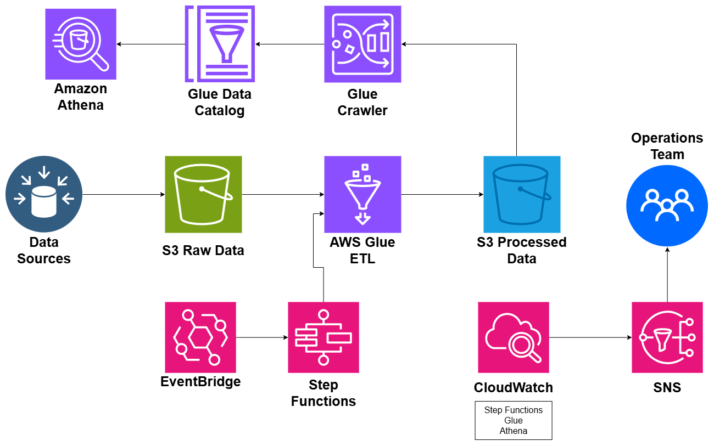

# Data Processing Pipeline

## System Design Question

Design a scalable batch data-processing pipeline on AWS.

The system should receive raw data from multiple sources, process and transform it, store the processed results, catalog the data, make it available for analytics, and provide monitoring and failure handling.

The architecture should support:

- Multiple data sources
- Raw data ingestion
- Raw data storage
- ETL processing
- Data transformation
- Processed-data storage
- Metadata cataloging
- Workflow orchestration
- Analytics
- Monitoring
- Failure handling
- Operational alerts

---

## Architecture



---

## Architecture Overview

This architecture uses Amazon S3 as the main data lake storage layer.

Raw data from multiple sources is first stored in an S3 Raw Data area.

AWS Glue performs ETL processing to clean, transform, and normalize the incoming data.

The processed output is stored in a separate S3 Processed Data area.

AWS Glue Crawler scans the processed data and updates the AWS Glue Data Catalog.

Amazon Athena uses the catalog metadata to query processed data stored in S3.

Amazon EventBridge can trigger the pipeline on a schedule or based on events.

AWS Step Functions orchestrates the processing workflow and provides retry and failure-handling logic.

Amazon CloudWatch monitors the pipeline, while Amazon SNS sends alerts to the Operations Team.

---

## Main AWS Services

- Amazon S3
- AWS Glue
- AWS Glue Crawler
- AWS Glue Data Catalog
- AWS Step Functions
- Amazon EventBridge
- Amazon Athena
- Amazon CloudWatch
- Amazon SNS

---

## Main Processing Flow

The core pipeline is:

```text
Data Sources
    ↓
S3 Raw Data
    ↓
AWS Glue ETL
    ↓
S3 Processed Data
```

This separates original source data from transformed analytical data.

---

## Data Sources

The pipeline can receive data from different systems.

Examples include:

- Application logs
- CSV files
- JSON files
- Databases
- APIs
- IoT devices
- Transactional systems

Conceptually:

```text
Data Sources
    ↓
Amazon S3
```

The exact ingestion mechanism can vary depending on the source.

---

## Raw Data Storage

Original incoming data is stored in the S3 Raw Data area.

```text
Data Sources
    ↓
S3 Raw Data
```

The main principle is:

```text
Keep the original raw data.
```

This makes it possible to reprocess data later if transformation logic changes.

---

## Example Raw Data Layout

A possible S3 structure is:

```text
s3://company-data-lake/raw/
├── application-logs/
├── transactions/
├── customers/
└── external-data/
```

The raw zone should preserve data as close to the original format as possible.

---

## AWS Glue ETL

AWS Glue performs data transformation.

```text
S3 Raw Data
    ↓
AWS Glue ETL
```

Glue jobs can perform tasks such as:

- Data cleaning
- Data validation
- Schema normalization
- Filtering invalid records
- Joining datasets
- Column transformation
- Format conversion
- Data partitioning

---

## Example Transformation

Raw data may arrive as:

```text
CSV
JSON
Logs
```

Glue can transform it into a more analytics-friendly format such as:

```text
Parquet
```

Conceptually:

```text
Raw CSV
   ↓
AWS Glue
   ↓
Clean Parquet
```

Columnar formats such as Parquet are commonly used for analytical workloads.

---

## Processed Data Storage

After transformation, Glue stores the output in the processed-data area.

```text
AWS Glue ETL
     ↓
S3 Processed Data
```

Example:

```text
s3://company-data-lake/processed/
```

This data is ready for downstream analytics.

---

## Raw vs Processed Data

The architecture separates data into two logical zones.

```text
Raw Zone
→ Original source data

Processed Zone
→ Cleaned and transformed data
```

This separation improves reliability and makes reprocessing easier.

---

## Glue Crawler

AWS Glue Crawler scans the processed data.

```text
S3 Processed Data
      ↓
Glue Crawler
```

The crawler discovers:

- Tables
- Columns
- Data types
- Partitions
- S3 locations

It then updates the Glue Data Catalog.

---

## Glue Data Catalog

The AWS Glue Data Catalog stores metadata about datasets.

```text
Glue Crawler
     ↓
Glue Data Catalog
```

The catalog does not store the actual analytical data.

The actual files remain in Amazon S3.

The catalog stores information describing those files.

---

## Catalog and Analytics Flow

The metadata path is:

```text
S3 Processed Data
      ↓
Glue Crawler
      ↓
Glue Data Catalog
      ↓
Amazon Athena
```

Athena uses the catalog to understand the structure of the S3 data.

---

## Amazon Athena

Amazon Athena provides serverless SQL analytics.

```text
Glue Data Catalog
      ↓
Amazon Athena
```

Athena can query processed data directly from Amazon S3.

Example query:

```sql
SELECT customer_id, SUM(total_amount)
FROM orders
GROUP BY customer_id;
```

No traditional database server is required for this analytical query pattern.

---

## Athena Data Access

Conceptually:

```text
Amazon Athena
   ├──→ Glue Data Catalog
   └──→ S3 Processed Data
```

The catalog provides schema information.

S3 provides the actual dataset.

---

## Workflow Orchestration

AWS Step Functions coordinates the processing workflow.

```text
Step Functions
      ↓
AWS Glue ETL
```

A workflow may include:

```text
Start Pipeline
      ↓
Run Glue Job
      ↓
Validate Result
      ↓
Update Catalog
      ↓
Complete
```

Step Functions makes multi-step processing easier to control and observe.

---

## EventBridge Trigger

Amazon EventBridge can start the workflow.

```text
EventBridge
    ↓
Step Functions
```

Possible triggers include:

```text
Scheduled Processing
```

such as:

```text
Every Night at 1:00 AM
```

or event-driven processing when new data becomes available.

---

## Complete Orchestration Flow

```text
EventBridge
    ↓
Step Functions
    ↓
AWS Glue ETL
    ↓
S3 Processed Data
```

This separates scheduling from workflow orchestration and data processing.

---

## Retry Handling

Data-processing jobs may fail because of:

- Invalid data
- Service errors
- Transformation errors
- Permission problems
- Resource limits

Step Functions can implement retry behavior.

```text
Step Functions
      ↓
Glue Job
      ↓
Failure
      ↓
Retry
```

This allows temporary failures to recover automatically.

---

## Failure Handling

If retries are exhausted:

```text
Glue Job
   ↓
Failure
   ↓
CloudWatch
   ↓
SNS
   ↓
Operations Team
```

The Operations Team can investigate the failed processing job.

---

## Monitoring

Amazon CloudWatch monitors the data pipeline.

```text
Step Functions
AWS Glue
Amazon Athena
EventBridge
     ↓
CloudWatch
```

Important things to monitor include:

- Glue job failures
- Glue job duration
- Step Functions failures
- Workflow execution time
- Processing errors
- Pipeline completion status
- Athena query failures

---

## Alerting

CloudWatch can send alerts through Amazon SNS.

```text
CloudWatch
    ↓
SNS
    ↓
Operations Team
```

For example:

```text
ETL Job Failed
     ↓
CloudWatch Alarm
     ↓
SNS
     ↓
Operations Team
```

This prevents failed data pipelines from going unnoticed.

---

## Example End-to-End Flow

Suppose a company receives daily transaction files.

```text
Transaction Files
      ↓
S3 Raw Data
      ↓
AWS Glue ETL
      ↓
Clean + Transform
      ↓
S3 Processed Data
      ↓
Glue Crawler
      ↓
Glue Data Catalog
      ↓
Amazon Athena
```

Analysts can then query the transformed data using SQL.

---

## Data Reprocessing

Keeping raw data provides an important recovery option.

Suppose the transformation logic contains a bug.

Instead of requesting the original data again:

```text
S3 Raw Data
    ↓
Corrected Glue Job
    ↓
Reprocess
    ↓
S3 Processed Data
```

This is one major benefit of keeping an immutable raw layer.

---

## Scalability

The architecture uses managed AWS services that can scale with processing demand.

For example:

```text
More Raw Data
    ↓
Larger Glue Processing Workload
    ↓
Processed Data
```

S3 can store large datasets without manually managing storage servers.

Athena can query data without provisioning a traditional analytics server.

---

## Serverless Analytics Pattern

The analytical side is mostly serverless.

```text
Amazon S3
    ↓
Glue Data Catalog
    ↓
Amazon Athena
```

There are no analytics servers that need to remain running continuously.

---

## Security Considerations

The architecture should follow good security practices.

Examples:

- Keep S3 buckets private
- Encrypt raw data
- Encrypt processed data
- Use least-privilege IAM roles
- Restrict Glue access to required S3 locations
- Restrict Athena query permissions
- Protect Glue Data Catalog metadata
- Enable logging
- Monitor unusual data access
- Avoid storing credentials in ETL scripts

---

## Data Quality

Processing pipelines should validate incoming data.

Example checks:

```text
Required fields exist
Data types are valid
Invalid records are rejected
Duplicate records are handled
Unexpected values are detected
```

Bad data should not silently enter the processed layer.

---

## Main Architecture Flow

```text
Data Sources
    ↓
S3 Raw Data
    ↓
AWS Glue ETL
    ↓
S3 Processed Data
```

Cataloging:

```text
S3 Processed Data
      ↓
Glue Crawler
      ↓
Glue Data Catalog
```

Analytics:

```text
Glue Data Catalog
      ↓
Amazon Athena
```

Orchestration:

```text
EventBridge
    ↓
Step Functions
    ↓
AWS Glue ETL
```

Monitoring:

```text
Glue
Step Functions
Athena
    ↓
CloudWatch
    ↓
SNS
    ↓
Operations Team
```

---

## Key Design Decisions

| Component | Purpose |
|---|---|
| Data Sources | Generate raw business data |
| S3 Raw Data | Stores original data |
| AWS Glue ETL | Cleans and transforms data |
| S3 Processed Data | Stores analytics-ready data |
| Glue Crawler | Discovers data schema |
| Glue Data Catalog | Stores metadata |
| Athena | Queries S3 data using SQL |
| EventBridge | Triggers the pipeline |
| Step Functions | Orchestrates processing |
| CloudWatch | Monitors the pipeline |
| SNS | Sends operational alerts |
| Operations Team | Responds to failures |

---

## Benefits

### Durable Raw Storage

Original data remains available for future reprocessing.

### Scalable ETL

AWS Glue processes large datasets without managing traditional ETL servers.

### Separation of Data Layers

Raw and processed data remain separate.

### Central Metadata

Glue Data Catalog provides one metadata repository.

### Serverless Analytics

Athena can query S3 directly.

### Automated Processing

EventBridge and Step Functions automate pipeline execution.

### Failure Visibility

CloudWatch and SNS notify the Operations Team when jobs fail.

---

## Tradeoffs

The architecture also introduces some challenges.

Examples include:

- Glue processing cost
- Data-quality management
- Schema changes
- S3 organization
- Partition design
- Athena query cost
- Workflow complexity
- Handling partial processing failures

Good data governance becomes increasingly important as the data lake grows.

---

## Key Takeaway

The core batch-processing pipeline is:

```text
Data Sources
→ S3 Raw Data
→ AWS Glue ETL
→ S3 Processed Data
```

Metadata management is provided by:

```text
Glue Crawler
→ Glue Data Catalog
```

Analytics is provided by:

```text
Amazon Athena
```

Workflow automation is provided by:

```text
EventBridge
→ Step Functions
→ AWS Glue
```

Operational visibility is provided by:

```text
CloudWatch
→ SNS
→ Operations Team
```

This creates a scalable, serverless, and production-oriented batch data-processing architecture on AWS.