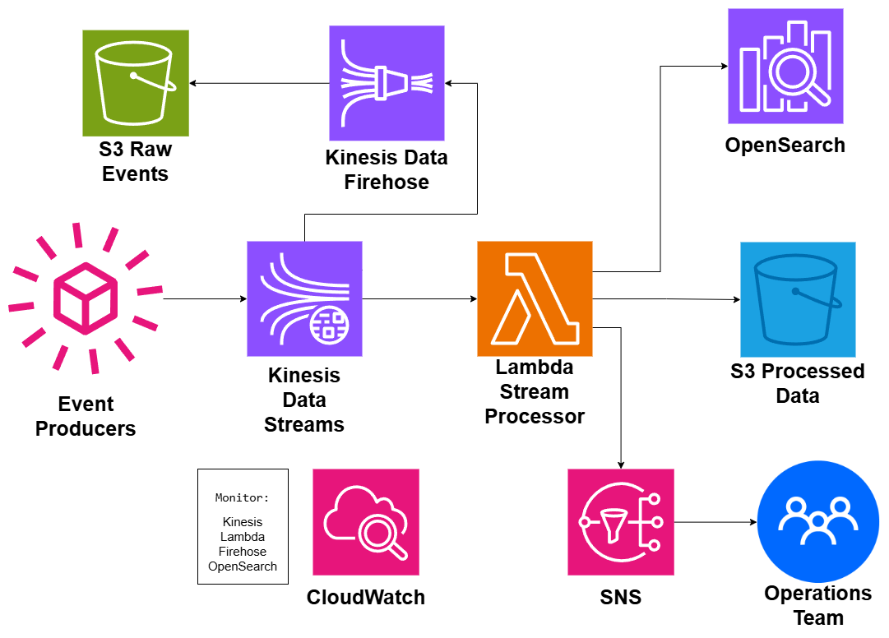

# Real-Time Streaming Architecture

## System Design Question

Design a real-time streaming architecture on AWS that can continuously ingest, process, store, analyze, and monitor high-volume event data.

The system should support:

- Multiple event producers
- Continuous stream ingestion
- Real-time processing
- Raw event archival
- Processed event storage
- Near-real-time analytics
- Alerting
- Monitoring
- Failure handling
- Scalable throughput

---

## Architecture



---

## Architecture Overview

This architecture uses Amazon Kinesis Data Streams as the main ingestion layer for continuously arriving event data.

Event producers send data into Kinesis Data Streams.

AWS Lambda consumes records from the stream and performs real-time processing such as validation, transformation, enrichment, and filtering.

Processed events can be sent to:

- Amazon OpenSearch Service for near-real-time search and analytics
- Amazon S3 for processed-data storage
- Amazon SNS for alerts

At the same time, Kinesis Data Firehose delivers raw streaming events into Amazon S3 for long-term archival.

Amazon CloudWatch monitors the health and performance of the streaming pipeline.

---

## Main AWS Services

- Amazon Kinesis Data Streams
- Amazon Kinesis Data Firehose
- AWS Lambda
- Amazon S3
- Amazon OpenSearch Service
- Amazon SNS
- Amazon CloudWatch

---

## Event Producers

The architecture supports multiple streaming data sources.

Examples include:

- Web applications
- Mobile applications
- IoT devices
- Payment systems
- Security systems
- Application logs
- Clickstream events

Conceptually:

```text
Event Producers
      ↓
Kinesis Data Streams
```

The producers do not need to communicate directly with every downstream consumer.

---

## Amazon Kinesis Data Streams

Amazon Kinesis Data Streams acts as the central real-time ingestion layer.

```text
Event Producers
      ↓
Kinesis Data Streams
```

Kinesis receives continuously arriving records and makes them available to downstream consumers.

This decouples the event producers from the processing systems.

---

## Why Use a Stream?

Without a streaming layer:

```text
Producer
   ↓
Processor
```

the producer may depend directly on the processor.

With Kinesis:

```text
Producer
   ↓
Kinesis
   ↓
Consumer
```

the producer and consumer can scale more independently.

---

## Real-Time Stream Processing

AWS Lambda acts as the real-time stream processor.

```text
Kinesis Data Streams
      ↓
Lambda Stream Processor
```

The Lambda function can perform tasks such as:

- Validate incoming events
- Transform records
- Filter unwanted data
- Enrich events
- Detect important conditions
- Route processed results

---

## Example Processing Flow

An incoming event might look like:

```text
Payment Event
      ↓
Kinesis
      ↓
Lambda
```

Lambda can inspect the event and determine whether it should be:

```text
Stored
Analyzed
Alerted
Filtered
```

---

## Raw Event Archival

Raw streaming events should also be preserved.

The architecture uses Kinesis Data Firehose.

```text
Kinesis Data Streams
      ↓
Kinesis Data Firehose
      ↓
S3 Raw Events
```

This provides a durable historical copy of the original events.

---

## Why Store Raw Events?

Raw events can be useful for:

- Auditing
- Historical analysis
- Reprocessing
- Troubleshooting
- Security investigations
- Data recovery

Keeping raw data allows the company to process it again later if the processing logic changes.

---

## Raw Data Storage

Amazon S3 stores the raw event archive.

Example structure:

```text
s3://streaming-data/raw/
├── application/
├── payments/
├── security/
└── iot/
```

The raw zone should preserve events with minimal modification.

---

## Processed Data Storage

The Lambda processor can store transformed data in a separate S3 location.

```text
Lambda Stream Processor
        ↓
S3 Processed Data
```

Example:

```text
s3://streaming-data/processed/
```

This keeps raw and processed data separate.

---

## Raw vs Processed Data

```text
S3 Raw Events
→ Original streaming records

S3 Processed Data
→ Cleaned / enriched / transformed records
```

This separation improves data management and reprocessing.

---

## Amazon OpenSearch Service

Processed events can also be sent to Amazon OpenSearch Service.

```text
Kinesis
   ↓
Lambda
   ↓
OpenSearch
```

OpenSearch provides near-real-time search and analytics.

Possible use cases include:

- Log search
- Operational dashboards
- Security analysis
- Error monitoring
- User activity analysis

---

## Real-Time Analytics

The real-time analytics path is:

```text
Event Producers
      ↓
Kinesis
      ↓
Lambda
      ↓
OpenSearch
```

This allows dashboards and search tools to display recent events quickly.

---

## Example Metrics

The system could analyze:

```text
Requests per second
Payment failures
Application errors
User activity
Security events
IoT readings
```

These results can be viewed through OpenSearch dashboards or other analytical tools.

---

## Alerting

The Lambda processor can identify important events and publish alerts.

```text
Lambda
  ↓
SNS
  ↓
Operations Team
```

Examples include:

- Critical application errors
- High payment failure rate
- Suspicious activity
- Important security events

---

## Example Alert Flow

```text
Critical Event
     ↓
Kinesis
     ↓
Lambda
     ↓
SNS
     ↓
Operations Team
```

This enables near-real-time operational response.

---

## Multiple Consumers

One benefit of a streaming platform is that several consumers can use the same event stream.

Conceptually:

```text
                 Kinesis Data Streams
                  /               \
                 ↓                 ↓
          Lambda Processor      Firehose
                 ↓                 ↓
           OpenSearch         S3 Raw Events
```

The same event can support both real-time processing and historical storage.

---

## Kinesis Data Firehose

Kinesis Data Firehose delivers streaming records to durable destinations.

In this architecture:

```text
Kinesis Data Streams
      ↓
Kinesis Data Firehose
      ↓
Amazon S3
```

Firehose handles the delivery path so the application does not need to build custom archival logic.

---

## Scalability

The streaming architecture is designed to support growing event volume.

Conceptually:

```text
More Producers
      ↓
More Events
      ↓
Kinesis
      ↓
Parallel Processing
```

The stream capacity and downstream consumers can scale based on workload.

---

## Processing Latency

Unlike batch processing, the goal is to process events quickly after arrival.

```text
Event Produced
      ↓
Kinesis
      ↓
Lambda
      ↓
Processed Result
```

This allows the organization to react to events in near real time.

---

## Failure Handling

Stream processing can fail because of:

- Invalid records
- Lambda errors
- Permission issues
- Destination failures
- Temporary service problems

Conceptually:

```text
Kinesis
   ↓
Lambda
   ↓
Processing Failure
   ↓
Retry
```

The processing design should prevent one failed record from permanently blocking the pipeline.

---

## Retry Handling

Temporary failures can be retried.

```text
Record
  ↓
Lambda
  ↓
Failure
  ↓
Retry
```

For production systems, failure destinations or additional retry strategies can be added where required.

---

## Monitoring

Amazon CloudWatch provides centralized monitoring.

```text
Kinesis
Lambda
Firehose
OpenSearch
    ↓
CloudWatch
```

The architecture explicitly monitors these main streaming components.

---

## Important CloudWatch Metrics

Useful metrics include:

- Kinesis incoming records
- Kinesis throughput
- Iterator age
- Lambda errors
- Lambda duration
- Lambda throttles
- Firehose delivery failures
- OpenSearch health
- Processing latency

---

## Iterator Age

Iterator age is an important streaming metric.

If Lambda is processing events quickly:

```text
Iterator Age
→ Low
```

If processing falls behind:

```text
Iterator Age
→ Increasing
```

A growing iterator age can indicate that consumers are not keeping up with incoming records.

---

## Firehose Monitoring

Monitor Firehose for:

- Delivery failures
- Delivery latency
- S3 errors
- Record-processing issues

A Firehose failure could prevent raw events from reaching long-term storage.

---

## OpenSearch Monitoring

OpenSearch should be monitored for:

- Cluster health
- Indexing failures
- Query latency
- Storage utilization
- Processing errors

This helps ensure the analytics layer remains healthy.

---

## Main Architecture Flow

```text
Event Producers
      ↓
Kinesis Data Streams
      ↓
Lambda Stream Processor
      ├──→ OpenSearch
      ├──→ S3 Processed Data
      └──→ SNS → Operations Team
```

Raw event archival:

```text
Kinesis Data Streams
      ↓
Kinesis Data Firehose
      ↓
S3 Raw Events
```

Monitoring:

```text
Kinesis
Lambda
Firehose
OpenSearch
    ↓
CloudWatch
```

---

## Real-Time vs Batch Processing

### Batch

```text
Collect Data
    ↓
Wait
    ↓
Process Large Batch
```

Example:

```text
Process every night
```

### Streaming

```text
Event Arrives
    ↓
Process Immediately
```

The streaming model is useful when fast reaction matters.

---

## Example Use Case: Application Monitoring

```text
Application Logs
      ↓
Kinesis
      ↓
Lambda
      ↓
OpenSearch
      ↓
Dashboard
```

The operations team can search recent application activity quickly.

---

## Example Use Case: Security Events

```text
Security Events
      ↓
Kinesis
      ↓
Lambda
      ↓
Detect Suspicious Pattern
      ↓
SNS
      ↓
Security Team
```

This can support near-real-time security monitoring.

---

## Example Use Case: Payment Events

```text
Payment Transactions
       ↓
Kinesis
       ↓
Lambda
       ↓
Payment Analysis
       ├──→ OpenSearch
       └──→ SNS Alert
```

The system can detect unusual payment behavior quickly.

---

## Security Considerations

The architecture should follow these practices:

- Encrypt streaming data
- Encrypt S3 storage
- Use least-privilege IAM roles
- Keep S3 buckets private
- Restrict access to OpenSearch
- Protect sensitive data in events
- Monitor failed processing
- Avoid hard-coded credentials
- Use secure network access where required
- Control who can publish or consume stream records

---

## Key Design Decisions

| Component | Purpose |
|---|---|
| Event Producers | Generate continuous events |
| Kinesis Data Streams | Real-time event ingestion |
| Lambda | Stream processing |
| Kinesis Data Firehose | Raw-event delivery |
| S3 Raw Events | Historical event archive |
| S3 Processed Data | Stores transformed events |
| OpenSearch | Near-real-time search and analytics |
| SNS | Sends important alerts |
| CloudWatch | Monitors the streaming pipeline |
| Operations Team | Responds to important events |

---

## Benefits

### Near-Real-Time Processing

Events can be processed shortly after they are generated.

### Decoupled Architecture

Producers do not depend directly on downstream consumers.

### Raw Data Preservation

Original events are retained in S3.

### Real-Time Search

OpenSearch provides quick visibility into recent events.

### Independent Storage

Raw and processed data are stored separately.

### Automated Alerting

Important events can trigger SNS notifications.

### Central Monitoring

CloudWatch provides pipeline visibility.

---

## Tradeoffs

Streaming architectures introduce additional complexity.

Examples include:

- Stream capacity planning
- Duplicate records
- Event ordering
- Consumer lag
- Retry behavior
- OpenSearch cost
- Data-retention planning
- Monitoring multiple asynchronous services

Consumers should be designed to safely handle duplicate events where possible.

---

## Key Takeaway

The main real-time processing path is:

```text
Event Producers
→ Kinesis Data Streams
→ Lambda
→ OpenSearch
```

Raw data is preserved through:

```text
Kinesis
→ Firehose
→ S3 Raw Events
```

Processed results are stored through:

```text
Lambda
→ S3 Processed Data
```

Important events trigger:

```text
Lambda
→ SNS
→ Operations Team
```

And pipeline health is monitored through:

```text
Kinesis
+
Lambda
+
Firehose
+
OpenSearch
→ CloudWatch
```

This creates a scalable, event-driven, near-real-time streaming architecture on AWS.